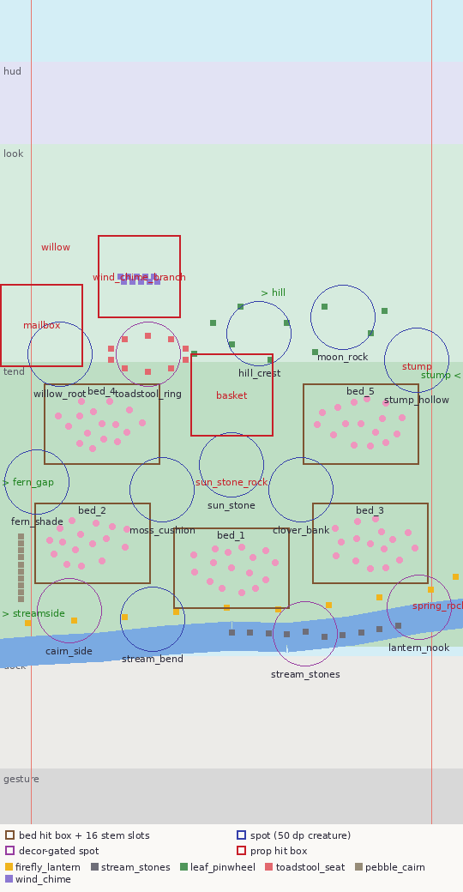

# Mossling Meadow — Game Design Document (MVP slice)

*Game Designer + Systems/Economy Designer · 2026-10-20 · Godot 4.7.2-stable · binding inputs: `docs/research/00-SYNTHESIS.md` (§4 principles, §5.2 concept), `docs/research/04-cozy-idle-design-science.md`; supporting: 02 (UX), 05 (visual/motion), 06 (audio/haptics).*

**How to read this.** Numbers live in `data/*.json` and `i18n/strings.csv`; those files are the single source of truth. Tables marked ⟲ were generated from them when this document was written — if a table and a data file disagree, the data file wins and the table is stale. Principle tags (E1…X2) refer to 00-SYNTHESIS §4. "dp" = design dp = 3 px on the 1080×1920 base (C2).

**Validation status.** `python3 tools/sim/economy_sim.py` → **ALL CHECKS PASS** on 10,000 random play schedules over 30 days + 2,000 reference players over 80 days, including the Retention v1 content-left checks (§9, §13.8) and, since 2026-10-22, the Active Play v1 model and checks A1–A2 (§14.10; `--no-active` reproduces §9.2). `python3 tools/sim/validate_content.py` → content OK (§10). Godot 4.7.2 imports `i18n/strings.csv` and resolves both locales (checked headless, §11).

---

## 0. One-page summary

A sun-dappled hollow under an open sky. Round, felted **mosslings** wander in, nap on warm stones, sip dew from your flowers and leave little gifts. You plant, place a few cozy things, pet whoever is visiting, and read the postcards they send. Nothing can go wrong: nothing wilts, nobody leaves forever, nothing expires, and every return finds the hollow at least as lovely as you left it.

| | MVP slice |
|---|---|
| Place | 1 hollow, portrait, one screen, no camera travel |
| Content | Active Play v1 (§14): 31 wishes, 24 tea recipes, 15 teaware pieces, free décor placement · 12 mossling species (one named individual each), 8 flowers, 6 décor sets, 1 repeatable leaf boat, 44 postcards (12 three-part friend stories + 8 events), 60 photo poses · Retention v1 (§13): 5 heart unlocks per friend, 12 nests, 6 best-buddy pairs, 12 signature gifts, 46 clues, 12 cousins, 8 away scenes |
| Time | Device clock: 5 palettes (dawn, day, golden hour, dusk, night) · weather: clear / breeze / soft rain · Spring only (season structure in place) |
| Currency | **Dew** (one spendable currency) + **affection** per mossling (never decays, never spent) |
| Sessions | 30 s glance · 1–5 min check-in · ambient watch mode |
| Pacing (reference player, 2 × 5 min/day) | first visitor at 20–40 s · 3 friends in the first 5 min · 4 by 24 h · all 12 by day 8 (median; p90 day 11) · whole catalogue ≈ day 24 · something new on 30 of the first 30 days · 8 friends at ♥3 by day 14 · last ♥5 ≈ day 65 · cousins until ≈ day 67 · with Active Play (§14): ≈ 50 wishes and ≈ 88 cups by day 30, ≥ 3 meaningful actions in 99.8 % of sessions, 8 friends at ♥5 by day 30, last ♥5 still ≈ day 65 |
| Economy | 140 purchasable copies, prices 15–527 dew, r = 1.10 (flowers) / 1.12 (décor), next purchase ≈ 79 min of passive income mid-game (median), basket full after ≈ 10–17 h, offline clamp 7 days · teaware 150–4,500 dew (14,850 in all) and dew drops are the post-catalogue sinks: median day-30 wallet 32 k → 18 k (§14.7) |
| Ethics | No fail states, decay, timers that end in loss, streaks, FOMO, gacha, ads, IAP, notifications, accounts or network (E1–E9) |

---

## 1. Vision

### 1.1 Fantasy and logline
> *"Grow a little garden in a mossy hollow, and the fuzzy ones will come."*

The player is the quiet keeper of a hollow: a shallow, mossy bowl ringed by a willow, an old stump and a gentle hill, with a trickling stream along its foot and the whole sky above. **Refuge with prospect** (04 §3.2): enclosed and safe below, open and luminous above. Mosslings are not pets to maintain; they are guests who choose to visit because the place is lovely. The player's verbs are *plant, place, pet, watch, name, read*.

### 1.2 Pillars (every feature must serve at least one and break none)

| # | Pillar | Means | Never |
|---|---|---|---|
| P-A | **Safe and soft** | No loss, no hurry, no wrong answers. Every input makes something nicer (Townscaper principle). | Fail states, decay, red alerts, error buzzes, countdowns |
| P-B | **Small tender relationships** | Twelve named individuals who remember their favourite spot, grow fonder of you, and write to you. | Leaderboards, guilt NPCs, "X misses you" |
| P-C | **A garden that is always lovelier** | Growth is visible within minutes, absence is rewarded, the hollow only ever gains. | Weeds, mess, empty "come back" screens |
| P-D | **Calm to watch** | Ambient life (wind, light, water, breathing creatures) is a first-class mode, not a screensaver. | Busy UI, flashing, looping animations under 20 s composite |

### 1.3 Emotional targets
- **Affect quadrant:** positive valence, low arousal (Russell circumplex; 04 §3.3). Internal panel target after 5 min of watching: valence ≥ +2 and arousal ≤ −1 on a ±4 affect grid (04 §7).
- **Primary feeling: tenderness** (baby-schema care response, 04 §3.2): round silhouettes, low-set eyes, slow breathing, squash on touch.
- **Secondary:** soft fascination (ART), quiet competence ("I figured out what Bellkins like"), gentle anticipation ("the bluebells open this afternoon") that is *never* framed as pressure.
- **Recovery experience** (Sonnentag & Fritz): detachment (no news, no real-world stakes), relaxation (low-arousal AV), optional mastery (combo discovery), full control (player decides everything).
- **Anti-targets:** flow/challenge, urgency, completionist anxiety, spreadsheet thinking (numbers stay small, §5).

### 1.4 Target player
- Adults 18–45 who use phones to decompress (commute, bed, breaks); fans of Neko Atsume, Usagi Shima, Cats & Soup, Alba, Unpacking; many play with sound off (A4 covers that).
- One-handed, portrait, often half-attentive. Bilingual launch: **Vietnamese and English** at equal quality.
- Accessibility first-class: motion- and transparency-sensitive players, low vision (text to 200 %), left-handed, mono listeners (X1).

### 1.5 Session shapes

| Shape | Typical flow (taps) | Design guarantees |
|---|---|---|
| **30 s glance** | Open → (recap card up to 5 s, tap to skip) → see who is visiting → tap **Basket** → **Collect all** → close. 2–3 taps. | Something new every time (§5.6). Collecting is one tap. Leaving costs nothing; leaving mid-anything is safe (autosave). E4: even a 30 s session plants the tutorial seed or collects a gift, which is visible next launch. |
| **1–5 min check-in** | Glance + plant 1–2 flowers or place 1 décor piece (Garden sheet) + pet a visitor + read a postcard / rename a new friend / float a leaf boat. | ≥ 1 affordable purchase at every session start (E5, proven in §5.11 and §9). Next catalogue item ≈ 30–90 min of passive income mid-game. |
| **Ambient watch** | Put the phone down. After 60 s without input (or tap the eye in the HUD) the HUD and dock fade out (600 ms), frame rate drops to 30 fps (C21), the world keeps living by the device clock. First tap only wakes the UI. | No required input ever. Screen stays on only if the player enabled it (default off, 02 R12). |

### 1.6 Principle traceability

| Principle | Where it is satisfied |
|---|---|
| E1 no fail/decay | §5.8 world step only adds; sim check E1 (§9); no decay code path exists to write; retention G1/G2 (§13.0) |
| E2 timers only good news | Only timers: growth ("Blooms in about 40 min"), dew cup ("brimming"), visits. None ends in loss (§3.3, §8.6) |
| E3 return without guilt | §5.6 greeter + recap, basket → photos when full, nothing ever degrades; 30-day absence test (§9) |
| E4 player-paced | §3.4: seed waits until tapped; scripted visitors happen in world time even if the app closed |
| E5 abundance | §5.11 proof + sim: 0 of 2,985,975 sessions without an affordable purchase or something new |
| E6 small numbers | Max price 527, max displayed ≈ 52 k (a saver's wallet after 30 d), hard cap 99,999 (§5.7) |
| E7 relatedness | Named individuals, favourite spots, hearts, postcards (§4.1, §7) |
| E8 no streaks/FOMO | No day counters; banned-word lint (§8.6); seasons recur (§6.4); signs never expire, scenes reward absence (§13.0) |
| E9 ethical v1 | No IAP/ads/notifications/accounts/network anywhere in this design |
| I1–I3 input | §8.2–8.4 (feedback map, hit sizes, gestures) |
| V1–V6 | §2 composition, §6 palettes/weather, motion tokens referenced from 05 |
| A1–A4 | §8.3 feedback map (every meaningful sound has a visual twin; captions in X1) |
| X1–X2 | §7.6 settings; copy rules §8.6 |

---

## 2. The world: one hollow

### 2.1 Frame and zones
- The world is authored in a **1080 × 1920 play frame anchored to the bottom of the viewport**. Positions in `data/spots.json` are normalized: x ∈ [0, 1] left→right, y ∈ [0, 1] top→bottom of the frame. On taller phones (20:9 = 1080 × 2400) the extra height is **sky above y = 0** (02 §1.2, Z2 is elastic). The play area never moves.
- Zones (frame-normalized y; ⟲ `spots.json:zones`): **HUD** 0.075–0.175 (overlaps the frame only on 16:9 phones) · **look** 0.175–0.44 (sky, tree line, the hollow's rim; optional "delight" targets ≥ 64 dp) · **tend** 0.44–0.785 (garden floor; core targets ≥ 60 dp) · **dock** 0.797–0.934 (UI; the world renders under it, no world targets) · **gesture** 0.934–1.0 (nothing interactive).
- No drag may *start* outside x ∈ [0.067, 0.933] (24 dp edge rule, I2).

### 2.2 Layout in words (the Art Bible owns the look)
Reading the screen top to bottom:
1. **Sky** (L0/L1): the full upper half; sun or moon arcs across with the clock; clouds drift on L2. This is the rest area (30–40 % low detail, 05 §4).
2. **Far hills and tree line** (L2/L3): a soft fractal ridge at y ≈ 0.30 descending to the hollow's rim at y ≈ 0.42.
3. **The rim** (look zone, y 0.33–0.44), left to right: a **willow** whose canopy fills the top-left corner with one low branch where the **shell wind chime** hangs (0.30, 0.336); the **mailbox** on a mossy post (0.09, 0.395); the **toadstool ring** on the left slope (centre 0.32, 0.43); the grassy **hill crest** (0.56, 0.405) where **leaf pinwheels** catch the wind; a pale mossy **moon rock** (0.74, 0.385); the **old stump** with a hollow (0.90, 0.445) on the right.
4. **The garden floor** (tend zone, y 0.44–0.75): the woven **gift basket** sits at the top centre (0.50, 0.48) just above the flat, warm **sun stone** (0.50, 0.585), the composition's focal point (05 §4: lower-third band). Five **flower beds** surround it like petals: two upper beds (willow side and stump side) and three lower beds. A loose path runs left–right through the middle (y ≈ 0.59) with the **moss cushion**, **clover bank** and **fern shade** spots along it.
5. **The stream** (y 0.74–0.80): a quiet trickle that rises from a **spring rock** at the right edge (0.95, 0.735) and runs right→left along the foot of the garden, half under the frosted dock glass. Its upper bank carries the **firefly lantern** posts, the water holds the **stream stones**, and the **pebble cairn** grows on the far-left bank. Leaf boats drift along it from right to left.

⟲ Preview of the authored layout (spot circles ≈ a 50 dp creature, boxes = hit areas; regenerate with `python3 -I tools/sim/layout_preview.py` whenever `spots.json` changes):



### 2.3 Mossling spots ("favourite spots")
Named rest positions. A spot holds `capacity` mosslings and allows the listed behaviours. Four spots only exist once enough of their décor is placed. ⟲ `spots.json:spots`

| id | Name (en / vi) | x | y | Cap. | Behaviours | Shelter | Appears when |
|---|---|---|---|---|---|---|---|
| `sun_stone` | Sun Stone / Phiến đá nắng | 0.500 | 0.565 | 2 | nap, play | no | always |
| `moss_cushion` | Moss Cushion / Nệm rêu | 0.350 | 0.595 | 1 | nap, play | no | always |
| `clover_bank` | Clover Bank / Gò cỏ ba lá | 0.650 | 0.595 | 1 | nibble, nap | no | always |
| `fern_shade` | Fern Shade / Bóng dương xỉ | 0.080 | 0.585 | 1 | nap, wander | yes | always |
| `stream_bend` | Stream Bend / Khúc suối cong | 0.330 | 0.752 | 1 | sit_by_stream | no | always |
| `willow_root` | Willow Root / Gốc liễu | 0.130 | 0.430 | 1 | nap, wander | yes | always |
| `hill_crest` | Hill Crest / Đỉnh đồi | 0.560 | 0.405 | 1 | wander, play | no | always |
| `stump_hollow` | Stump Hollow / Hốc gốc cây | 0.900 | 0.437 | 1 | nap | yes | always |
| `moon_rock` | Moon Rock / Tảng đá trăng | 0.740 | 0.385 | 1 | nap, wander | no | always |
| `toadstool_ring` | Toadstool Ring / Vòng nấm | 0.320 | 0.430 | 2 | play, nap | yes | 3 × Toadstool Seat |
| `stream_stones` | Stepping Stones / Đá giữa suối | 0.660 | 0.770 | 1 | sit_by_stream, play | no | 3 × Stream Stones |
| `lantern_nook` | Lantern Nook / Góc đèn | 0.905 | 0.738 | 1 | nap, sit_by_stream | no | 3 × Firefly Lantern |
| `cairn_side` | Cairn Corner / Góc tháp sỏi | 0.150 | 0.742 | 1 | sit_by_stream, nap | no | 3 × Pebble Cairn |

**Entries** (off-screen walk-in points, ⟲): 

- `entry_fern_gap` (-0.08, 0.585)
- `entry_stump` (1.08, 0.455)
- `entry_hill` (0.56, 0.355)
- `entry_streamside` (-0.08, 0.745)

### 2.4 Flower beds
Five beds × 16 stem positions = 80 = the total of all flower copies (8 × 10), so planting can never dead-end. Each bed's stems are a seeded Poisson-disk cluster (min 31 px apart) stored centre-out as offsets in `beds[].stems`; `nibble_points` are where a nibbling mossling sits at the bed's edge. Hit area 90 × 63 dp per bed. ⟲

| id | Name (en / vi) | x | y | Hit (dp) | Stems | Fill order |
|---|---|---|---|---|---|---|
| `bed_1` | Brookside bed / Luống bên suối | 0.500 | 0.690 | 90 × 63 | 16 | 1 |
| `bed_2` | Fern bed / Luống dương xỉ | 0.200 | 0.660 | 90 × 63 | 16 | 2 |
| `bed_3` | Sunny bed / Luống nắng | 0.800 | 0.660 | 90 × 63 | 16 | 3 |
| `bed_4` | Willow bed / Luống gốc liễu | 0.220 | 0.515 | 90 × 63 | 16 | 4 |
| `bed_5` | Stump bed / Luống gốc cây | 0.780 | 0.515 | 90 × 63 | 16 | 5 |

Placement rules (implementable as written):
1. The **first** copy of a flower type asks the player to choose a bed: beds with free stem slots glow; tap one. (Tapping outside picks the bed with the lowest `fill_order` that has room.)
2. Later copies of that type go to the bed that already holds most stems of that type if it has room, else to the bed with room nearest to it.
3. Inside a bed, the stem takes the free slot nearest to the centroid of same-type stems already in the bed (types cluster, Townscaper-style); the first stem of a type takes the free slot with the lowest index.
4. Mixed beds are allowed and look lovely; nothing can be uprooted or moved in the MVP (no destructive actions).

### 2.5 Décor anchors and props
Décor sets **start at pre-authored positions**: each new copy pops in at the next position of its anchor (auto-beautified, 05 §4 odd-cluster rule handled by authoring order). With Active F3 (§14) every piece except the wind chime can then be moved, turned or tucked away in edit mode; the anchors stay as the purchase default, as soft-snap sockets and as the migration source (`decor_placement.json`). Anchor indices are 0-based. ⟲ `spots.json:decor_anchors`

- `firefly_lantern` (path): (0.930, 0.716), (0.820, 0.726), (0.710, 0.735), (0.600, 0.740), (0.490, 0.738), (0.380, 0.743), (0.270, 0.749), (0.160, 0.754), (0.060, 0.757), (0.985, 0.700)
- `stream_stones` (path): (0.660, 0.768), (0.700, 0.773), (0.620, 0.770), (0.740, 0.771), (0.580, 0.769), (0.780, 0.768), (0.540, 0.769), (0.820, 0.764), (0.500, 0.768), (0.860, 0.760)
- `leaf_pinwheel` (scatter): (0.500, 0.418), (0.620, 0.392), (0.680, 0.428), (0.460, 0.392), (0.800, 0.405), (0.585, 0.437), (0.700, 0.372), (0.420, 0.430), (0.830, 0.378), (0.520, 0.372)
- `toadstool_seat` (ring): (0.320, 0.408), (0.320, 0.452), (0.401, 0.423), (0.239, 0.437), (0.370, 0.448), (0.270, 0.412), (0.370, 0.412), (0.270, 0.448), (0.401, 0.437), (0.239, 0.423)
- `pebble_cairn` (stack): (0.045, 0.728), (0.045, 0.720), (0.045, 0.711), (0.045, 0.703), (0.045, 0.694), (0.045, 0.685), (0.045, 0.677), (0.045, 0.668), (0.045, 0.660), (0.045, 0.651)
- `wind_chime` (string): (0.260, 0.336), (0.269, 0.342), (0.278, 0.336), (0.286, 0.342), (0.295, 0.336), (0.304, 0.342), (0.314, 0.336), (0.323, 0.342), (0.332, 0.336), (0.341, 0.342)

Props (⟲ `spots.json:props`):

| id | x | y | Size (dp) | Tap | Hit (dp) |
|---|---|---|---|---|---|
| `sun_stone_rock` | 0.500 | 0.585 | 87 × 40 | — | — |
| `basket` | 0.500 | 0.480 | 44 × 36 | open_basket | 64 |
| `mailbox` | 0.090 | 0.395 | 30 × 48 | open_postcards | 64 |
| `wind_chime_branch` | 0.300 | 0.336 | 40 × 60 | ring_chime | 64 |
| `stump` | 0.900 | 0.445 | 70 × 60 | — | — |
| `spring_rock` | 0.950 | 0.735 | 60 × 40 | — | — |
| `willow` | 0.120 | 0.300 | 140 × 170 | — | — |
| `tea_nook` (Active F2, ⟲ `tea.json:nook`; sits on the stump once tea unlocks) | 0.900 | 0.400 | 56 × 44 | open_tea | 64 |

**Hit priority** when targets overlap (world): mossling > bed with a ready bud **or ready petals** (Active F2) > prop (basket, mailbox, chime, tea nook) > décor piece with a `tap_fx` (pinwheel, lantern; optional delight, hit ≥ 60 dp, 64 dp in the look zone, nearest piece wins) > bed > stream = still décor piece (cairn, toadstool, stone: a small wobble, Active F3; a stone beats the brook only through its 20 dp core) > background. In Active F3 edit mode only décor pieces are targets (priority 8, the selected one 9). In choose-a-bed mode the beds with room come first. Round 7 (ARCHITECTURE §3.5): every press goes to exactly **one** target, picked by one arbiter. A target that contains the touch beats one only reached through the fat-finger slop (9 dp, aim 3 dp above the contact). Then the priority above decides, then the nearest centre. A décor piece's generous 64 dp ring only wins over empty ground and the stream; its 20 dp-radius core outranks a plain bed. The validator checks every static target for size floors, 8 dp gaps and that its hit area lies fully inside the frame (§10).

---

## 3. Core loops, timings and onboarding

### 3.1 Seconds loop (touch → delight, always < 100 ms to first response, I1)
| Action | Result | Timing |
|---|---|---|
| Tap a **ready bud** (a stem whose bloom time arrived while you were watching) | the bed's ready buds unfurl, 30 ms stagger, 3–5 sparkles, S04 | 600 ms unfurl; un-tapped ready buds open by themselves after 20 s (2.4 s slow unfurl) |
| **Long-press** a mossling | pet: radial fill from 150 ms, at 450 ms squash to 0.88 (`jelly` spring), purr chime S03 loops while held, hearts on release | +1 affection, first pet per visit only (never stated in UI) |
| **Stroke** (drag ≥ 24 px starting on a mossling) | same as pet | — |
| Tap a mossling | it turns to you, chirps (S13 at its `voice_step`), name tag fades in for 2 s; a second tap within 2 s opens its card (an optional shortcut, not a timed requirement: the Album opens the same card, I3). A napping mossling only stirs (S14) | — |
| Tap the **stream** | ripple ring to 36 dp in 380 ms, bubbles S06; nearby awake mosslings glance | — |
| Tap the **wind chime** (once placed) | rings the owned shells, falling arpeggio (S21) | — |
| Tap a bed (no ready buds) | gathers its spare petals if any are ready (Active F2: they arc to the tea nook, S28), else the stems sway, soft rustle (S18); long-press = bed card ("Blooms in about 40 min") | — |
| Long-press a décor piece (Active F3) | edit mode opens with the piece already lifted under the finger (S35); keep dragging to move it | 450 ms, like petting |

### 3.2 Minutes loop (1–5 min)
1. **Collect** — Basket (dock or in-world basket) → **Collect all**: gifts fly to the dew counter, counter rolls up (600 ms), S02 ladder. One tap.
2. **Grow** — Garden → Flowers → **Plant** (first copy: choose a bed). Or Décor → **Place**. 2–3 taps each. Typical: plant 1–2 flowers or place 1 décor piece per check-in.
3. **Befriend** — pet whoever is visiting; read a postcard (mailbox flag); name a new friend.
4. **Ritual** — float a **leaf boat** (1 dew): it drifts the length of the stream in 40 s and visiting mosslings gather to watch (+1 affection each, once per visit).
5. **Active Play (§14)** — help a friend's **wish** (a thought bubble: a cuddle, a bed of daisies, a boat, a cup of tea, a pinwheel nearby), **gather petals** and **brew** a cup in the tea nook to offer a visitor, or **arrange** the garden in edit mode. All optional, none can fail.

### 3.3 Hours and days loop
| Clock | What happens | Source |
|---|---|---|
| 2 min – 6.3 h | Flower stages: sprout → bud → bloom (per flower, §4.2). Bloomed stems add dew to the cup and count for attraction | `flora.json` |
| ~25–40 min | Average gap between visits: λ = 1.4–2.4 visits/h, rising with snugness | `economy.json` |
| 40–80 min × stay | A visit (the mossling stays, cycles 2–6 min behaviour bouts, leaves a gift on departure) | §5.6 |
| 10–17 h | Gift basket fills (24 slots); after that, visitors leave **photos** instead | §5.7 |
| 12 h | Dew cup stops filling until the next collect ("brimming") | §5.3 |
| 30 min – 2 h | A bloomed stem grows a spare petal (up to 2 wait on it) for tea (Active F2) | `tea.json` |
| 1–4 min of play | A present friend may float a small wish (≤ 2 visible, never expires) | §14, `wishes.json` |
| 15 min – 6 h | Mystery signs (footprints, a dropped thing, a rustle, a riddle note) appear after a friend's flower/décor combination is ready; its debut follows the last sign | §13.3 |
| ~1 day early / ~2 days later | A new species debuts after its flower/décor combination blooms or is placed (and its signs are out) | §5.5, §9 |
| Every return after ≥ 2 h | Sometimes a small staged away scene is waiting (nap pile, leaf fort, moon watchers …) | §13.4 |
| Days–weeks | Hearts grow (visit affection at most once per 20 h per friend); postcards at ♥2, ♥4 and ♥5; nest at ♥3 (grows over 3 days); best buddies at ♥4; keepsake and a cousin mystery at ♥5 | §7.4, §13.2 |
| Weeks 3–10 | Cousins (colour variants) visit with their ♥5 friends once their conditions hold | §13.3.5 |
| 14 days | A season length. MVP is Spring only; the cycle structure exists (`world.json`) | §6.4 |

### 3.4 The first five minutes (scripted; numbers in `economy.json:onboarding`)
Rule zero: **no text walls**. The only words on screen in the first five minutes are mossling names on the new-friend card and labels inside sheets the player chooses to open. Every hint is diegetic (light, motion, sound).

| Time | What the player sees and hears | Diegetic hint (only if the player is idle) |
|---|---|---|
| 0.0 s | Splash `#F0EEE9` fades into the hollow at the device's time of day while shaders warm up behind it (C8). Ambience bed fades in over 4 s, pad joins at 6 s. The camera settles from 103 % to 100 % over 2.5 s (`emphasized`; cross-fade under Reduce Motion). The dock is present but Garden, Album and Basket are "asleep": full colour (never greyed, nothing looks locked), a sleepy closed-eye icon that breathes softly under a little "z z" (static under Reduce Motion), still tappable (the sheet opens on its friendly empty state); the Settings gear is awake. | — |
| 2.5 s | A single **glowing seed** rests on the Brookside bed (`bed_1`, nearest the thumb), pulsing on the 4.84 s ambient period. | From 6.5 s: a soft tap ring expands from the seed every 3 s |
| tap (3–25 s typical) | Tap the seed: it sinks into the soil (S05, soil puff). Tutorial stages: sprout +10 s, bud +40 s, bloom-ready +90 s. | — |
| 20–40 s | **First visitor Pip** (Puffmoss) at clamp(tap + 15 s, 20 s, 40 s); if the seed is not tapped by 25 s Pip comes at 30 s anyway. Fades in at the fern gap (400 ms), hops to sniff the sprout, then curls up on the sun stone (S12). When Pip settles, the **new-friend card** rises (S09, MEDIUM haptic): portrait, "A new friend!", "This is Pip", pencil to rename. Tap anywhere: the card shrinks into the Album button, which wakes. | 6 s after the card closes, if Pip has not been touched: a dotted ring fills around Pip in 450 ms (demonstrating "hold"), every 5 s, at most 3 times |
| tap + 90 s | The bud glows: ready. Tap → unfurls in 600 ms (S04). Auto-opens after 20 s. | Tap ring on the bud after 3 s |
| Pip + 80 s | Pip wakes, stretches, waves and leaves an **acorn cup of dew (18)** in the in-world basket; the Basket button wakes with a glint and a soft bounce. | Basket button glints every 6 s |
| on collect | **Collect all**: "+18" flies to the HUD where the dew counter appears for the first time. Clover #2 costs 17, so the Garden button wakes with a tiny "new" sparkle. | — |
| bloom + 15 s (≤ 150 s) | **Second visitor Dot** (Buttonbud), drawn by the new bloom, bounces over the hill crest straight to the clover (nibble). New-friend card. Stays 100 s, leaves a petal bundle (12 dew). | — |
| 210 s | **Third visitor Cobble** (Pebblepaw) wanders up the stream bank to the stream bend. New-friend card. While Cobble sits there, a leaf drifts down the stream once and a ripple ghost appears on the water (invites the stream tap). Cobble is the first normal visit (40–80 min stay, normal gift). | — |
| 240 s | The **mailbox flag** pops up with a paper rustle (S16): the welcome postcard. Opening it is optional. | Flag wiggles every 8 s |
| 300 s | Scripted part ends; Poisson visits begin (§5.4). | — |

Outcome (sim-verified): 3 species met, 1 flower bloomed, 1–2 purchases possible, 0 words of instruction. Players who leave early lose nothing: scripted visits run in world time, so their gifts and new-friend cards are waiting (in the recap) next time; the seed keeps sparkling until tapped.

---

## 4. Content (MVP)

### 4.1 Mosslings (12 species, one named individual each)

#### 4.1.1 Roster ⟲ `species.json`
| # | id | Species (en / vi) | Default name (en / vi) | Rarity | Gift | Favourite spot | Entry | Personality |
|---|---|---|---|---|---|---|---|---|
| 1 | `puffmoss` | Puffmoss / Rêu Bông | Pip / Bơ | common | 12 dew (acorn cup) | Sun Stone | `entry_fern_gap` | A round little sunbather. Puffmosses can nap anywhere warm, and usually do. |
| 2 | `buttonbud` | Buttonbud / Nụ Cúc | Dot / Chấm | common | 12 dew (petal bundle) | Clover Bank | `entry_hill` | Curious about everything, especially petals. Follows your taps with great interest. |
| 3 | `pebblepaw` | Pebblepaw / Sỏi Tròn | Cobble / Cuội | common | 12 dew (shiny pebble) | Stream Bend | `entry_streamside` | Patient and calm. Can watch the stream for an entire afternoon. |
| 4 | `honeyhum` | Honeyhum / Mật Ngọt | Bumble / Vo Ve | uncommon | 15 dew (petal bundle) | Moss Cushion | `entry_hill` | Hums while working, and is always working. Sips dew from flower to flower. |
| 5 | `fernwhisk` | Fernwhisk / Lá Xoăn | Wisp / Xíu | uncommon | 15 dew (seed pouch) | Fern Shade | `entry_fern_gap` | Shy, gentle and very soft. Peeks out from the ferns before saying hello. |
| 6 | `dandelfluff` | Dandelfluff / Bông Gió | Drift / Mây | uncommon | 15 dew (seed pouch) | Hill Crest | `entry_hill` | Light as a seed and twice as dreamy. Drifts wherever the breeze goes. |
| 7 | `bellkin` | Bellkin / Chuông Nhỏ | Lilt / Leng Keng | uncommon | 15 dew (acorn cup) | Willow Root | `entry_fern_gap` | Musical down to the ears. Sways to any sound and hums along to wind chimes. |
| 8 | `primpip` | Primpip / Má Hồng | Tansy / Mận | uncommon | 15 dew (petal bundle) | Stump Hollow | `entry_stump` | Tidy and polite. Blushes when petted and lines up pebbles in neat little rows. |
| 9 | `capling` | Capling / Nấm Lùn | Nib / Tí | rare | 20 dew (seed pouch) | Toadstool Ring | `entry_fern_gap` | Bouncy, bubbly and fond of puddles. Hops from toadstool to toadstool. |
| 10 | `puddlewump` | Puddlewump / Bì Bõm | Puddle / Bọt | rare | 20 dew (shiny pebble) | Stepping Stones | `entry_streamside` | Happiest when it rains. Splashes in the shallows and sits on stream stones. |
| 11 | `glowmote` | Glowmote / Đốm Sáng | Lumen / Đóm | rare | 20 dew (moon drop) | Lantern Nook | `entry_hill` | Quiet and thoughtful. Its antenna glows softly as the evening settles in. |
| 12 | `moonpuff` | Moonpuff / Bông Trăng | Luna / Hằng | very rare | 28 dew (moon drop) | Moon Rock | `entry_stump` | Arrives with the moon and naps on the moon rock until dawn. Very hard to wake, very easy to love. |

Album hints (shown on a silhouette before you meet them) are in `strings.csv` as `SPECIES_*_HINT`; the album also shows the required items as icons with dots (● bloomed/placed, ◐ growing, ○ missing).

#### 4.1.2 Parametric rig and palette contract
All mosslings are one SDF creature material with `instance uniform`s (D7, C11): a single rounded body blob (head = body, baby schema: eyes in the lower half, eye width ≥ 18 % of body width, 05 §0.1) on tiny nub feet, plus swappable parts. Parameters ⟲:

| id | body w/h | size | ear | tail | antenna | pattern | eye | fuzz dp | fur | fur_2 | belly | accent | voice step |
|---|---|---|---|---|---|---|---|---|---|---|---|---|---|
| `puffmoss` | 1.15 | 1.00 | round | puff | none | belly | sleepy | 1.0 | `cr_moss` | `cr_fern` | `cr_cream` | `cr_rose` | +0 |
| `buttonbud` | 1.00 | 0.85 | tuft | none | sprout | freckles | round | 0.8 | `cr_cream` | `cr_oat` | `cr_snow` | `cr_sun` | +2 |
| `pebblepaw` | 1.25 | 1.05 | round | curl | none | socks | round | 0.7 | `cr_mist` | `cr_slate` | `cr_snow` | `cr_sky` | -2 |
| `honeyhum` | 1.05 | 0.95 | none | puff | double_bobble | back_stripes | round | 1.1 | `cr_honey` | `cr_cocoa` | `cr_cream` | `cr_sun` | +3 |
| `fernwhisk` | 0.85 | 1.00 | pointed_soft | brush | fern_curl | cap | round | 1.2 | `cr_sage` | `cr_fern` | `cr_cream` | `cr_leaf` | +1 |
| `dandelfluff` | 1.00 | 0.90 | none | puff | dandelion_puff | none | round | 1.2 | `cr_snow` | `cr_cream` | `cr_snow` | `cr_sky` | +4 |
| `bellkin` | 1.00 | 0.95 | bell | none | none | belly | round | 0.9 | `cr_mist` | `cr_lilac` | `cr_snow` | `cr_berry` | +5 |
| `primpip` | 1.10 | 0.90 | leaf | leaf | none | cheeks | round | 0.9 | `cr_peach` | `cr_blush` | `cr_cream` | `cr_rose` | +2 |
| `capling` | 1.10 | 0.85 | none | sprout | none | cap_spots | round | 0.8 | `cr_oat` | `cr_rose` | `cr_cream` | `cr_snow` | +3 |
| `puddlewump` | 1.30 | 1.05 | nub | none | none | spots | round | 0.6 | `cr_mist` | `cr_sage` | `cr_snow` | `cr_sky` | -1 |
| `glowmote` | 0.95 | 0.85 | pointed_soft | curl | glow_bobble | none | round | 1.0 | `cr_dusk` | `cr_slate` | `cr_lilac` | `cr_glow` | +1 |
| `moonpuff` | 1.20 | 1.15 | tuft | puff | none | cap | sleepy | 1.2 | `cr_lilac` | `cr_snow` | `cr_snow` | `cr_glow` | -3 |

- `body_w_h`: width/height of the body ellipse-squircle at rest (0.85 tall … 1.30 wide). `size`: scale relative to 1.0 = 50 dp tall (150 px).
- `ear` ∈ {none, round, tuft, pointed_soft, bell, leaf, nub} · `tail` ∈ {none, puff, curl, brush, leaf, sprout} · `antenna` ∈ {none, sprout, double_bobble, fern_curl, dandelion_puff, glow_bobble} · `pattern` ∈ {none, belly, freckles, socks, back_stripes, cap, cap_spots, cheeks, spots} · `eye` ∈ {round, sleepy}.
- `fuzz_dp`: amplitude of the noise-displaced fur rim (05 §2.3 item 7: 0.6–1.2 dp). Golden hour adds the backlit peach-fuzz rim in the palette's `key` colour.
- Palette slots: `fur` (body), `fur_2` (pattern/secondary), `belly`, `accent` (ear insides, antenna tips, blush). All four reference **creature tokens `cr_*`**; flowers reference **`fl_*`** petal tokens. **Contract:** the token *names* below are binding for data; **final hex values live in `data/palettes.json` (`creatures.tokens`, `flora.flowers`, owned by the Art Bible)** — all 20 `cr_*` and 8 `fl_*` tokens referenced here are present there (checked 2026-10-20). The hex column below is only the initial design proposal (fur at HSV S ≤ 0.45 for V2; `cr_sun`, `fl_buttercup`, `fl_dandelion` as small-area accents); where it differs, `palettes.json` wins. Each palette is re-lit per time of day by the shared ambient/key globals, never hand-tinted.

| Token | Initial proposal (superseded by `palettes.json`) | HSV S | HSV V | Used by |
|---|---|---|---|---|
| `cr_moss` | `#A3C68C` | 0.29 | 0.78 | puffmoss |
| `cr_fern` | `#7FA37A` | 0.25 | 0.64 | fernwhisk, puffmoss |
| `cr_sage` | `#B7CBA8` | 0.17 | 0.80 | fernwhisk, puddlewump |
| `cr_cream` | `#F3E8D2` | 0.14 | 0.95 | buttonbud, capling, dandelfluff, fernwhisk, honeyhum, primpip, puffmoss |
| `cr_oat` | `#E2D0AE` | 0.23 | 0.89 | buttonbud, capling |
| `cr_snow` | `#F7F4EE` | 0.04 | 0.97 | bellkin, buttonbud, capling, dandelfluff, moonpuff, pebblepaw, puddlewump |
| `cr_peach` | `#F5C9AE` | 0.29 | 0.96 | primpip |
| `cr_blush` | `#EDB9BE` | 0.22 | 0.93 | primpip |
| `cr_rose` | `#E39AA6` | 0.32 | 0.89 | capling, primpip, puffmoss |
| `cr_honey` | `#EBC889` | 0.42 | 0.92 | honeyhum |
| `cr_cocoa` | `#A98C7B` | 0.27 | 0.66 | honeyhum |
| `cr_mist` | `#B9CDE0` | 0.17 | 0.88 | bellkin, pebblepaw, puddlewump |
| `cr_slate` | `#8C9BB3` | 0.22 | 0.70 | glowmote, pebblepaw |
| `cr_sky` | `#9CC3E6` | 0.32 | 0.90 | dandelfluff, pebblepaw, puddlewump |
| `cr_lilac` | `#CBBCE0` | 0.16 | 0.88 | bellkin, glowmote, moonpuff |
| `cr_dusk` | `#8F8BB8` | 0.24 | 0.72 | glowmote |
| `cr_berry` | `#B98AB0` | 0.25 | 0.73 | bellkin |
| `cr_sun` | `#F4CF6E` | 0.55 | 0.96 | buttonbud, honeyhum |
| `cr_leaf` | `#74A86F` | 0.34 | 0.66 | fernwhisk |
| `cr_glow` | `#FFE6A6` | 0.35 | 1.00 | glowmote, moonpuff |
| `fl_clover` | `#EBB3C8` | 0.24 | 0.92 | sweet_clover |
| `fl_daisy` | `#FBF7EE` | 0.05 | 0.98 | button_daisy |
| `fl_buttercup` | `#F2D16B` | 0.56 | 0.95 | buttercup |
| `fl_forget_me_not` | `#9EC4EC` | 0.33 | 0.93 | forget_me_not |
| `fl_bluebell` | `#9AA6E0` | 0.31 | 0.88 | bluebell |
| `fl_primrose` | `#F3E39E` | 0.35 | 0.95 | primrose |
| `fl_dandelion` | `#F4CF62` | 0.60 | 0.96 | dandelion |
| `fl_moonbloom` | `#EDEAF7` | 0.05 | 0.97 | moonbloom |

- `voice_step`: offset in pentatonic steps for the species' arrive/nap notes (S12), chirp (S13) and purr root (S03), so friends are distinguishable by ear (06 §0.5).

#### 4.1.3 Behaviours (state machine shared by all species)
States: **ENTER** → (**BOUT** ⇄ **MOVE**)* → **LEAVE**.
- **ENTER**: fade in over 400 ms at the species' `entry`, walk to the first bout's spot (20–30 dp/s, hop gait with 8 % squash for bouncy species: Buttonbud, Capling, Puddlewump).
- **BOUT**: one of five behaviours, duration uniform **120–360 s**, chosen by the species' `behaviours` weights, adjusted: **night ×3 nap**; in **rain**, species without a rain like (`likes_weather` rain) pick shelter spots (`shelter: true`) or hold a big leaf over their head (fallback, any spot); rain-likers ×1.5 play. **A new bout never repeats the previous (behaviour, spot) pair**, and bouts never exceed 6 min — so after any absence of ≥ 10 min, every mossling still visiting is visibly doing something different (used by E5, §5.11).
  - `nap`: curl up, eyes closed, breathing 5–6 s (V5), tiny "z" puffs (no text).
  - `nibble`: sit at a bed's `nibble_point` (prefer a bed holding a flower the species requires or likes) or the Clover Bank and sip dew from the petals — **flowers never lose anything**.
  - `play`: hop, roll, chase pollen; with another mossling present they play together (photo pose stays `play`).
  - `wander`: stroll a Catmull-Rom path through 2–3 random points of the tend zone, sniff flowers, look at the camera.
  - `sit_by_stream`: sit at a stream spot or anywhere on the upper bank, paw the water (ripples), watch boats.
- **Spot choice**: the first bout and every nap go to the **favourite spot** if it is free and allows the behaviour (60 %); otherwise a random free spot allowing it. Spot capacity is respected; `nibble` uses beds, `wander` uses paths.
- **Awake breathing** 3.5–4.5 s, asleep 5–6 s; each individual gets its own period inside those ranges as 600/k with a seeded integer k (`motion_tokens.json loops_k.breathe_*`, 05 §3.4, C4). Blinks every 2–6 s (`creature.blink`).
- **LEAVE**: at departure time: stretch, wave toward the camera, drop the gift into the basket (gift flies 600 ms to the in-world basket), walk to the entry, fade out over 400 ms.
- **Boat**: when a leaf boat launches, awake mosslings turn to watch; those within 300 px of the stream walk to the bank and `sit_by_stream` until it passes.
- **Max 5 mosslings in the hollow**; a 6th arrival "peeks" (waves from the rim for 4 s, leaves its gift, no stay).

#### 4.1.4 Attraction rules (Neko Atsume-style, never gacha)
Weights are deterministic functions of what is in the garden, the weather and the time of day; randomness only decides *which eligible friend* comes next. Nothing is bought for a chance. ⟲

| id | Base weight | Requires (all) | Phases | Likes (multipliers) | Stay × | Behaviours nap / nibble / play / wander / stream |
|---|---|---|---|---|---|---|
| `puffmoss` | 10 | — | any | 3 × Sweet Clover ×1.5; clear ×1.2; golden ×1.3 | 1.0 | 0.45 / 0.20 / 0.05 / 0.15 / 0.15 |
| `buttonbud` | 10 | — | any | 3 × Button Daisy ×2.0; 3 × Sweet Clover ×1.3; day ×1.2 | 0.9 | 0.10 / 0.30 / 0.25 / 0.30 / 0.05 |
| `pebblepaw` | 10 | — | any | 2 × Pebble Cairn ×2.0; 2 × Stream Stones ×1.5 | 1.1 | 0.20 / 0.10 / 0.05 / 0.15 / 0.50 |
| `honeyhum` | 6 | 2 × Buttercup | any | 3 × Button Daisy ×1.5; clear ×1.2; dawn ×1.4; day ×1.4 | 0.9 | 0.10 / 0.50 / 0.10 / 0.25 / 0.05 |
| `fernwhisk` | 6 | 3 × Forget-me-not | any | rain ×1.3; golden ×1.5; dusk ×1.5 | 1.0 | 0.35 / 0.15 / 0.05 / 0.30 / 0.15 |
| `dandelfluff` | 6 | 2 × Dandelion | any | 3 × Leaf Pinwheel ×1.5; breeze ×2.5 | 0.8 | 0.15 / 0.10 / 0.30 / 0.40 / 0.05 |
| `bellkin` | 6 | 3 × Bluebell | any | 1 × Shell Wind Chime ×2.5; breeze ×1.3 | 1.0 | 0.25 / 0.15 / 0.20 / 0.25 / 0.15 |
| `primpip` | 6 | 3 × Primrose | any | 3 × Pebble Cairn ×2.0; dawn ×1.5 | 1.0 | 0.30 / 0.25 / 0.10 / 0.25 / 0.10 |
| `capling` | 4 | 5 × Toadstool Seat | any | 5 × Sweet Clover ×1.3; rain ×1.8 | 1.0 | 0.15 / 0.10 / 0.50 / 0.20 / 0.05 |
| `puddlewump` | 4 | 5 × Stream Stones | any | 2 × Pebble Cairn ×1.3; rain ×4.0 | 1.0 | 0.10 / 0.05 / 0.35 / 0.10 / 0.40 |
| `glowmote` | 4 | 5 × Firefly Lantern | dusk, night | 2 × Moonbloom ×2.0; clear ×1.3 | 1.2 | 0.30 / 0.10 / 0.10 / 0.30 / 0.20 |
| `moonpuff` | 4 | 5 × Moonbloom, 5 × Shell Wind Chime | night | 6 × Firefly Lantern ×1.5; clear ×1.5 | 1.5 | 0.60 / 0.05 / 0.05 / 0.15 / 0.15 |

Item counts mean **bloomed stems** for flowers and **copies** for décor. A species with unmet `requires`, or outside its `phases`, has weight 0. Its favourite spot always exists when it can visit (validator check).

### 4.2 Flowers (8) ⟲ `flora.json`
Times are cumulative from planting. Price of copy n (n = copies already owned, 0-based) = ⌊cost_base · r^n + 0.5⌋.

| # | id | Name (en / vi) | Sprout | Bud | Bloom | Dew/h per bloom | Snug | Opens | Price copy 1 → 10 | All 10 |
|---|---|---|---|---|---|---|---|---|---|---|
| 1 | `sweet_clover` | Sweet Clover / Cỏ ba lá | 2 min | 12 min | 42 min | 0.5 | 1 | any | 15 → 35 (r = 1.10) | 239 |
| 2 | `button_daisy` | Button Daisy / Cúc dại | 5 min | 25 min | 1.1 h | 0.5 | 1 | any | 24 → 57 (r = 1.10) | 383 |
| 3 | `buttercup` | Buttercup / Mao lương vàng | 5 min | 35 min | 1.6 h | 0.6 | 1 | any | 34 → 80 (r = 1.10) | 541 |
| 4 | `forget_me_not` | Forget-me-not / Lưu ly | 10 min | 40 min | 2.2 h | 0.7 | 1 | any | 46 → 108 (r = 1.10) | 733 |
| 5 | `bluebell` | Bluebell / Chuông xanh | 10 min | 1.2 h | 3.2 h | 0.8 | 1 | any | 60 → 141 (r = 1.10) | 957 |
| 6 | `primrose` | Primrose / Anh thảo | 10 min | 1.2 h | 4.2 h | 0.9 | 1 | any | 72 → 170 (r = 1.10) | 1,147 |
| 7 | `dandelion` | Dandelion / Bồ công anh | 10 min | 1.2 h | 5.2 h | 1.0 | 1 | any | 88 → 207 (r = 1.10) | 1,402 |
| 8 | `moonbloom` | Moonbloom / Hoa quỳnh | 20 min | 2.3 h | 6.3 h | 1.5 | 2 | dusk/night | 150 → 354 (r = 1.10) | 2,393 |

Who each flower attracts ⟲: 

- Sweet Clover: Puffmoss ×1.5 at 3+; Buttonbud ×1.3 at 3+; Capling ×1.3 at 5+
- Button Daisy: Buttonbud ×2.0 at 3+; Honeyhum ×1.5 at 3+
- Buttercup: Honeyhum needs 2 in bloom
- Forget-me-not: Fernwhisk needs 3 in bloom
- Bluebell: Bellkin needs 3 in bloom
- Primrose: Primpip needs 3 in bloom
- Dandelion: Dandelfluff needs 2 in bloom
- Moonbloom: Glowmote ×2.0 at 2+; Moonpuff needs 5 in bloom

Notes:
- Forms (`form`) feed the procedural L-system presets: globe, daisy, cup, cluster, bell, primrose, puff, lily. Moonbloom petals close by day (still counts as bloomed) and open with a faint glow from dusk.
- The tutorial clover is a free copy (copy #1 of 10) with stages 10 s / 40 s / 90 s.
- Growth visuals: sprout = two leaves; bud = closed head that sways; bloom = open, with dew beads catching light. Growth steps use the `move` spring stretch (05 §3.3).

### 4.3 Décor (6 sets) ⟲ `decor.json`
| # | id | Name (en / vi) | Snug / copy | Price copy 1 → 10 | All 10 | Attracts | Look & feel |
|---|---|---|---|---|---|---|---|
| 9 | `leaf_pinwheel` | Leaf Pinwheel / Chong chóng lá | 2 | 70 → 194 (r = 1.12) | 1,227 | Dandelfluff ×1.5 at 3+ | spin_with_wind |
| 10 | `pebble_cairn` | Pebble Cairn / Tháp sỏi | 2 | 75 → 208 (r = 1.12) | 1,316 | Pebblepaw ×2.0 at 2+; Primpip ×2.0 at 3+; Puddlewump ×1.3 at 2+ | stack_grows |
| 11 | `toadstool_seat` | Toadstool Seat / Ghế nấm | 3 | 85 → 236 (r = 1.12) | 1,492 | Capling needs 5 | ring_forms, rain_shelter |
| 12 | `stream_stones` | Stream Stones / Đá suối | 3 | 95 → 263 (r = 1.12) | 1,665 | Pebblepaw ×1.5 at 2+; Puddlewump needs 5 | water_riffle |
| 13 | `firefly_lantern` | Firefly Lantern / Đèn đom đóm | 4 | 150 → 416 (r = 1.12) | 2,632 | Glowmote needs 5; Moonpuff ×1.5 at 6+ | glow_golden_dusk_night, fireflies_gather |
| 14 | `wind_chime` | Shell Wind Chime / Chuông gió vỏ ốc | 4 | 190 → 527 (r = 1.12) | 3,334 | Bellkin ×2.5 at 1+; Moonpuff needs 5 | adds_chime_note, rings_with_wind |

Each copy adds the next piece at its anchor (§2.5); with Active F3 the player may then move it (§14). Effects beyond attraction (`fx`): pinwheels spin with `g_wind`; the cairn grows one pebble taller per copy; ten toadstools close a fairy ring (shelter in rain); stream stones add riffles to the water sound; lanterns glow from golden hour to morning and draw fireflies (particle budget shared, D9); **each wind-chime shell adds one note** of F-Lydian pentatonic over two octaves (F4 G4 A4 C5 D5 F5 G5 A5 C6 D6), and the chime rings on breeze gusts (every 8–20 s in breeze, 30–60 s otherwise) using only owned shells.

### 4.4 Leaf boat (the always-affordable ritual)
- Cost `leaf_boat_cost` = **1 dew**, unlimited, found as the last row of the Garden → Décor tab.
- A boat appears at the spring rock and drifts the stream polyline right→left in `leaf_boat_drift_s` = 40 s (a candle on it from golden hour to dawn). Up to 3 on the water; extra taps queue 4 s apart.
- Every mossling present that has not yet watched a boat this visit gains +1 affection. The 10th boat ever sends a postcard. Pure delight, no economic return.

### 4.5 Gift items
Visual types for basket gifts (⟲ `economy.json:gift_items`, assigned per species `gift_item`): acorn cup of dew, petal bundle, shiny pebble, seed-pod pouch, moonlit dewdrop. The dew value is the species' `gift_dew` (onboarding overrides: 18 and 12). From ♥2 each friend leaves its own **signature gift** instead (⟲ `economy.json:signature_gift_items`, species `signature_gift`, same dew value; §13.2.2).

---

## 5. Economy and visitor model

### 5.1 Currencies
- **Dew** — the only spendable currency. Shown as a drop icon and an integer (Baloo 2, MSDF). Never negative, never decays, never displayed above 99,999.
- **Affection** — per individual, integer points, **never decays and is never spent**. Shown only as hearts (0–5). See §7.4.

### 5.2 Prices
- `price(item, n) = floor(cost_base · cost_growth^n + 0.5)`, n = copies owned (the free tutorial clover counts as owned).
- `cost_growth` r = **1.10 for flowers, 1.12 for décor**; `max_copies` = **10** everywhere (04 §4.2: last copy = r⁹ = 2.36× / 2.77× the first).
- Catalogue: 140 copies, total **19,461 dew** (flowers 7,795; décor 11,666). ⟲ Full price ladders:

| id | #1 | #2 | #3 | #4 | #5 | #6 | #7 | #8 | #9 | #10 |
|---|---|---|---|---|---|---|---|---|---|---|
| `sweet_clover` | 15 | 17 | 18 | 20 | 22 | 24 | 27 | 29 | 32 | 35 |
| `button_daisy` | 24 | 26 | 29 | 32 | 35 | 39 | 43 | 47 | 51 | 57 |
| `buttercup` | 34 | 37 | 41 | 45 | 50 | 55 | 60 | 66 | 73 | 80 |
| `forget_me_not` | 46 | 51 | 56 | 61 | 67 | 74 | 81 | 90 | 99 | 108 |
| `bluebell` | 60 | 66 | 73 | 80 | 88 | 97 | 106 | 117 | 129 | 141 |
| `primrose` | 72 | 79 | 87 | 96 | 105 | 116 | 128 | 140 | 154 | 170 |
| `dandelion` | 88 | 97 | 106 | 117 | 129 | 142 | 156 | 171 | 189 | 207 |
| `moonbloom` | 150 | 165 | 182 | 200 | 220 | 242 | 266 | 292 | 322 | 354 |
| `leaf_pinwheel` | 70 | 78 | 88 | 98 | 110 | 123 | 138 | 155 | 173 | 194 |
| `pebble_cairn` | 75 | 84 | 94 | 105 | 118 | 132 | 148 | 166 | 186 | 208 |
| `toadstool_seat` | 85 | 95 | 107 | 119 | 134 | 150 | 168 | 188 | 210 | 236 |
| `stream_stones` | 95 | 106 | 119 | 133 | 149 | 167 | 188 | 210 | 235 | 263 |
| `firefly_lantern` | 150 | 168 | 188 | 211 | 236 | 264 | 296 | 332 | 371 | 416 |
| `wind_chime` | 190 | 213 | 238 | 267 | 299 | 335 | 375 | 420 | 470 | 527 |

### 5.3 Income
Two sources, both passive, both saturating so that absence is rewarded but bounded:
1. **Visitor gifts** — each visit leaves one gift on departure (`gift_dew` 12 / 15 / 20 / 28 by rarity) into the **24-slot basket**.
2. **Dew cup** — the moss and the bloomed flowers condense dew continuously:
   `cup_rate (dew/h) = dew_cup_base_per_h (6) + Σ_bloomed_stems dew_per_hour(flower)` (max 6 + 65 = 71/h with every stem in bloom).
   The cup accrues only while `t < last_collect + dew_cup_saturation_s` (12 h), then shows "brimming". Collecting takes `floor(cup)`; the fractional remainder stays (nothing lost).

Passive income right now (used by the pacing metric): `income/min = (cup_rate + λ(S) · mean_gift_eligible) / 60`, where mean_gift_eligible is the weight-averaged `gift_dew` of currently eligible species.

### 5.4 Visitors: Poisson arrivals modulated by snugness
- **Snugness** S = Σ_bloomed stems `snug` (1; Moonbloom 2) + Σ_décor copies `snug` (2–4). Range 0–270. Not shown as a number; the hollow simply looks cozier.
- **Arrival rate** λ(S) = λ_min + (λ_max − λ_min) · S / (S + S_half), with λ_min = 1.4/h, λ_max = 2.6/h, S_half = 45 → ⟲:

| Snugness | lambda (visits/h) | Basket full after (h) |
|---|---|---|
| 0 | 1.40 | 17.1 |
| 30 | 1.88 | 12.8 |
| 60 | 2.09 | 11.5 |
| 120 | 2.27 | 10.6 |
| 240 | 2.41 | 10.0 |

- Implementation: a homogeneous candidate process at λ_max (next candidate = now + Exp(λ_max)), each candidate accepted with probability λ(S)/λ_max (thinning — exact for a piecewise-constant λ). The first candidate is drawn at `poisson_start_s` (300 s).
- **Stay** = U(40, 80 min) × `stay_mult`. Mean presence ≈ λ × 1 h ≈ 2.1–2.4 mosslings.

### 5.5 Who comes (species choice and debuts)
At an accepted arrival time t:
1. `eligible` = species not currently present, with every `requires` met and (if `phases` non-empty) the current phase listed. An **unmet** species is additionally held until its mystery signs are out: not eligible before `debut_ok_t` (§13.3.1).
2. `w(k) = base_weight · Π(mult of satisfied likes_items, likes_weather, likes_phases) · (1.25 if ♥5)`.
3. **Debut rule**: if any eligible species has never been met, with probability `debut_chance` = 0.6 the pick is made among those only (weighted by w). This makes discovery feel responsive ("I planted bluebells and a Bellkin came") without guaranteeing it on a clock.
4. Otherwise pick among all eligible by w. If none is eligible, the candidate is skipped.

### 5.6 Presence, gifts and the greeter
- A visit: +1 affection on arrival; gift on departure (§5.7). More than `max_present` (5) → peek visit (§4.1.3).
- **Greeter rule** (E3/E5): when the app is opened (or resumed) and **either nothing happened since the last close or nobody is in the hollow**, an already-met mossling that is not present strolls in from its entry `greeter_delay` 4–10 s after the world is visible (after the recap). It is a hello, not a visit: **no gift and no visit affection**, so opening the app often is never an advantage. It stays until the app is backgrounded or 5 min pass, then leaves like a visitor. Petting it counts only if that individual has not been petted in the last 60 min. If a real arrival picks the greeter's species, the greeter simply becomes that visit. Active Play (§14.2): the greeter never spawns a wish, but it is preferably a friend holding a wish and brings that wish back; it may be offered tea (it sips, 0 tea affection).

### 5.7 Basket, photos and brimming
- On departure: if the basket has a free slot → the gift goes in (and 15 % of the time the friend also leaves a **photo**); if the basket is full (24) → the friend leaves a **photo** instead. First time the basket fills → postcard "brimming". Photos never stop, so a long absence always brings something to see.
- **Collect all** moves every gift and `floor(cup)` into the wallet in one tap. **Wallet cap** 99,999: if a gift would exceed it, that gift waits in the basket and the sheet says the dew jar is brimming (still good news; E6 holds by construction).
- Display bounds: max gift 28, basket ≤ 672, cup ≤ 852, wallet ≤ 99,999, prices ≤ 527.

### 5.8 World step and offline progress (one algorithm for live and offline)
- All world timestamps are in **world seconds** (a monotonic world clock saved in the save file), not wall time.
- `advance(to)` processes, in time order, every event in (now, to]: next arrival candidate, earliest departure, next growth stage, next scripted onboarding event. Ties: scripted → growth → departure → candidate. Before any change of the cup rate (a bloom) the cup is settled. Nothing in `advance` ever removes or decreases anything (E1). `tools/sim/economy_sim.py: Player.advance` is the reference implementation.
- **Live play** calls `advance(world_now)` every frame (cheap: usually no event). Phase and weather are read from the device's local wall clock.
- **On resume/launch**: `delta = clamp(now_unix − saved_at_unix, 0, offline_clamp_s = 7 d)`; `advance(world + delta)`; during catch-up the wall time of an event is `now_unix − (world_end − t_event)`, used for phase/weather lookups. Any time beyond 7 days is skipped ("the hollow rested"): timers are in world seconds, so nothing jumps or is lost.
- **Clock rolled back** (delta < 0): delta = 0, re-anchor `saved_at` to now, nothing changes (sim-tested).
- Saves: JSON per D12 (tmp → rename, `.bak`, on FOCUS_OUT, PAUSED and every 30 s). Persist at least: schema, install_seed, rng state, world clock, saved_at_unix, dew, basket entries {species, gift_item, dew}, cup value + last_collect, stems {flower, bed, slot, planted_world_t}, décor counts, present visitors {species, arrive_t, depart_t, gift, boat_credit, pet_credit, scripted}, next_candidate_t, met {species: first_met_unix}, custom names, affection, photos, postcards {id, species, received_unix, read}, boats, onboarding step and flags (tutorial seed planted, basket_full_seen, postcards sent). Retention v1 adds the fields in §13.6 (schema +1, additive migration).

### 5.9 Seasons (structure only in the MVP)
`season_index = floor(world_days / length_days) mod len(season_cycle)`; MVP cycle = [spring]. Content carries `seasons` tags; a species out of season has weight 0, a flower out of season stays planted and keeps counting (nothing is removed, seasons recur — E8).

### 5.10 Affection and hearts
+1 per visit (arrival) **if at least `visit_affection_rest_s` = 20 h of world time passed since that friend's last affection-granting visit** (Retention v1, §13.2.1), +1 per pet (once per visit), +1 per leaf boat watched (once per visit). Active Play (§14.6): +1 per granted wish and +1 (liked or content) / +2 (loved) per offered cup, each at most once per friend per 20 h on its own clock. Hearts at **3 / 8 / 15 / 25 / 40** points (`heart_thresholds`). Unlocks in §7.4 and §13.2.

### 5.11 Why E5 holds by construction (and the sim confirms it)
- **Affordable**: the minimum gap between sessions is 10 min; the cup gains at least 6 dew/h × 1/6 h = 1 dew in any gap of 10 min–12 h (and ≥ 72 dew beyond), the fractional remainder is kept, and the leaf boat costs 1. At install, the free tutorial seed is the action. At the wallet cap, dew ≥ 1. So **every session can buy something meaningful** whatever the player spent before — even the sim's "drain" players who float boats with every last drop.
- **Something new**: either something happened while away (90 % of sessions organically), or a visiting mossling is visibly doing something new (bouts ≤ 6 min < 10 min, never repeated), or the greeter walks in, or the palette/weather changed.
- Catalogue health is tracked separately: a new flower/décor copy is affordable at **99.5 % of sessions after ≥ 3 h away** (§9).

---

## 6. Weather and time of day (device clock)

### 6.1 Phases and palettes ⟲ `world.json`
| Phase | Starts (local) | `g_day` | Audio profile | Cross-fade |
|---|---|---|---|---|
| Dawn | 05:00 | 0.2 | dawn | palette lerps from the previous key over 40 min starting at the phase start (`phase_crossfade_s` 2400); audio profile switches over 90 s at the start |
| Day | 08:00 | 0.4 | day | " |
| Golden hour | 16:30 | 0.6 | day | " |
| Dusk (blue hour) | 18:30 | 0.8 | dusk | " |
| Night | 20:30 | 1.0 (= 0.0) | night | " ; `g_day` wraps 1.0 → 0.0 at midnight, seamless because the gradient has night at both ends |

The five palettes are 05 §0.4 (OKLab `Gradient` sampled by `g_day`, D8). Gameplay uses the phase id for `phases`/`likes_phases`. **Audio note:** these boundaries supersede 06 §0.4's 05/09/17/21 table so picture and sound turn together.

Per phase: dawn — birds every 6–15 s, low mist, long cool shadows; day — dust motes in sun shafts, butterflies; golden — peach-fuzz rim light on mosslings, lanterns begin to glow, pollen drifts; dusk — fireflies (8–20) wake, moonbloom opens, lanterns full; night — moon, stars twinkle 0.2–0.5 Hz, most mosslings nap (×3), crickets low in the mix.

### 6.2 Weather
Three states. A **day plan** per local calendar day is drawn deterministically from (install seed, day index): rain episode count ∈ {0, 1, 2} with p = 0.30 / 0.45 / 0.25, breeze episode count ∈ {0, 1, 2, 3} with p = 0.10 / 0.25 / 0.40 / 0.25; each episode starts uniformly in the day and lasts 1–3 h; episodes may cross midnight; **rain wins over breeze, otherwise clear**. Measured over 300 installs × 30 days: soft rain 7.9 % of the time, breeze 13.1 %, clear 79.1 %. Transitions cross-fade over **30 s** (particles fade in over ≥ 300 ms, `g_wind` tweens, audio beds cross-fade).

| | Clear | Breeze | Soft rain |
|---|---|---|---|
| `g_wind` | 0.35 | 0.85 (sway ×1.6, gusts every 6–10 s) | 0.55 |
| Sky | light shafts, dust motes | clouds drift ×2, pollen and dandelion seeds | cloud cover 0.85, sun halo ×0.4, `ambient` multiply 0.92 |
| Particles | motes 15–40 | seeds/pollen 5–12 | rain streaks ≈ 120 (≤ 150 cap) + 4–8 ground ripples/s; no fireflies |
| Sound (06) | stream + wind | wind layer +4 dB, chime rings more | rain bed replaces stream, music density −0.1; **no thunder, ever** |
| Mosslings | normal | Dandelfluff ×2.5, Bellkin ×1.3; pinwheels spin | shelter or leaf umbrellas; Puddlewump ×4, Capling ×1.8, Fernwhisk ×1.3 |

Rain is "threat as contrast" only in the coziest sense: it is gentle, everyone is sheltered, and it brings rain-loving friends.

### 6.3 What the clock never does
It never closes anything, never makes anyone sad, never penalizes the player for playing at night or never at night: night visitors arrive while you sleep and are waiting in the recap and the album.

### 6.4 Seasons
See §5.9. Each future season adds flowers, species and a palette shift, and recurs every cycle; nothing is exclusive.

---

## 7. Album, postcards, photos, naming, petting, settings

### 7.1 Album (collection)
Five tabs (Retention v1, §13.5.1): **Friends**, **Clues**, **Memories** (away-scene moments + the photos below), **Keepsakes**, **Postcards**.
- **Friends**: 12 cards in `album_order`. Unmet: soft silhouette, "Not met yet", the hint line, and requirement icons with dots (● ◐ ○), plus a moon icon for night-only friends. Met: live portrait (the rig, idle-breathing, at the current palette), name (tap the pencil to rename), hearts, "Favourite spot" (shows "Still a little secret" until ♥1), "First met on {date}", photo strip (5 poses), "Likes" (revealed at ♥3). If the friend is currently in the hollow: a **Pet** button (accessible alternative to long-press).
- **Photos** (a section of Memories): per friend, 5 pose slots (nap, sipping dew, playing, wandering, by the stream) = 60 total. A photo is *metadata* (species, pose, phase, weather, world time) rendered live by the rig, so no screenshots are stored. Re-taking a pose refreshes its time-of-day variant.
- **Postcards**: newest first; unread marked with a small dot (not a number).
- The counter "{met} of {total} friends met" is the only collection number. No percentages.

### 7.2 Postcards (44 templates ⟲ `strings.csv: POSTCARD_*`)
- **Friendship**: each species has its own three-part story (`postcard_heart2`, `postcard_heart4`, `postcard_heart5`; §13.2.5), signed "— {name}" with the player's chosen name. 36 deliveries in total. A ♥4 postcard names the best buddy and waits for the buddy's first visit if needed.
- **Events** (`economy.json:event_postcards`, signed "— the hollow"): welcome (240 s), first bloom of a bought flower, first décor, first rainy visit, first night visitor, basket brimming, 10th leaf boat, all friends of spring met. 8 deliveries.
- Delivery: the mailbox flag pops up (S16, paper rustle); tap the mailbox (S07 as the reader opens) or open Album → Postcards. Reading is optional and nothing waits on it.

### 7.3 Naming
- Every friend has a default name per language (`SPECIES_*_DEFAULT_NAME`). Renaming: tap the name on the new-friend card or in the album → `LineEdit` with the platform keyboard, max **12 characters**, trimmed; empty → default. A custom name is shown in every language.
- **Allowed characters = the subset font's coverage** (Latin + Vietnamese + digits + space + `- ' .`), because fonts have no system fallback (D6); other characters are silently filtered while typing (no error). Input is NFC-normalized before saving.

### 7.4 Petting and hearts
- Long-press 450 ms or stroke (§3.1). Purr S03 loops while held; haptic: Subtle = none during the purr, Full = TICK every 120 ms (≥ 60 ms apart). On release 3 hearts float up (fade in ≥ 300 ms); crossing a heart threshold adds the 5-heart `celebrate` burst (`motion_tokens.json creature.pet`).
- Unlocks (Retention v1, full rules in §13.2): ♥1 favourite spot revealed + waves hello when you open the app · ♥2 story postcard I + signature gift · ♥3 "Likes" revealed + its own nest · ♥4 story postcard II + best-buddy pair · ♥5 **best friend**: story postcard III, keepsake portrait, golden frame in the album, visit weight ×1.25, and a cousin mystery.
- Reference player: 7 best friends by day 30 and all 12 by about day 65 (median; §13.8).

### 7.5 Welcome-back recap
Shown on resume when the gap ≥ `welcome_back_min_gap_s` (20 min) and at least one event happened. A frosted card over the living world, up to 3 lines chosen in priority order: new friend → away-scene teaser → cousin → postcard → hearts → clue → "{name} napped at the {spot}" (the longest nap of the absence) → nest → gifts waiting → new flowers opened → photos → it rained (Retention v1 lines: §13.5.3). Sound S10, MEDIUM haptic once. Auto-continues after 5 s; tap anywhere skips. Never lists what *didn't* happen.

### 7.6 Settings (X1) — one sheet, grouped
| Group | Setting | Values (default **bold**) | Effect |
|---|---|---|---|
| Comfort | Reduce motion | on / **off** (default follows the OS where readable: Android `ValueAnimator.areAnimatorsEnabled()`, Web `prefers-reduced-motion`) | `g_motion` 0.3, cross-fades ≤ 150 ms replace moves, parallax and camera drift off, particles ×0.3, ambient loops ≥ 4 s |
| Comfort | Reduce transparency | on / **off** | glass → 100 % surface fill |
| Comfort | Text size | **100** / 115 / 130 / 150 / 200 % (default nearest Android `font_scale`) | rebuild theme font sizes; hit areas unchanged |
| Comfort | Hide buttons while I watch | **on** / off | ambient mode after 60 s idle |
| Comfort | Keep the screen on while I watch | on / **off** | `screen_set_keep_on` only in ambient mode |
| Comfort | Simple brewing (Active F2) | on / off (default **= Reduce motion**) | one Brew button replaces the stir and pour gestures (`TEA_SETTING_SIMPLE`) |
| Sound | Music | **On** / Nature sounds only / Off | 06 §0.3 fatigue guard still applies |
| Sound | Music / Nature / Effects volume | 0–100, step 10, **80** | bus gains |
| Sound | Mono audio | on / **off** | Master `AudioEffectStereoEnhance pan_pullout = 0` |
| Sound | Sound captions | on / **off** | caption bubbles for meaningful sounds (`CAPTION_*`) |
| Touch | Haptics | Off / **Subtle** / Full | D11 |
| Touch | Left-handed | on / **off** | mirrors the dock and HUD |
| — | Language | **Same as device** / English / Tiếng Việt | device locale `vi*` → vi, else en |
| About | Privacy line, Credits, Licenses, Version | — | Godot MIT notice, OFL fonts |

There is deliberately **no "reset game"** in the MVP (no destructive action reachable by a stray tap).

---

## 8. UI flow, input and copy

### 8.1 Screens and sheets
```
Boot (splash + warm-up) ──▶ Main = World + HUD + Dock
                              │  ├─ Recap card (if eligible) ─ tap/5 s ─▶ Main
                              │  ├─ New-friend card ─ tap ─▶ Main (shrinks into Album)
                              │  └─ Postcard reader (from mailbox) ─ tap/Back ─▶ Main
Dock:  [Album] [Garden] [Basket]      (left-handed: [Basket] [Garden] [Album]); Settings = the gear, top-left of the HUD
  Garden sheet  ─ tabs Flowers | Décor (+ Leaf boat row, + "Arrange your décor" row ─▶ edit mode, Active F3) ─ item card ─ Plant/Place ─(first copy: choose bed)─▶ Main
  Basket sheet  ─ 24-slot grid + dew cup + [Collect all] (+ "Tea nook" row ─▶ Tea sheet, Active F2)
  Album sheet   ─ tabs Friends | Clues | Memories | Keepsakes | Postcards ─ friend detail (rename, Pet, photos, unlocks, nest, best buddy, cousin, wishing row + wish stamps, tea line) · Friends tab: "Wishes" chip ─▶ wish list card (Active F1)
  Tea sheet     ─ (tea nook prop or Basket row) tabs Brew | Recipes | Teaware (Active F2, §14)
Edit mode (Active F3) ─ long-press a décor piece or Garden › Arrange: HUD and dock fade, top bar = Undo · banner · Done, tray replaces the dock ─ Done/Back ─▶ Main
  Settings sheet─ groups §7.6
Back (Android) closes the top-most card/sheet; at Main it opens "Leave the hollow for now?" [Stay a while] [Leave for now]
```
- **Dock** (round 6, owner: "the bottom menu is still not friendly"): the three destinations only, on a floating warm-glass pebble: **Album · Garden · Basket**. Garden is the centre hero (larger icon on a raised round plate); the frequent Basket sits under the right thumb (mirrored for left-handed play). Hit ≥ 76 dp each. Plush full-colour icons with friendly Baloo labels; the open sheet's tab sits in a soft bubble of its own tint that springs between tabs. Settings is rare, so it lives in the HUD as a round gear (72 dp hit), not in a prime thumb slot. The Basket never shows a count and never a red badge: what peeks over its rim (a dew drop, a bloom, brimming) shows how full it is, with a soft warm glow while gifts wait and a brim sparkle when full. "Something new" (Garden after the first collect, the Album after a new friend) is a tiny twinkling sparkle, never a dot.
- **HUD (Z1, passive)**: the Settings gear (top-left corner, 72 dp hit), the dew chip beside it (appears after the first collect), time/weather chip and the "just watch" eye (top-right, 72 dp hit). Mirrored when left-handed.
- **Sheets**: bottom sheets rising from the dock, opening at 56 % of the height on 16:9 and up to 66 % on tall phones, with a large detent (drag the grabber up) reaching the top bar (≤ 80 %); round 6, owner on a 720×1600 phone: "the sheets are unfriendly", `standard` 320 ms in / `exit` ≈ 210 ms out (0.65 × 320); exactly one at a time; the open sheet is the one live-glass surface (C7). Close by tapping the scrim, swiping down (> 25 % of height or > 1000 px/s), Back, or tapping the same dock button. Tapping another dock button swaps sheets (200 ms cross-fade).
- **Garden item card**: icon (live mini-render), name, price chip with drop icon, "{owned} of {max}", dew-yield drops (flowers), bloom time ("Blooms in about 40 min"), "Loved by {names}" for met friends or "A friend you haven't met yet loves these", primary button **Plant / Place** at the card's bottom. Unaffordable: button reads "A little more dew", price chip in `ink_2`; pressing it gives the soft S11 tok and a ±2 dp wiggle — never red, never a buzz.

### 8.2 Gestures (I3)
- **Tap**: pressed state on touch-down in the same frame; action on touch-up inside the target; sliding off cancels. This holds everywhere, world props and the stream included (round 7: the basket, the mailbox, the chime and the ripple no longer act on touch-down, so a pan that starts on them opens nothing).
  - In the world a finger that moves past 24 px cancels the tap and pans.
  - On UI buttons more than 10 dp of travel cancels the press, so a scroll never presses a button.
  - A second press on the same button within 350 ms is ignored: one purchase, plant or collect per press.
  - A press on a gliding map or a flinging list only stops it.
  - The first touch in ambient watch only wakes the HUD.
  - Presses starting in the gesture-bar inset at the bottom do nothing.
- **Long-press**: 450 ms, radial fill from 150 ms, cancelled by > 24 px movement. Every long-press action has a tap alternative (Pet button, bed card via tap on the bed's info chip, décor edit mode via Garden › Arrange).
- **Drag**: starts after 24 px (`gui/common/drag_threshold = 24`); used for stroking mosslings, scrolling sheets, swipe-to-dismiss and **panning the hollow**; with Active Play also for petals into the pot, the circular stir and the pour (inside the Tea sheet, each with a tap alternative) and moving a décor piece in edit mode (tap-then-tap alternative). No drag starts within 24 dp of a side edge.
- **Map pan**: one finger on empty world (or a bed, décor, prop or the brook) and past 24 px moves the camera, 1:1 with the finger; on release it glides and eases to a stop, with a soft rubber band at the edges. It reaches ±400 px sideways (exactly as far as the art goes) and up to 600 px into the sky, never below the ground. Starting a pan cancels the pending tap or long-press under the finger; a stroke that starts on a mossling always pets it. No pan through an open sheet. Reduce Motion: no glide or bounce. The slow idle drift pauses while panning and fades back in afterwards. Calm: no sound or haptic.
- No multi-touch, no timed or rapid input. Pinch is not used. One optional shortcut: a double tap on empty ground glides back to the home view (never required; dragging back does the same).

### 8.3 Feedback map (I1, A3, A4)
| Event | Visual (≤ 100 ms to first change) | Sound (06 §0.5) | Haptic (Subtle / Full) |
|---|---|---|---|
| Any touch-down | tint +6 L*, UI scale 0.96 in 80 ms / world squash 0.94 | S01 | — / TICK |
| Tap mossling | look-at, chirp bubble, name tag 2 s | S13 at `voice_step` | — / TICK |
| Tap a napping mossling | stirs (squash 0.97, ear twitch), stays asleep | S14 | — |
| Pet | radial fill, squash 0.88, hearts on release | S03 loop | — / TICK every 120 ms |
| Ready bud | unfurl 600 ms, sparkles | S04 | — / TICK at end |
| Plant / place | seed arc 320 ms, soil puff / piece settles 500 ms | S05 | — / TICK |
| Collect | gifts fly to HUD, counter rolls 600 ms | S02 ladder | DOUBLE / DOUBLE |
| New friend | card rises (`emphasized` 500 ms) | S09 | MEDIUM / MEDIUM |
| Welcome back | recap card | S10 | MEDIUM once |
| Sheet open / close | rise / exit | S07 / S08 | — |
| Not affordable | price chip pulse, ±2 dp wiggle | S11 (soft tok, no buzz) | — |
| Stream tap | ripple ring 380 ms | S06 | — |
| Leaf boat | boat launches at the spring | S17 | — / TICK |
| Postcard arrives / opened | mailbox flag pops / reader card rises | S16 / S07 | — |
| Arrival / falls asleep | fade-in 400 ms / curls up | S12 | — |
| Tap a bed (no ready bud) | stems sway | S18 | — |
| Tap a pinwheel / lantern | spin burst / lantern brightens | S19 / S20 | — |
| Tap the wind chime; breeze gusts | owned shells swing | S21 | — |
| Settings toggle / segmented choice | thumb slides / pill moves | S15 | — / TICK |
| Rustle sign shakes (§13.3.2) | bush sways | S22 at `voice_step` | — |
| Tap a sign (clue found) | sign lifts into the Album button 600 ms, clue toast | S23 | — / TICK |
| Heart-up (§13.2.2) | `celebrate` burst ≤ 900 ms, toast | S24 | MEDIUM / MEDIUM |
| Away scene revealed (§13.4) | scene fades in, recap teaser | S25 | — |
| Wish appears / granted (Active F1) | thought bubble rises 600 ms / bubble pops into petals, delight pose | S26 / S27 | — / DOUBLE on grant |
| Petals gathered (Active F2) | petals lift and arc to the nook 600 ms | S28 | — / TICK |
| Petal or drop into the pot / stir / pour / sip | plip ripple / swirl + progress ring / pour arc / cup arc and sip | S29 / S30 / S31 / S32 | — / TICK |
| New recipe / nook ambience | "A new recipe!" stamp / steam wisp | S33 / S34 | MEDIUM / MEDIUM on a new recipe |
| Décor lift, snap, turn, tuck (Active F3) | lift 1.08 + shadow / sparkle socket / pop turn / shrink into tray | S35 / S36 / S37 / S38 | — / TICK |
| Invalid décor spot (Active F3) | dashed `ink_2` foot ring, piece α 0.7, hint after 150 ms | none (never a buzz) | — |
Captions (setting) show `CAPTION_*` bubbles next to the source.

### 8.4 Targets (I2)
Play zone ≥ 60 dp, look zone ≥ 64 dp, HUD ≥ 72 dp, dock ≥ 76 dp, every UI target in a sheet ≥ 48 dp (the sheet × 60 dp); gaps ≥ 8 dp between discrete targets; world hit areas extend 4 dp downward (02 §1.1). Mossling hit circle ≥ 60 dp whatever its visual size. No required target in Z0, Z1 or Z5. The validator enforces static targets (§10), the tea nook included; dynamic mosslings use hit priority (§2.5). Active Play: Tea sheet jars 56 dp, cups 48 dp, friend chips 64 dp; décor edit targets 60 dp (64 dp in the look zone), chip buttons 60 dp, tray tiles 72 dp, Undo/Done 72 dp; all gaps ≥ 8 dp.

Round 7 rules (ARCHITECTURE §3.5; `--debug-hits` draws them all):
- World targets also take a 9 dp fat-finger slop when nothing contains the touch.
- The dock's tabs tile the whole pebble edge to edge and reach down to the gesture-bar guard: no dead gap on the dock.
- The HUD row, the dock, sheets (their whole rect), scrims, modal cards and the toast all consume their presses, also while they animate out. Nothing reaches the world through them.
- Full-width Settings list rows stack under a hairline (a list, not separate buttons). Contiguous dock tabs share edges by design.
- Sliders move only on a horizontal drag; a vertical drag over a slider scrolls the sheet.

### 8.5 Text rendering
Nunito 500/700/800, Baloo 2 700 (D6); type scale Caption 36 / Label 42 / Body 48 / HUD numerals 66 / Title 84 px; Vietnamese lines +12 % line spacing; dark text on pastels, never white on pastel (X2). HUD strings have a 2-line or ellipsis fallback at 200 % text.

### 8.6 Copy tone guide and banned words (E8)
**Voice:** warm, small and concrete. Present tense. Nature nouns. Short sentences. Mosslings speak in first person ("I", *mình*) and call the player "you" (*bạn*). Good news only; describe what *is*, never what is missing. At most one exclamation mark per string, only for joy. Numbers only where needed (prices, dew, "3 of 12").

| Do | Don't |
|---|---|
| "Blooms in about 40 min" | "Only 40 min left!" |
| "A little more dew" | "Not enough dew" / "Insufficient funds" |
| "Pip dropped by" | "Pip missed you" |
| "The basket is brimming" | "Basket full — collect now or lose gifts" |
| "Leave for now" / "Stay a while" | "Are you sure you want to quit?" |

**Vietnamese:** natural northern-standard Vietnamese, not literal. Mosslings use *mình – bạn*; UI uses soft imperatives sparingly softened with *nhé*. Prefer native words over Sino-Vietnamese where both exist (*ghé chơi*, not *viếng thăm*). Diacritics NFC. Species and spot names are proper names (*Rêu Bông*, *Phiến đá nắng*); flower names are common nouns in sentence case (*Cỏ ba lá*, *Lưu ly*).

**Banned (lint in `validate_content.py`, word-boundary, case-insensitive):**
- en: hurry, rush, urgent, "quick!", last chance, limited, expire(s/d), expiring, ending soon, don't miss, miss you / miss out, streak, daily, every day, come back, lonely, sad, hungry, starving, thirsty, wilt*, wither*, dead, die(s/d), dying, lost, lose, fail*, error, wrong, penalty, punish*, waste*, "only N left", now or never, before it's gone, deadline, countdown, boost, premium, buy now, sale, deal, exclusive, neglect*, abandon*, forgot(ten), timer.
- vi: nhanh lên, khẩn, gấp gáp, cơ hội cuối, sắp hết, hết hạn, giới hạn, có hạn, bỏ lỡ, chuỗi ngày, điểm danh, mỗi ngày, hằng ngày, hàng ngày, quay lại ngay, nhớ bạn, cô đơn, buồn (except *buồn ngủ*), đói, khát, héo, chết, mất, thua, thất bại, lỗi, sai, phạt, lãng phí, bỏ rơi, khuyến mãi, giảm giá, độc quyền, đếm ngược.

### 8.7 String keys
All 727 player-facing strings (443 MVP + Retention v1, 284 Active Play v1), en + vi, are in Appendix A (copied from `i18n/strings.csv`, which wins). Placeholders use `{name}` style for `String.format()`: `{count} {name} {spot} {flower} {names} {time} {hours} {minutes} {owned} {max} {met} {total} {hearts} {date} {bed} {behaviour} {percent} {version}`, plus Retention v1 `{friend}` (the best buddy or second scene role), `{nest}` (style + stage name) and `{gift}` (a signature gift name), plus Active Play v1 `{wish}` (a wish title) and `{hint}` (a wish hint; both A11Y only), `{recipe}` (a recipe name) and `{decor}` (a décor set name). No plural forms are needed: every string is phrased to avoid them (no `?plural` column).

---

## 9. Validation (economy simulation)

### 9.1 Method
`tools/sim/economy_sim.py` (numpy, seed 20261020, 4 worker processes) loads `data/*.json` and contains **no game constants**; only player behaviour lives in the script:
- **10,000 random players**, each with its own mix of 30 s / 3 min / 10 min sessions (Dirichlet) and its own typical gap (log-uniform median 20 min–1 day, lognormal σ = 1, clipped to 10 min–3 days), install at a random local hour 07–23, 10 % never tap the tutorial seed in the first session.
- **Spending policies** (share): *gentle* 35 % (≤ 1/2/3/4 purchases per 30 s/3 min/5 min/10 min session, sometimes skips, sometimes saves), *keen* 40 % (≤ 2/5/6/10), *greedy* 15 % (buys everything affordable), *drain* 10 % (greedy, then floats leaf boats with every remaining drop — the E5 stress case). Players follow album hints toward the next friend 0–70 % of the time.
- **2,000 reference players**: install 20:00, then 2 × 5 min per day (08:00 and 20:00 ± 30 min), half gentle and half keen — the GDD pacing yardstick. They run **80 days** so the ♥5 and cousin tail can be measured; their "by day 30" metrics are snapshots at day 30.
- **Retention v1** (§13): friendship depth, mystery signs/clues/cousins and away scenes are simulated from `friendship.json`, `mysteries.json`, `scenes.json`; players tap every visible sign; the content-left metric and checks R1–R4 are explained in §13.8.
- Plus a **30-day absence** test (clamped to 7 days), a clock-rollback test and a deterministic trace of the first 300 s.
- Iteration log: first pass failed E5 at install sessions and on early "everyone is already here" sessions, and pacing was too slow (median all-12 at day 16) → added the free-seed/greeter/bout rules (§5.11), bigger visitor gifts with a smaller moss drip, hint-directed players, λ_min 1.0 → 1.4/h; then discovery was too fast (day 7) → raised rare requirements to 5 copies; then next-purchase minutes were too high (98) → raised flower dew yields; finally breeze was rarer than intended (10 % of the time) → more breeze episodes. Final numbers below.

### 9.2 Results (final run, 2026-10-21, Retention v1 data; the pre-Active baseline, reproduced by `--no-active`; Active Play results are in §14.10)
Simulated 10,000 random-schedule players + 2,000 reference players (2 x 5 min/day), 30 days (reference 80 days), 3,185,960 sessions, seed 20261020, 295 s.

| Check | Result | Target | Verdict |
|---|---|---|---|
| E1 no decrease (all sessions + 30-day absence) | 0 violations | 0 | PASS |
| E1 clock rollback | unchanged | unchanged | PASS |
| E5 sessions with nothing affordable | 0 of 3,185,960 | 0 | PASS |
| E5 sessions with nothing new to see | 0 of 3,185,960 | 0 | PASS |
| E6 max displayed value | 99,999 | <= 99,999 | PASS |
| E6 max price | 527 | <= 99,999 | PASS |
| First visitor (s) | 20-40 | 20-40 | PASS |
| Species met in the 5-min first session | 3-3 | 3 | PASS |
| Reference: species by 24 h (median) | 4 | 4-6 | PASS |
| Reference: species by day 7 (median) | 11 | >= 9 | PASS |
| Reference: all 12 met, day (p10 / median / p90) | 6.2 / 7.2 / 11.0 | median 7-14 | PASS |
| Reference: players who never meet all 12 in 30 d | 0 of 2000 | 0 | PASS |
| Next purchase, minutes of passive income (days 2-10; p25 / median / p75) | 56 / 79 / 101 | median 30-90 | PASS |
| Basket saturation at mid-game snugness (h) | 11.5 | 10-14 | PASS |
| R1 Reference: days with something new, first 30 (min / p10 / median) | 27 / 29 / 30 | median >= 30 | PASS |
| R2 Reference: day the last of 12 friends reaches 5 hearts (p10 / median / p90) | 58.3 / 65.1 / 72.3 | median 45-70 | PASS |
| R3 Species at >= 3 hearts by day 14 (reference median / random median) | 8 / 9 | >= 6 | PASS |
| R4 Missable content (signs or scenes removed unseen) | 0 | 0 | PASS |
| R4 30-day absence keeps waiting signs and scenes | 13 signs waiting, 1 memories | nothing removed | PASS |

| Informational metric | Value |
|---|---|
| Random: share of played days (first 30) with something new (p10 / median) | 89 % / 96 % |
| Random: days with something new, first 30 (p10 / median) | 20 / 27 |
| Reference: days 30-59 with something new (p10 / median) | 14 / 17 |
| Reference: days with something new counting only friends, hearts, postcards, clues, first-time scenes and cousins (p10 / median) | 26 / 28 |
| Reference: new friends seen in the first 30 days (median) | 12 |
| Reference: heart levels seen in the first 30 days (median) | 52 |
| Reference: postcards seen in the first 30 days (median) | 37 |
| Reference: clues seen in the first 30 days (median) | 34 |
| Reference: first-time scenes seen in the first 30 days (median) | 8 |
| Reference: cousins seen in the first 30 days (median) | 5 |
| Reference: new memories seen in the first 30 days (median) | 26 |
| Reference: nest growth stages seen in the first 30 days (median) | 22 |
| Reference: cousins met by day 30 / by day 80 (median of 12) | 6 / 12 |
| Reference: last cousin met, day (median) | 67.2 |
| Reference: clues collected by day 80 (median of 46) | 46 |
| Random: heart-5 friends by day 30 (median) | 9 |
| Sessions where a new flower/decor copy is affordable (all gaps) | 59.5 % |
| ... after a gap of 3 h or more | 99.5 % |
| Sessions with organic news (without the greeter rule) | 90.5 % |
| Reference: whole catalogue bought, day (median; bimodal: keen ≈ 13.5, gentle ≈ 23.5) | 13.5 |
| Random: whole catalogue bought within 30 d | 81.5 % |
| Random 'gentle' (3493): species by day 7 / day 30 (median) | 11 / 12 |
| Random 'keen' (3994): species by day 7 / day 30 (median) | 11 / 12 |
| Random 'greedy' (1525): species by day 7 / day 30 (median) | 10 / 12 |
| Random 'drain' (988): species by day 7 / day 30 (median) | 9 / 12 |
| Final wallet after 30 d (median / max) | 32,359 / 51,097 |
| Postcards by day 30, reference (median of 44) | 37 |
| Photo poses by day 30, reference (median of 60) | 55 |
| Best friends (5 hearts) by day 30, reference (median) | 7 |
| 30-day absence: basket after return | 24 / 24 slots, cup 265 dew, photos 9 -> 44 |

| Species (reference player) | Met by day (median) | p90 | Hearts 1/2/3/4/5 by day (median) | Heart 5 p90 | Cousin met, day (median) |
|---|---|---|---|---|---|
| puffmoss | 0.00 | 0.00 | 1 / 4 / 7 / 13 / 21 | 24 | 23 |
| buttonbud | 0.00 | 0.00 | 1 / 4 / 7 / 12 / 20 | 23 | 22 |
| pebblepaw | 0.00 | 0.00 | 1 / 3 / 7 / 11 / 18 | 21 | 22 |
| honeyhum | 0.73 | 1.26 | 2 / 5 / 9 / 16 / 26 | 30 | 28 |
| fernwhisk | 1.70 | 2.75 | 3 / 6 / 11 / 19 / 31 | 36 | 36 |
| dandelfluff | 1.90 | 3.39 | 4 / 7 / 12 / 20 / 30 | 35 | 33 |
| bellkin | 2.27 | 3.81 | 4 / 7 / 10 / 16 / 25 | 29 | 27 |
| primpip | 2.64 | 4.35 | 4 / 8 / 12 / 18 / 28 | 32 | 29 |
| capling | 4.20 | 6.69 | 6 / 10 / 17 / 25 / 39 | 45 | 41 |
| puddlewump | 4.25 | 7.25 | 6 / 11 / 17 / 25 / 38 | 44 | 40 |
| glowmote | 5.26 | 8.95 | 8 / 12 / 18 / 28 / 42 | 48 | 44 |
| moonpuff | 7.23 | 11.05 | 11 / 18 / 28 / 42 / 65 | 72 | 67 |

| Scene (reference player) | Seen within 80 days |
|---|---|
| nap_pile | 100 % |
| pebble_tower | 100 % |
| leaf_fort | 100 % |
| moon_watchers | 100 % |
| flower_crowns | 100 % |
| boat_regatta | 100 % |
| lantern_party | 100 % |
| pair_nap | 100 % |

| Snugness | lambda (visits/h) | Basket full after (h) |
|---|---|---|
| 0 | 1.40 | 17.1 |
| 30 | 1.88 | 12.8 |
| 60 | 2.09 | 11.5 |
| 120 | 2.27 | 10.6 |
| 240 | 2.41 | 10.0 |

Onboarding trace (first 300 s): 25 s meets puffmoss; 106 s basket holds 18 dew; 115 s meets buttonbud; 210 s meets pebblepaw; 226 s basket holds 30 dew

### 9.3 Reading the results
- **E1/E3**: no value ever decreased across ≈ 3 M sessions; after a 30-day absence the basket is full, the cup brimming and the photo album grew.
- **E5**: 0 sessions without an affordable purchase or something new, including the drain players.
- **E6**: the largest number ever displayed is the wallet of a gentle saver on day 30 (≈ 52 k); every price is ≤ 527.
- **Pacing**: first visitor 20–40 s; 3 friends in the first 5-min session; 4 by 24 h; all 12 by day 7–8 (p10 6, p90 11) for the reference player, so the "~1–2 weeks" target holds; the catalogue lasts ≈ 3.5 weeks; mid-game the next purchase costs a median of 79 minutes of passive income.
- **Known MVP characteristic** (not a failure): after the catalogue is complete (≈ day 24 for the reference player) dew keeps accumulating (median wallet 32 k on day 30; savers reach the 99,999 cap by day 80, so E6's max displayed value reads 99,999). Seasons (post-MVP) are the intended sink; the 99,999 hard cap and "brimming" copy keep E6 safe meanwhile.

How to re-run: `python3 tools/sim/economy_sim.py` (≈ 5 min on 4 CPUs; `--quick` = 500 + 200 players for a ≈ 25 s smoke run; `--ref-days N`; `--markdown FILE` writes the tables). Exit code 1 on any failed check, so it can gate CI.

---

## 10. Data files (single source of truth)

All files: UTF-8 JSON, `"schema": 1`, a `"doc"` string, snake_case ids, seconds for durations, rates per hour only where the key says `_per_h`, positions normalized to the 1080 × 1920 bottom-anchored frame. Text is never stored in data — only string keys. Validate with `python3 tools/sim/validate_content.py` (add `--format` to rewrite the canonical layout).

| File | Top-level | Record fields |
|---|---|---|
| `data/species.json` | `species[]` | `id, name_key, default_name_key, desc_key, hint_key, album_order, rarity, base_weight, gift_dew, gift_item, stay_mult, entry, favourite_spot, requires[{item,min}], phases[], likes_items[{item,min,mult}], likes_weather[{weather,mult}], likes_phases[{phase,mult}], behaviours{nap,nibble,play,wander,sit_by_stream} (sum 1), rig{body_w_h,size,ear,tail,antenna,pattern,eye,fuzz_dp,fur,fur_2,belly,accent}, voice_step, postcard_heart2, postcard_heart4, postcard_heart5, signature_gift, nest_style, best_friend, seasons[]` |
| `data/flora.json` | `flowers[]` | `id, name_key, desc_key, garden_order, form, petal_token, cost_base, cost_growth, max_copies, sprout_at_s, bud_at_s, bloom_at_s, dew_per_hour, snug, opens_at (any / dusk_night), seasons[]` |
| `data/decor.json` | `decor[]` | `id, name_key, desc_key, garden_order, anchor, cost_base, cost_growth, max_copies, snug, fx[], tap_fx, seasons[]` |
| `data/economy.json` | flat constants | `display_max, wallet_cap, offline_clamp_s, welcome_back_min_gap_s, basket_slots, dew_cup_saturation_s, dew_cup_base_per_h, lambda_min_per_h, lambda_max_per_h, snug_half, stay_min_s, stay_max_s, max_present, photo_chance_with_gift, debut_chance, affection_per_visit/pet/boat, visit_affection_rest_s, heart_thresholds[5], best_friend_heart, best_friend_weight_mult, leaf_boat_cost, leaf_boat_drift_s, greeter_delay_min_s/max_s, greeter_stay_s, greeter_pet_cooldown_s, rarity_order[], onboarding{…}, event_postcards[{id,template,trigger}], gift_items[{id,name_key}], signature_gift_items[{id,name_key,signature_of}], validation_targets{…}` |
| `data/world.json` | clock & weather | `phases[{id,start_s,g_day,audio_profile,name_key}], phase_crossfade_s, audio_profile_crossfade_s, weather[{id,name_key,g_wind,rain_particles,cloud_cover,ambient_mult}], weather_crossfade_s, weather_plan{rain_count_probs, rain_min_s, rain_max_s, breeze_count_probs, breeze_min_s, breeze_max_s}, seasons[{id,name_key,length_days}], season_cycle[]` |
| `data/friendship.json`, `data/mysteries.json`, `data/scenes.json` | Retention v1 | see §13.10 |
| `data/wishes.json`, `data/tea.json`, `data/decor_placement.json` | Active Play v1 | see §14.9–14.10 and the three detailed docs |
| `data/spots.json` | layout | `frame{width_px,height_px,anchor,px_per_dp}, zones[{id,y0,y1}], safe_x{x0,x1}, stream{polyline[[x,y]],water_width (fraction of frame height, = the tap band's height),tap_band_y0,tap_band_y1}, entries[{id,x,y}], spots[{id,name_key,x,y,capacity,behaviours[],shelter,requires_item,requires_min}], beds[{id,name_key,x,y,fill_order,hit_w_dp,hit_h_dp,capacity,stems[[dx,dy]],nibble_points[[x,y]]}], decor_anchors[{decor_id,layout,positions[[x,y]]}], props[{id,x,y,w_dp,h_dp,tap_action,hit_dp}]` |

`world.json` is a sixth file beyond the five requested: clock and weather numbers are needed by both the sim and the game, and do not belong in the economy file.

Validator rules (exit 1 on failure): ids unique snake_case; every reference resolves (items, spots, entries, anchors, phases, weather, seasons, gift items, string keys); r ∈ [1.10, 1.12]; copies ∈ [10, 12]; top price ≤ 99,999; stage times increase; behaviour weights sum to 1; every MVP species visits in spring; favourite spots exist whenever the species can visit; rig palette slots are `cr_*`; beds hold all flower copies; anchors hold exactly `max_copies` positions; static targets meet size floors, keep 8 dp gaps, keep their hit areas inside the frame's side edges and stay clear of the dock; required targets are not in the look zone. Retention v1 rules: §13.10. Active Play v1 rules: §14.10.

---

## 11. Translations
- `i18n/strings.csv` — Godot CSV translation format, header `keys,en,vi`, UTF-8 **without BOM**, Vietnamese **NFC**, comma-delimited, RFC-4180 quoting. 727 keys (271 MVP + 172 Retention v1 + 284 Active Play v1: 83 wishes, 156 tea, 45 décor): UI, dock, sheets, settings, accessibility labels, captions, species (name, default name, description, hint), flowers, décor, spots, beds, behaviours, time/weather/season names, recap lines, 44 postcard templates, and the Retention v1 strings (heart-up toasts, unlock lines, nests, signature gifts, signs and clues, 12 riddles, 8 scenes with recap teasers, 12 cousins with names, descriptions and riddles, Album tabs).
- Import: Godot generates `strings.en.translation` and `strings.vi.translation` next to the CSV (verified on 4.7.2 headless; `unescape_translations` default true). Both are registered at startup by `I18n.ensure_translations()`, not in `project.godot` (ARCHITECTURE §2: on a fresh clone the editor would otherwise log load errors before the first import has produced them). Use `tr("KEY").format({...})`.
- Lint: `validate_content.py` checks header, BOM, NFC, empty cells, duplicate keys, placeholder parity between en and vi, banned words, and that every key referenced from data exists.

---

## 12. Hand-offs and open items
**Art Director / Technical Artist:** creature token names `cr_*` (20) and petal tokens `fl_*` (8) are binding names and already resolve in `data/palettes.json`; keep them in sync if tokens are renamed. Layout positions (§2) are a gameplay contract; nudges ≤ 0.02 are fine if `validate_content.py` still passes. (2026-10-21 integration review: `mailbox` x 0.07 → 0.09 so its 64 dp hit no longer crosses the left edge, and `wind_chime_branch` + its 10 anchors x +0.02 to keep the 8 dp gap; Art Bible U6.) Gift item art (5), photo poses (5) and the leaf boat are needed.
**Sound Designer:** phase boundaries in `world.json` supersede 06 §0.4 (05:00 / 08:00 / 18:30 / 20:30 for dawn / day / dusk / night profiles). Each species has a `voice_step`; wind-chime notes per §4.3; no thunder.
**Gameplay Engineer / Tech Lead:** port `Player.advance` from the sim (§5.8) as the one world step for live and offline; world seconds in the save; RNG state persisted; data loaded from JSON only. Greeter, debut, bout and wallet-cap rules are part of the contract (§5.5–5.7, §4.1.3).
**UI Engineer:** dock order and mirroring (§8.1), sheet behaviour, unaffordable state (§8.1), name input filtering (§7.3), recap (§7.5), all strings via `tr()`.
**QA:** `economy_sim.py` and `validate_content.py` are CI-ready gates (exit codes). The E1/E3 30-day screenshot diff (00 §4) still needs a render-based test.
**Retention v1** hand-offs (P1 systems, P2 creatures/world/UI/audio, P3 QA) are in §13.9. **Active Play v1** hand-offs (Systems engineer, three front-end teams) are in §14.11.
**Open:** (1) post-catalogue dew accumulation is accepted for the MVP; Active Play's teaware and dew drops roughly halve it (§14.10), Seasons remain the long-term sink. (2) The first-visit card for night species discovered offline appears in the morning recap — playtest whether players want a "who came last night" moment in the album. (3) A one-time unlock (04 §5) is out of scope (R11).

---

## 13. Retention v1: a reason to come back tomorrow

*P0 Design of `docs/plans/RETENTION_V1.md` (F1 friendship depth, F2 mystery signs, F3 away scenes). Numbers live in `data/friendship.json`, `data/mysteries.json`, `data/scenes.json`, the new `species.json` fields and `economy.json` (`visit_affection_rest_s`, `signature_gift_items`); text lives in `i18n/strings.csv`. Where this section and the data disagree, the data wins.*

### 13.0 Guarantees (binding for P1–P3)

| # | Guarantee | How it holds |
|---|---|---|
| G1 | **Never decreasing.** Affection, hearts, nest stages, clues, cousins met, memories, keepsakes and postcards only grow | No code path removes them. The save migration only adds fields. The sim checks every session and the 30-day absence (§13.8, R4 and E1) |
| G2 | **Never missable.** Nothing is lost by being away or by not tapping | Signs wait until tapped and never expire. A debut never waits for a tap and never cancels a sign. A staged scene is archived to Memories when tapped, or after 600 s of foreground time, and stays pending across app closes. A ♥4 postcard that names a buddy you have not met waits for the buddy's first visit. Offline heart-ups are shown in the recap and as toasts at the next open |
| G3 | **No urgency.** No retention timer is ever displayed. Copy is wonder-framed | E8 lint covers every new key (§13.10). Signs have no countdown, and nests show their stage, not a time |
| G4 | **Absence is positive** | Scenes exist only because you were away (≥ 2 h). Nests grow, signs gather and cousins arrive while you are away |
| G5 | **Opening the app often is no advantage** | At most 1 scene per return, and only after ≥ 2 h away. Visit affection rests for 20 h per friend (§13.2.1). The greeter rules are unchanged (§5.6) |
| G6 | **Deterministic and replayable** | All retention randomness comes from the stateless hash in §13.1 and never draws from the world RNG stream. Everything else is a pure function of the save |

### 13.1 Determinism: the retention hash

`u(parts…) = (splitmix64(install_seed XOR fnv1a64(utf8(join(parts, "|")))) >> 11) / 2^53`, a float in [0, 1). The reference implementation is `tools/sim/economy_sim.py: hash_u`.

- **FNV-1a 64:** offset `0xCBF29CE484222325` (signed int64 `-3750763034362895579`), prime `0x100000001B3`, multiplication mod 2^64.
- **splitmix64:** `x += 0x9E3779B97F4A7C15; z = (x ^ (x >>> 30)) * 0xBF58476D1CE4E5B9; z = (z ^ (z >>> 27)) * 0x94D049BB133111EB; return z ^ (z >>> 31)`. As signed int64 the constants are `-7046029254386353131`, `-4658895280553007687` and `-7723592293110705685`.
- **GDScript notes:** `int` is a signed 64-bit integer whose multiplication wraps. `>>` is arithmetic, so a logical shift must be written `(x >> n) & ((1 << (64 - n)) - 1)`.
- **Golden vectors** (P1 parity tests):

| Input | `u` |
|---|---|
| `u(12345, "sign", "honeyhum", 0)` | 0.90297526886713 |
| `u(12345, "sign", "honeyhum", 1)` | 0.02754163461250092 |
| `u(12345, "scene_roll", 1)` | 0.8649366456155851 |
| `u(12345, "scene_pick", 1)` | 0.6148913306348076 |
| `u(0, "sign", "twilight_puffmoss", 0)` | 0.7363310847892622 |

| Draw | Key parts |
|---|---|
| Sign time | `"sign", <species id or variant id>, <sign index>` |
| Scene roll | `"scene_roll", <return index>` |
| Scene pick | `"scene_pick", <return index>` |
| Wave delay (presentation only) | `"wave", <open index>, <species>` |

Anchors and casts are chosen by fixed rules, with no randomness.

### 13.2 F1 Friendship depth

#### 13.2.1 Affection (changes §5.10)
- **Visit:** +1 `affection_per_visit`, but only if at least `visit_affection_rest_s` = **72,000 s (20 h) of world time** have passed since this friend's last affection-granting visit (`visit_aff_t[species]`).
  - Rationale: without the rest, hearts filled in about 9 days and the long tail vanished. With it, a frequent visitor warms by about one point per day from visits.
  - The rest is never shown and nothing is lost. 20 h is short enough that a night-only friend visiting on consecutive nights is almost always credited.
- **Pet** (+1, once per visit) and **leaf boat watched** (+1, once per visit) are unchanged. The greeter still gives nothing.
- Hearts at **3 / 8 / 15 / 25 / 40** (`heart_thresholds`, unchanged). Affection never decays and is never spent.
- **Tuning note:** Moonpuff `base_weight` went from 3 to 4. Moonpuff is the slowest friend by design, and at 3 its ♥5 landed after day 74. All-12-met is unchanged at a median of day 8.

#### 13.2.2 Unlock table ⟲ `friendship.json: heart_unlocks`

| ♥ | Points | Unlocks | Where |
|---|---|---|---|
| 1 | 3 | **Favourite spot** revealed (existing). **Waves hello on open:** when the app opens or resumes and the recap closes, up to 3 present friends with ≥ ♥1 (by hearts desc, then album order) turn to the camera and play the `wave` pose. Each waits a delay of 0.6–1.6 s (`u("wave", open_index, species)`), staggered 0.35 s apart | World, Album |
| 2 | 8 | **Story postcard I** (`postcard_heart2`) plus the **signature gift**. From now on this friend leaves its `signature_gift` item instead of `gift_item` (same `gift_dew`, so the economy is unchanged). The first one carries `BASKET_SIGNATURE_NOTE`, and Keepsakes lists it | Basket, Postcards, Keepsakes |
| 3 | 15 | **Likes** revealed (existing) plus the **nest** (§13.2.3) | World, Album |
| 4 | 25 | **Story postcard II** (`postcard_heart4`, names the buddy as `{friend}`; if the buddy has not been met yet it waits for the buddy's first visit) plus the **best-buddy pair** (§13.2.4) | Postcards, World, Album |
| 5 | 40 | **Story postcard III** (`postcard_heart5`, hints at the cousin's condition), the **keepsake** (a framed plush portrait, pose `keepsake_portrait`, golden-hour palette, frame `plush_portrait`, in Keepsakes), the golden album frame and visit weight ×1.25 (existing), and the **cousin mystery** opens (§13.3.5) | Album, World |

- **Renaming** stays available from the first meeting (§7.3). The plan listed it at ♥1, but gating an ability players already have would be a regression; this is open question Q1.
- **Heart-up, live:** the `celebrate` motion token (900 ms, `input_block_ms` 0, 5-heart burst) plays, with S24 and MEDIUM haptic (Subtle: none). A toast shows `HEART_UP_TITLE` plus `HEART_UP_n` for 3.0 s.
  - At ♥4 the toast is `HEART_UP_4_SOLO` if the buddy is unmet.
  - Toasts queue 0.6 s apart, at most 3 per open; the rest show only as the Album dot.
- **Heart-up, offline:** the recap line `RECAP_HEARTS` appears (§13.5.3). The toasts then play after the recap card closes. `hearts_seen` stores what was shown, so nothing toasts twice.

#### 13.2.3 Nests ⟲ `friendship.json: nest`
- **Building:** a friend reaching ♥3 builds its nest at `nest.anchors[species]`, which is ≤ 60 dp from its favourite spot. The style is `species.nest_style` (moss bowl, leaf cradle, petal cup or pebble ring).
- **Stages, in world seconds from `built_t`:** **twigs** at 0 s, **moss bed** at 86,400 s (1 day) and **flower canopy** at 259,200 s (3 days). The nest grows offline and never wilts or shrinks.
- **Napping:** a nap bout of that friend chooses the nest with p `nap_preference` = 0.7, otherwise the normal spot rule (§4.1.3). Capacity is 1, and no other friend uses it. The exception is the pair nap fallback (§13.2.4).
- **Look and hit:** the visual is 48 × 24 dp. The nest is not a tap target; the mossling in it is.
- **Validation:** nests sit ≥ 30 dp apart and ≥ 8 dp clear of the basket, mailbox and chime hit areas.
- **Album line:** `ALBUM_NEST`, with `{nest}` = style name + stage name. The recap line `RECAP_NEST` appears when a stage was reached while away.

| Style | Species |
|---|---|
| `moss_bowl` | puffmoss, dandelfluff, moonpuff |
| `leaf_cradle` | honeyhum, fernwhisk, glowmote |
| `petal_cup` | buttonbud, bellkin, primpip |
| `pebble_ring` | pebblepaw, capling, puddlewump |

#### 13.2.4 Best buddies ⟲ `species.best_friend`, `friendship.json: pair`

Pairs are symmetric, and the validator checks this:
- puffmoss ↔ moonpuff
- buttonbud ↔ honeyhum
- pebblepaw ↔ puddlewump
- fernwhisk ↔ glowmote
- dandelfluff ↔ bellkin
- primpip ↔ capling

**Pair behaviour:**
- **Trigger:** both A and B are in the hollow (real visitors or a greeter), either one is at ≥ ♥4 (`min_hearts_either`), and B is not napping. Then, when A starts a new bout, with p `pair_chance` = 0.6 it picks a pair behaviour by `weights`:
  - **`pair_nap`** 0.45: back to back at the first free `nap_spots` (sun_stone, toadstool_ring) with capacity ≥ 2. If neither is free, the fallback is `side_by_side_at_nest` (the lead's nest).
  - **`pair_play`** 0.35: a roll and chase next to each other.
  - **`pair_sit_by_stream`** 0.2: leaning together at a stream spot.
- **How B joins:** B ends its current bout early and walks over. Bouts are presentation-only, so this has no economy effect.
- **Duration and repeats:** a pair bout lasts 120–360 s. The no-repeat rule (§4.1.3) applies to the pair.
- **Pose ids:** `pair_nap_back_to_back`, `pair_play_roll`, `pair_sit_lean`.
- **Album:** `ALBUM_PAIR` ("Best buddy: {friend}") appears once both are met and either is at ♥4.

#### 13.2.5 The 3-part stories (36 postcards)

Every friend has its own arc:
1. **I** (♥2): settling in. These are the existing `POSTCARD_FRIEND_01…12`, now one per species; 09 was rewritten for Puddlewump.
2. **II** (♥4): the nest and the best buddy, `POSTCARD_FRIEND_<SPECIES>_H4`.
3. **III** (♥5): belonging, plus a gentle hint at the cousin's condition, `POSTCARD_FRIEND_<SPECIES>_H5`. For example, "She only travels when the sky turns gold."

The full text is in Appendix A.

### 13.3 F2 Mystery signs, clues and cousins ⟲ `mysteries.json`

#### 13.3.1 Opening a mystery and holding the debut
- **When a mystery opens:** a species that is not met and not an onboarding friend (onboarding = Puffmoss, Buttonbud, Pebblepaw) opens its mystery at the first world time `open_t` when every `requires` entry holds. Phases are ignored.
  - Checked after every bloom and every décor purchase, and once at migration.
  - Because nothing is ever removed, an open mystery never closes.
- **Sign times:** `appear_t[i] = open_t + lo_i + (hi_i − lo_i) · u("sign", species, i)`, using `sign_windows_s[n]`, where n is the number of signs (`mysteries.species[].signs`).
- **The debut hold** (adds a step 0 to §5.5): an unmet species is not eligible before `debut_ok_t = max(appear_t) + debut_after_last_sign_s` (1,800 s).
  - From then on the normal debut rule applies.
  - The debut never waits for any sign to be tapped.

| Signs | Who | Sign windows after opening | Earliest debut |
|---|---|---|---|
| 2 | uncommon (honeyhum, fernwhisk, dandelfluff, bellkin, primpip) | 15–60 min · 1.5–3 h | 2–3.5 h |
| 3 | rare and very rare (capling, puddlewump, glowmote, moonpuff) | 15–60 min · 1.5–3 h · 3.5–6 h | 4–6.5 h |

Every debut mystery ends with the **note** (its riddle).

| Species | Signs | Footprint | Dropped thing | Tint |
|---|---|---|---|---|
| honeyhum | dropped, note | tiny_paw | buttercup_petal | `cr_honey` |
| fernwhisk | rustle, note | tiptoe | fern_frond | `cr_sage` |
| dandelfluff | dropped, note | skip_dots | seed_fluff | `cr_snow` |
| bellkin | rustle, note | tiny_paw | bluebell_flower | `cr_lilac` |
| primpip | footprints, note | neat_row | primrose_petal | `cr_peach` |
| capling | footprints, rustle, note | hop_dots | cap_fleck | `cr_rose` |
| puddlewump | footprints, dropped, note | splash_paw | wet_pebble | `cr_sky` |
| glowmote | dropped, rustle, note | tiptoe | glow_speck | `cr_glow` |
| moonpuff | dropped, footprints, note | sleepy_drag | moon_feather | `cr_lilac` |

The three onboarding friends also have a footprint, a dropped thing and a tint, used only for their cousins' signs.

#### 13.3.2 Showing signs
- **Visibility:** a sign is due at `appear_t`. At most `max_visible` = 3 are on screen at once.
  - Further due signs wait in order (`appear_t`, then album order) and fade in over 600 ms when a slot frees.
  - Signs that came due offline are already there when the world appears.
- **Anchor:** chosen when the sign becomes visible, from the free anchors that list its type. The pick is the anchor nearest in dp to a reference point; ties go by anchor order.

| Sign type | Reference point |
|---|---|
| footprints | the species' `entry` |
| dropped | the favourite spot |
| rustle | the favourite spot |
| note | the sun stone |

- **Anchors** ⟲ `mysteries.json: anchors`. All are in the tend zone with a 60 dp hit, except `ridge_bush`, which is in the look zone with a 64 dp hit.

| Anchor | x | y | Types |
|---|---|---|---|
| `stump_bush` | 0.760 | 0.452 | rustle, dropped, footprints |
| `fern_tuft` | 0.215 | 0.588 | rustle, dropped, footprints |
| `clover_patch` | 0.800 | 0.588 | dropped, footprints, rustle |
| `sun_stone_foot` | 0.500 | 0.628 | note, dropped, footprints |
| `cairn_bank` | 0.250 | 0.716 | footprints, dropped, note |
| `brook_bank` | 0.740 | 0.720 | footprints, dropped, note |
| `ridge_bush` | 0.620 | 0.335 | rustle |

  - **Rules** (validated):
    - Anchors keep ≥ 8 dp gaps from each other and from the basket, mailbox and chime.
    - Their centres are outside every bed's hit rectangle (a sign may overlap a bed edge; the sign wins the tap there).
    - They are ≥ 30 dp from every spot centre (a resting mossling never covers a sign) and from every nest.
    - Every type has ≥ 3 anchors, so 3 signs of the same type always fit.
- **Hit priority** (extends §2.5): mossling > scene participant > **sign** > ready bud > prop > décor `tap_fx` > bed > stream > background.
- **Look:**
  - Footprints: a 40 dp stamp in the species' footprint style.
  - Dropped thing: a 28 dp item in the species' tint, or the cousin's fur colour for a cousin.
  - Rustle: a 44 dp bush prop at the anchor. It shakes every 6–14 s with S22 at the species' `voice_step`, captioned `CAPTION_RUSTLE`.
  - Note: a 28 dp folded leaf.
  - All are felt-look SVG tone masks with a 600 ms fade-in.
- **Tap:**
  - The `clue_lift` effect plays: the sign lifts and floats into the Album button over 600 ms, with S23, captioned `CAPTION_CLUE`.
  - A toast shows `CLUE_FOUND_TITLE` plus `CLUE_FOUND_<TYPE>`. A note instead opens a mini postcard reader with the riddle.
  - `CLUE_ADDED` is shown once per install.
  - Saved: `clues[mystery] |= 1 << index`.
  - The accessibility labels are `A11Y_SIGN_*`.

#### 13.3.3 Album › Clues
- **Which cards appear:** one card per opened mystery, species in album order and then cousins in opening order. Mysteries that have not opened do not appear; the Friends tab's silhouette and hint already cover them.
- **Card while open:**
  - A soft silhouette (a cousin's is tinted at 40 % of its fur colour).
  - `CLUES_SOMEONE`, or `CLUES_COUSIN` for a cousin.
  - Clue dots: ● found, ○ not found yet.
  - The riddle, once the note is found.
  - The a11y line `CLUES_COUNT`.
- **Card once met:** `CLUES_SOLVED` ("So it was {name}!") with the live portrait.
- **Onboarding friends:** a card with `CLUES_CAME_ALONE` and their riddle, so the tab feels complete.
- **Empty state:** `CLUES_EMPTY`.

#### 13.3.4 Riddles

Riddles are `RIDDLE_<SPECIES>`, written from each species' hint, e.g. "Someone who loves…". The cousins have `VARIANT_<ID>_RIDDLE`. The text is in Appendix A.

#### 13.3.5 Cousins (variants): the post-album long tail
- **Opening:** a cousin mystery opens when its base friend is at ≥ `variant_hearts_required` (♥5), every species has been met (`variant_requires_all_met`), and the variant's `condition.items` hold.
- **Signs:** dropped, then note, at `variant_sign_windows_s[2]` = **1–8 h and 20–32 h** after opening, keyed by variant id. `cousin_ok_t` is the later of the two.
- **Debut:** the cousin arrives **together with its base friend** on the base's first arrival (not a peek, not a greeter) at t ≥ `cousin_ok_t` where:
  - the phase is in `arrival_phases` (if any),
  - the weather is in `arrival_weather` (if any),
  - and a place is free (present < `max_present` after the base arrived).

  If any part does not hold, it simply comes another time.
- **Determinism:** the cousin itself is never a random draw. Only the existing visit process decides when the base arrives.
- **While visiting:** the cousin is the base friend's guest. It takes a place, runs its own bouts with the base species' behaviour weights, and leaves with the base. It brings no gift and no affection, and has no hearts of its own.
- **Later visits:** it comes along on every `cousin_every_n_visits` = 3rd arrival of the base (`cousin_visits[species]`). These do not re-check the conditions.
- **Presentation:**
  - The new-friend card shows `NEWFRIEND_COUSIN_TITLE` plus the variant name, with S09.
  - The recap line is `RECAP_COUSIN`.
  - The base friend's card gets a "cousin" row (name, description, live portrait), and Keepsakes lists cousins.
- **Rig:** the base rig with exactly the four colour slots replaced; no new shapes. The validator checks that every token exists in `palettes.json`, that the fur changes plus ≥ 2 slots in all, and that the fur stays at HSV S ≤ 0.45 and V ≥ 0.45 (V2).

| Variant (en / vi) | Base | fur / fur_2 / belly / accent | Condition (besides ♥5 + all met) |
|---|---|---|---|
| Twilight Puffmoss / Rêu Bông Hoàng Hôn | puffmoss | dusk / lilac / cream / glow | arrives at golden hour or dusk |
| Honeydrop Buttonbud / Nụ Cúc Giọt Mật | buttonbud | honey / oat / cream / rose | 10 Button Daisy in bloom; arrives by day |
| Mossback Pebblepaw / Sỏi Tròn Lưng Rêu | pebblepaw | sage / moss / snow / leaf | 10 Pebble Cairn |
| Blossom Honeyhum / Mật Ngọt Hoa Đào | honeyhum | blush / rose / cream / sun | arrives at dawn |
| Misty Fernwhisk / Lá Xoăn Sương Mù | fernwhisk | mist / sky / snow / lilac | arrives in soft rain |
| Sunset Dandelfluff / Bông Gió Ráng Chiều | dandelfluff | peach / blush / cream / sun | arrives in a breeze |
| Rosebell Bellkin / Chuông Nhỏ Hoa Hồng | bellkin | blush / berry / snow / lilac | 10 Shell Wind Chime |
| Lavender Primpip / Má Hồng Oải Hương | primpip | lilac / dusk / cream / rose | 10 Primrose in bloom |
| Bluecap Capling / Nấm Lùn Mũ Xanh | capling | snow / sky / cream / lilac | 10 Toadstool Seat (the fairy ring closes) |
| Lilypond Puddlewump / Bì Bõm Hồ Sen | puddlewump | fern / leaf / cream / rose | 10 Stream Stones |
| Amber Glowmote / Đốm Sáng Hổ Phách | glowmote | cocoa / honey / cream / glow | arrives at night |
| Starlit Moonpuff / Bông Trăng Ánh Sao | moonpuff | mist / sky / snow / glow | arrives on a clear night |

Tokens are `cr_*`.

### 13.4 F3 Away scenes ⟲ `scenes.json`

**Return:** a foreground after a background, where `t_now − t_bg ≥ min_absence_s` = 7,200 s in world seconds (after the offline catch-up, §5.8). The first launch is excluded. On a return:

1. If `pending_scene` exists, re-show it and do not pick a new one.
2. `scene_returns += 1` (= r). If `u("scene_roll", r) ≥ scene_chance` (0.5), there is no scene this return.
3. Build the **absence profile:** seconds per (phase, weather) over `(t_bg, t_now]`, sampled every `away_sample_s` = 600 s with the catch-up wall-clock mapping.
4. **Eligible** = scenes whose conditions all hold at `t_now` given that profile. **Pool** = eligible scenes never seen if there are any, otherwise all eligible (repeats only once every applicable scene has been seen). Pick by `weight` with `u("scene_pick", r)`.
5. **Cast** (deterministic): fill the roles in order.
   - A role's `prefer` list wins if one of those species is met.
   - Then, ranked by: friends who have **not yet appeared in this scene** first; present visitors before absent ones; hearts (desc); album order.
   - Pair scenes take the best-buddy pair (both met) ranked the same way.
   - Every friend gets their moment, and repeats show new faces.
6. **Staging:**
   - Present participants walk to their slots; absent ones fade in at their slots (600 ms) behind the recap card. Staged-in friends behave like greeters: no gift, no affection, and they walk off when the scene ends.
   - The recap card gains the teaser line (§13.5.3) and S25 plays as the scene fades in.
   - The scene stays until the player taps a participant or prop (a long-press still pets), or until **600 s of foreground time** have passed (`pending_scene.shown_s`). It survives app closes.
   - It is then archived to `memories` as {scene, cast, phase, weather, world_t, unix} and rendered live like photos. `SCENE_SAVED` toasts, and everyone returns to normal bouts.

At most 1 scene and 3 signs are on screen at a time.

| Scene | Anchor | Conditions ⟲ | Cast (pose ids) | Props |
|---|---|---|---|---|
| `nap_pile` | sun_stone | 3 met; ≥ 1 h of night or ≥ 30 min of rain while away | bottom, middle, top (`scene_pile_*`) | — |
| `pebble_tower` | (0.14, 0.69) | 4 met; ≥ 3 Pebble Cairn | builder (prefers primpip, pebblepaw; `scene_tower_proud`), admirer | `scene_pebble_tower` |
| `leaf_fort` | (0.12, 0.585) | 2 met; ≥ 30 min of rain while away | 2 peekers (`scene_fort_peek`) | `scene_leaf_fort` |
| `moon_watchers` | stream_bend | a best-buddy pair met; ≥ 1 h of clear night while away | the pair (`scene_moon_sit`, `scene_moon_sit_lean`) | — |
| `flower_crowns` | moss_cushion | 2 met; ≥ 20 stems of ≥ 4 kinds in bloom | wearer, admirer (`scene_crown_*`) | `scene_flower_crown` |
| `boat_regatta` | (0.58, 0.738) | 3 met; ≥ 10 boats floated | 2 cheerers and a captain (`scene_regatta_*`) | `scene_boat_line` |
| `lantern_party` | (0.82, 0.70) | 3 met; ≥ 5 Firefly Lantern; ≥ 30 min of dusk or night while away | 3 dancers (prefers glowmote; `scene_lantern_circle`) | — |
| `pair_nap` | the lead's nest | a pair with either at ≥ ♥4 | the pair (`pair_nap_back_to_back`) | — |

**Strings:**
- `SCENE_<ID>_TITLE` and `SCENE_<ID>_CAPTION` (Memories; `{name}` = first role, `{friend}` = second).
- `RECAP_SCENE_<ID>`, the teaser. It names nobody, so the scene stays a surprise.

### 13.5 UI surfaces

#### 13.5.1 Album

**Tabs:** **Friends · Clues · Memories · Keepsakes · Postcards** (`ALBUM_TAB_*`).
- **Photos** move into **Memories**, which has two sections: `MEMORIES_SECTION_MOMENTS` (scenes, newest first) and Photos (the 60 poses). The per-friend photo strip stays on the friend card.
- **Tab bar:** icons plus labels. At 200 % text, labels wrap to 2 lines and the bar scrolls horizontally rather than shrinking text.
- **Dots:** an unread dot (never a number) marks a tab with something new.

**Friend card additions:**
- The heart bar.
- An unlock list of 5 lines (`UNLOCK_HEART_1…5`). Reached lines are in `ink`; lines not reached yet are in `ink_2` with `ALBUM_UNLOCK_LATER`, never a countdown or points.
- `ALBUM_NEST`, `ALBUM_PAIR`, and the cousin row.

**Keepsakes:** ♥5 portraits (`KEEPSAKE_TITLE`, `KEEPSAKE_PORTRAIT`), signature gifts (`KEEPSAKE_GIFT`) and cousins. The empty state is `KEEPSAKES_EMPTY`.

#### 13.5.2 World
- Signs (§13.3.2), nests (§13.2.3), a scene (§13.4) and cousins.
- New a11y labels: `A11Y_SIGN_*`, `A11Y_NEST`, `A11Y_SCENE`.
- Night chrome and Reduce Motion: signs and scenes cross-fade at ≤ 150 ms, `clue_lift` becomes a fade, and the celebrate burst particles drop to ×0.3.

#### 13.5.3 Recap (extends §7.5)

Up to 3 lines, in this priority order:
1. new friend
2. **scene teaser**
3. **cousin** (`RECAP_COUSIN`)
4. postcard
5. **hearts** (`RECAP_HEARTS`, the friend with the highest new heart)
6. **clue** (`RECAP_CLUE`, if new signs came due)
7. visitors
8. **nest** (`RECAP_NEST`)
9. gifts
10. flowers
11. photos
12. rain

The scene teaser is the only line allowed to replace "visitors" when 3 lines are already full.

#### 13.5.4 Toasts and cards
- Heart-up toast (§13.2.2) and clue toast (§13.3.2): frosted, bottom-up, never covering the dock, tap to dismiss, auto-dismiss after 3.0 s.
- Cousin new-friend card: the existing card with `NEWFRIEND_COUSIN_TITLE`.
- Basket: the first signature gift shows `BASKET_SIGNATURE_NOTE` under its slot.

### 13.6 Save schema +1 (additive) and migration

| Field | Type | Meaning |
|---|---|---|
| `visit_aff_t` | Dictionary[String species → float world t] | Last visit that granted affection (§13.2.1) |
| `hearts_seen` | Dictionary[String → int] | Hearts already celebrated to the player (offline toasts) |
| `nests` | Dictionary[String → {style: String, built_t: float, stage: int}] | Stage is derived from `built_t` and stored for event emission. It never decreases |
| `postcards_waiting` | Array[String] postcard id | ♥4 postcards waiting for the buddy's first visit |
| `mysteries` | Dictionary[String mystery id → {kind: "species"/"variant", target: String, open_t: float, ok_t: float, solved_unix: float (−1 = open)}] | id = species id or variant id |
| `signs` | Array[{mystery: String, index: int, type: String, appear_t: float, anchor: String ("" until visible)}] | Signs not yet tapped (scheduled, due or visible) |
| `clues` | Dictionary[String mystery → int bitmask] | Found signs |
| `variants_met` | Dictionary[String variant → float unix] | Cousins met |
| `cousin_visits` | Dictionary[String species → int] | Base arrivals since the cousin was met (every 3rd brings it) |
| `scene_returns` | int | Qualifying returns so far (hash key `r`) |
| `scenes_seen` | Dictionary[String scene → int] | Times staged |
| `scene_cast` | Dictionary[String scene → Array[String]] | Friends who have appeared in each scene (casting rule) |
| `pending_scene` | Dictionary {scene, cast: Array[String], world_t: float, shown_s: float} or {} | A staged scene not archived yet |
| `memories` | Array[{scene, cast: Array[String], phase, weather, world_t: float, unix: float}] | Album › Memories (metadata only) |
| `keepsakes` | Dictionary[String species → float unix] | ♥5 portraits |
| `last_bg_t` | float | World t when the app was last backgrounded (the 2 h scene rule) |
| `basket[].signature` | bool (new key in basket entries) | Marks signature gifts (the first gets the note) |

**Migration (schema N → N+1):**
- Add every field empty.
- `hearts_seen` = current hearts, so nobody re-toasts.
- For each species already at ♥3+, `nests[s].built_t` = now; nests start as twigs and grow normally.
- For each already ♥2+ friend, signature gifts start with its next departure; the gift has no retroactive copies.
- Postcards ♥4 and ♥5 already earned are sent as new postcards. They use new template keys, so they were never delivered before; this is additive.
- ♥5 friends get keepsakes now.
- For every unmet non-onboarding species whose requires hold, open its mystery at the migration time.
- If all 12 are met, open the cousin mysteries whose conditions hold.
- Affection is never reduced. The 20 h rest starts empty, so the first visit after migration counts.

### 13.7 Audio and haptics (new cues for the Sound Designer)

| Cue | When | Sound | Bus / level | Caption | Haptic |
|---|---|---|---|---|---|
| S22 | A rustle sign shakes (every 6–14 s while visible) | Soft leaf rustle plus a tiny chirp at the species' `voice_step` (S13 timbre, −6 dB) | Ambience −31 | `CAPTION_RUSTLE` | — |
| S23 | A sign is tapped (clue found) | Two-note felt-glass sparkle up a fifth, chord-snapped | SFX −24 | `CAPTION_CLUE` | — / TICK |
| S24 | Heart-up (live, or the first toast after the recap) | Warm 3-note chime ladder (chord_clip), with a pad swell like S09 for ♥5 only | SFX −23 | `CAPTION_HEART` | MEDIUM / MEDIUM |
| S25 | Scene fades in / teaser shown | Soft hush, airy glass swell, a far bird (no rhythm) | SFX −25 | `CAPTION_SCENE` | — |

The wave reuses S13 at −6 dB, and a cousin debut reuses S09 + S12. Nest growth is silent. All new cues must pass the A1/A2 gates and snap to the chord pentatonic (A3).

### 13.8 Validation: the content-left simulation

**Method:**
- `tools/sim/economy_sim.py` now also loads `friendship.json`, `mysteries.json` and `scenes.json` and implements everything above in `Player`.
- Reference players run **80 days**; random-schedule players run 30.
- Players tap every visible sign at the start and end of a session.
- A **discovery** is anything the player sees for the first time: a new friend, a heart level, a postcard, a clue, a first-time scene, a cousin, a **new memory** (a scene staged with at least one friend new to it) or a **nest growth stage**.
- A local calendar day "has something new" if any session that day shows ≥ 1 discovery. The install day is day 0.
- The plan's narrower list (friends, hearts, postcards, clues, first-time scenes, cousins) is reported too.

**Iteration log:**
1. First pass, with no affection rest: hearts filled by about day 30, R1 median was 27 and the last ♥5 came at day 74 (Moonpuff).
2. Added the 20 h visit rest, spread the scene gates (cairn ≥ 3, 20 stems/4 kinds, 10 boats, 5 lanterns) and the cast-new-faces rule, counted nest stages and new memories, and set Moonpuff weight 3 → 4: R1 median rose to 30 but p10 was only 28.
3. Stretched the cousin sign windows to 1–8 h / 20–32 h: R1 min / p10 / median became 27 / 29 / 30.
4. Final. `python3 tools/sim/economy_sim.py` (≈ 5 min on 4 CPUs) and `--quick` (500 + 200 players, ≈ 25 s) both exit 0.

Simulated 10,000 random-schedule players + 2,000 reference players (2 x 5 min/day), 30 days (reference 80 days), 3,185,960 sessions, seed 20261020, 295 s.

| Check | Result | Target | Verdict |
|---|---|---|---|
| R1 Reference: days with something new, first 30 (min / p10 / median) | 27 / 29 / 30 | median >= 30 | PASS |
| R2 Reference: day the last of 12 friends reaches 5 hearts (p10 / median / p90) | 58.3 / 65.1 / 72.3 | median 45-70 | PASS |
| R3 Species at >= 3 hearts by day 14 (reference median / random median) | 8 / 9 | >= 6 | PASS |
| R4 Missable content (signs or scenes removed unseen) | 0 | 0 | PASS |
| R4 30-day absence keeps waiting signs and scenes | 13 signs waiting, 1 memories | nothing removed | PASS |

| Retention metric | Value |
|---|---|
| Random: share of played days (first 30) with something new (p10 / median) | 89 % / 96 % |
| Random: days with something new, first 30 (p10 / median) | 20 / 27 |
| Reference: days 30-59 with something new (p10 / median) | 14 / 17 |
| Reference: days with something new counting only friends, hearts, postcards, clues, first-time scenes and cousins (p10 / median) | 26 / 28 |
| Reference: new friends seen in the first 30 days (median) | 12 |
| Reference: heart levels seen in the first 30 days (median) | 52 |
| Reference: postcards seen in the first 30 days (median) | 37 |
| Reference: clues seen in the first 30 days (median) | 34 |
| Reference: first-time scenes seen in the first 30 days (median) | 8 |
| Reference: cousins seen in the first 30 days (median) | 5 |
| Reference: new memories seen in the first 30 days (median) | 26 |
| Reference: nest growth stages seen in the first 30 days (median) | 22 |
| Reference: cousins met by day 30 / by day 80 (median of 12) | 6 / 12 |
| Reference: last cousin met, day (median) | 67.2 |
| Reference: clues collected by day 80 (median of 46) | 46 |
| Random: heart-5 friends by day 30 (median) | 9 |
| Postcards by day 30, reference (median of 44) | 37 |
| Best friends (5 hearts) by day 30, reference (median) | 7 |

| Species (reference player) | Met by day (median) | p90 | Hearts 1/2/3/4/5 by day (median) | Heart 5 p90 | Cousin met, day (median) |
|---|---|---|---|---|---|
| puffmoss | 0.00 | 0.00 | 1 / 4 / 7 / 13 / 21 | 24 | 23 |
| buttonbud | 0.00 | 0.00 | 1 / 4 / 7 / 12 / 20 | 23 | 22 |
| pebblepaw | 0.00 | 0.00 | 1 / 3 / 7 / 11 / 18 | 21 | 22 |
| honeyhum | 0.73 | 1.26 | 2 / 5 / 9 / 16 / 26 | 30 | 28 |
| fernwhisk | 1.70 | 2.75 | 3 / 6 / 11 / 19 / 31 | 36 | 36 |
| dandelfluff | 1.90 | 3.39 | 4 / 7 / 12 / 20 / 30 | 35 | 33 |
| bellkin | 2.27 | 3.81 | 4 / 7 / 10 / 16 / 25 | 29 | 27 |
| primpip | 2.64 | 4.35 | 4 / 8 / 12 / 18 / 28 | 32 | 29 |
| capling | 4.20 | 6.69 | 6 / 10 / 17 / 25 / 39 | 45 | 41 |
| puddlewump | 4.25 | 7.25 | 6 / 11 / 17 / 25 / 38 | 44 | 40 |
| glowmote | 5.26 | 8.95 | 8 / 12 / 18 / 28 / 42 | 48 | 44 |
| moonpuff | 7.23 | 11.05 | 11 / 18 / 28 / 42 / 65 | 72 | 67 |

| Scene (reference player) | Seen within 80 days |
|---|---|
| nap_pile | 100 % |
| pebble_tower | 100 % |
| leaf_fort | 100 % |
| moon_watchers | 100 % |
| flower_crowns | 100 % |
| boat_regatta | 100 % |
| lantern_party | 100 % |
| pair_nap | 100 % |

All MVP checks (E1, E5, E6, pacing) still pass in the same run; the full table is §9.2.

**Reading it:**
- **R1:** the median reference player finds something new on all 30 of the first 30 days (min 27 / p10 29). On the plan's narrower list it is 28 days, the gap being nest stages and repeat-scene memories.
- **R2:** the last ♥5 is Moonpuff at a median of about day 65, with every other friend between day 18 and 42. Cousins continue to about day 67 and days 30–59 still bring something new on about 17 of 30 days, so the tail is long and gentle.
- **R3:** 8 friends reach ♥3 by day 14.
- **E1, E5, E6 and nothing missable** all hold. E6 now shows 99,999 because reference players saving for 80 days reach the wallet cap ("brimming", §5.7). That is the known post-catalogue accumulation (§9.3), not a new risk.

### 13.9 Hand-off

**P1 Systems (Gameplay Engineer)**

- **Data loading:** load `friendship.json`, `mysteries.json` and `scenes.json` into `GameContent`. Read `economy.visit_affection_rest_s` and `economy.signature_gift_items`; look up gift items in `gift_items` ∪ `signature_gift_items`.
- **`WorldState`:** add every field in §13.6. **SaveStore:** schema +1, the migration in §13.6, and a test from a real current-schema fixture.
- **`WorldSim`:** port `Player` from the sim:
  - `_arrive`: rest rule, cousin debut and cousin visits.
  - `_add_affection`: nests, ♥4 waiting postcards, ♥5 keepsakes and the cousin mystery.
  - `_eligible`: the debut hold.
  - `check_mysteries` after blooms and décor purchases.
  - Sign due and visible bookkeeping with the anchor rule.
  - `on_return` scene selection with the absence profile and casting.
  - Nest stage events.
  - `_leave_gift`: the signature gift item from ♥2.
- **New events:** `EV_SIGN_DUE`, `EV_SIGN_VISIBLE`, `EV_CLUE`, `EV_NEST_STAGE`, `EV_SCENE_STAGED`, `EV_SCENE_ARCHIVED`, `EV_COUSIN_MET`, `EV_COUSIN_ARRIVED`, `EV_KEEPSAKE`.
- **`Game` API:** `tap_sign(sign_key)`, `tap_scene()`, `scene_foreground_tick(dt)`, `on_background(world_t)`.
- **`Recap`:** the priorities in §13.5.3.
- **Hash:** `RetentionHash.u(...)` (§13.1) with the golden-vector test.
- **GUT tests:**
  - determinism (same save, same signs, scenes and casts);
  - never-decreasing over a 30-day offline catch-up;
  - offline parity with `economy_sim.py` (signs `appear_t`, `debut_ok_t`, scene picks, cousin debuts on a fixed seed);
  - migration;
  - sign queue ≤ 3;
  - pending scene across close/reopen.
- **Creature brain:** nest nap preference 0.7, pair bouts (§13.2.4), wave-on-open, cousins (base behaviour, leave with base), staged scene slots, and staged friends that behave as greeters.
- **As built (P1, 2026-10-21; details in `docs/ARCHITECTURE.md` §3.1, §5.2a, §6):**
  - Names as above, plus `EV_MYSTERY_OPENED` (`mystery_opened`) for the Clues card. Events are `sign_due`, `sign_visible`, `clue`, `nest_stage`, `scene_staged`, `scene_archived`, `cousin_met`, `cousin_arrived`, `keepsake`; `hearts` gains `from`, `gift` gains `signature` / `first_signature`.
  - `Game` also exposes the read side for P2: `pending_scene()`, `visible_signs()`, `clue_cards()`, `clues_for(mystery)`, `heart_level()`, `unlocks()`, `unseen_hearts()` / `mark_hearts_seen()`, `nest_state()` / `nests()`, `memories()`, `keepsakes()`, `cousin_of()`, `variants_met()`, `best_buddy()`, `wave_plan()`, `can_rename()` (always true once met, ruling on Q1), and typed signals `heart_up`, `mystery_opened`, `sign_appeared`, `clue_found`, `nest_grew`, `scene_ready`, `scene_archived`, `cousin_met`, `cousin_arrived`, `keepsake_added`. Sign keys are `"<mystery>/<index>"`.
  - Casting follows §13.4 exactly; the reference sim now applies the role `prefer` lists too, and both pick the pair scene's pair among pairs meeting `pair_hearts_min` (higher hearts first, so `pair_nap` is anchored at the ♥4 friend's nest). Re-run `--quick`: R1 28 / 29 / 30, R2 median 65.4, all checks pass.
  - Extra save fields beyond §13.6: `retention_v` (the content-aware migration ran), `signature_gifts` (Keepsakes), `open_count` (the wave hash key), `pending_scene.phase/weather`, `present[].cousin`. A cousin rides on its base's visit record and, as in the reference, takes no economy place.
  - Migration: an MVP `<species>_h4` card (old shared template) keeps its id; the new ♥4 story then arrives as `<species>_h4_story`.
  - QA: `--fixture=retention_mid` has nests at all three stages (every ♥3+ friend has one, so a ♥1–5 spread means three) and writes the cousin directly although two friends are still unmet (in play a cousin needs all 12); `--qa-scene=<id>` stages any scene and implies the retention_mid world.

**P2 Creatures**
- Poses:
  - `wave`;
  - `pair_nap_back_to_back`, `pair_play_roll`, `pair_sit_lean`;
  - `scene_pile_bottom` / `_middle` / `_top`;
  - `scene_tower_proud`, `scene_tower_admire`;
  - `scene_fort_peek`;
  - `scene_moon_sit`, `scene_moon_sit_lean`;
  - `scene_crown_wear`, `scene_crown_admire`;
  - `scene_regatta_cheer`, `scene_regatta_wave`;
  - `scene_lantern_circle`;
  - `keepsake_portrait`.
- 12 cousin colourways via `creature_rig.json` (the 4 slot overrides in `mysteries.json: variants[].rig`, no new shapes; extend `art_data.py resolve` if useful).
- Heart-up celebration on the `celebrate` token, ≤ 900 ms, no input block.

**P2 World (Env + Garden)**
- Sign stamps:
  - footprints: `round_paw`, `hop_dots`, `tiny_paw`, `tiptoe`, `skip_dots`, `neat_row`, `splash_paw`, `sleepy_drag`;
  - dropped things: `moss_tuft`, `daisy_petal`, `smooth_pebble`, `buttercup_petal`, `fern_frond`, `seed_fluff`, `bluebell_flower`, `primrose_petal`, `cap_fleck`, `wet_pebble`, `glow_speck`, `moon_feather`;
  - the rustle bush and the folded note.
- Nests: 4 styles × 3 stages (`moss_bowl`, `leaf_cradle`, `petal_cup`, `pebble_ring` × `twigs`, `moss_bed`, `flower_canopy`).
- Scene props: `scene_pebble_tower`, `scene_leaf_fort`, `scene_flower_crown`, `scene_boat_line`.
- 12 signature gift stamps: `sig_*` in `decor_atlas` `gift_parts`. Then move `signature_gift_items` into the gift-stamp test.
- Everything within the ≤ 100 draw-call budget and the 30–40 % calm-area rule.

**P2 UI**
- The 5 Album tabs, Clues cards, Memories (moments + photos), Keepsakes.
- On the friend card: the unlock list, nest line, best buddy line and cousin row.
- The heart-up and clue toasts, the cousin card, the recap teaser line, and the basket signature note.
- vi/en, 200 % text, night chrome, Reduce Motion and Reduce Transparency.

**P2 Audio**
- S22–S25 (§13.7) in `tools/audio/`, plus manifest entries and the new captions.

**P3 QA**
- `--fixture=retention_mid`: hearts 1–5 spread, 2 nests (twigs and canopy), 2 open mysteries with 1 visible sign each, 1 pending scene and 1 cousin met.
- `--qa-scene=<id>` for each of the 8 scenes.
- A copy audit (the E8 lint already passes on all 443 keys), the rubric on the new views, and the 30-day sim report.

### 13.10 Data files and validator additions

| File | Top-level | Record fields |
|---|---|---|
| `data/friendship.json` | `heart_unlocks[]`, `wave_on_open`, `signature_gift`, `nest`, `pair`, `keepsake`, `celebration` | `heart_unlocks[{heart, unlocks[], toast_key, album_key}]`<br>`wave_on_open{min_hearts, delay_min_s, delay_max_s, stagger_s, max_wavers, pose}`<br>`signature_gift{from_heart, note_key}`<br>`nest{min_hearts, nap_preference, capacity, visual_w_dp, visual_h_dp, stages[{id, at_s, name_key}], styles[{id, name_key}], anchors[{species, x, y}]}`<br>`pair{min_hearts_either, pair_chance, weights{pair_nap, pair_play, pair_sit_by_stream}, nap_spots[], fallback, pose_ids{}, album_key}`<br>`keepsake{min_hearts, pose, frame, phase, album_key}`<br>`celebration{motion_token, max_duration_ms, input_block_ms, hearts_burst, toast_s, toast_queue_gap_s, max_toasts_per_open, audio_cue, haptic, offline_recap_key, toast_title_key}` |
| `data/mysteries.json` | `sign_types[]`, `anchors[]`, `species[]`, `variants[]` + constants | `sign_types[{id, name_key, a11y_key, visual_dp, ref, (rustle_every_min_s, rustle_every_max_s)}]`<br>`anchors[{id, x, y, hit_dp, types[]}]`<br>`max_visible`<br>`sign_windows_s{"n": [[lo, hi]…]}`, `variant_sign_windows_s{…}`<br>`debut_after_last_sign_s`, `fade_in_ms`, `tap_fx`, `audio{rustle, found}`<br>`variant_hearts_required`, `variant_requires_all_met`, `cousin_every_n_visits`<br>`species[{species, riddle_key, signs[], onboarding, footprint, dropped, tint}]`<br>`variants[{id, species, name_key, desc_key, riddle_key, signs[], rig{fur, fur_2, belly, accent}, condition{items[{item, min}], arrival_phases[], arrival_weather[]}}]` |
| `data/scenes.json` | `scenes[]` + constants | `min_absence_s`, `max_per_return`, `scene_chance`, `linger_s`, `away_sample_s`, `fade_in_ms`, `audio_cue`, `repeat_rule`<br>`scenes[{id, anchor{spot \| x, y \| nest_of}, weight, conditions{met_min, items[], boats_min, bloomed_stems_min, bloomed_types_min, pair_hearts_min, away[{phases[], weather[], min_s}]}, pair, roles[{role, pose, slot_dp[dx, dy], prefer[]}], props[{id, slot_dp}], title_key, caption_key, teaser_key}]` |
| `data/species.json` (added) | — | `signature_gift, nest_style, best_friend, postcard_heart5` (and `postcard_heart2/4` now point at each friend's own story) |
| `data/economy.json` (added) | — | `visit_affection_rest_s`, `signature_gift_items[{id, name_key, signature_of}]`, `validation_targets.{retention_days, retention_new_days_min, last_heart5_day_median, heart3_by_day, heart3_species_median_min}` |

**Validator** (`validate_content.py`, exit 1 on failure):
- Every new key resolves in en + vi.
- Signature gifts are unique, declare `signature_of`, and are distinct from `gift_items`.
- Nest styles exist. Best friends are another species and symmetric. Each friend has its own 3 story keys.
- Hearts 1…5 are listed in order. Nest stages start at 0 and increase. Pair weights sum to 1 and nap spots have capacity ≥ 2.
- Celebrate is ≤ 1,000 ms with no input block, and its motion token exists.
- Nests are inside the frame, above the dock, ≤ 60 dp from the favourite spot, ≥ 30 dp apart and ≥ 8 dp from tap props.
- Sign anchors:
  - meet the 60/64 dp floors, stay inside the frame and above the dock, and keep 8 dp gaps from each other and from props;
  - have centres outside beds and ≥ 30 dp from spots and nests;
  - give every type ≥ `max_visible` anchors.
- Sign windows are ordered.
- Onboarding flags match `economy.onboarding`. Non-onboarding species have `requires` and end with a note. Tints are existing tokens.
- Variants: one per species; rig = 4 existing `cr_*` tokens with the fur changed plus ≥ 2 slots; fur inside V2; items achievable; phases compatible with the base.
- Scenes: min absence ≥ 2 h, 1 per return, known conditions, `met_min` ≥ roles, slots inside the play area, pair scenes cast 2. Captions use `{name}` (+ `{friend}` only with 2 roles), and teasers name nobody.
- Cousin descriptions use `{name}`. ♥4 postcards may use only `{friend}`; the others take no placeholders.
- The E8 lint runs over all 443 keys. `python3 tools/art/art_data.py check` still passes (no palette tokens were added).

### 13.11 Open questions for the Director
1. **Renaming at ♥1:** the plan gates it, but the MVP already allows renaming at first meeting. Kept ungated (§13.2.2).
2. **The content-left definition counts nest stages and new memories.** On the plan's narrower list the median reference player has 28 of 30 days. If only that list may count, the next lever is a third, later scene tier or more cousin signs.
3. **Five Album tabs** (Photos merged into Memories) need a UI-team check at 200 % text.
4. **Signature gifts** live in `economy.signature_gift_items` until P2 Garden adds their stamps, because the existing gift-stamp test requires a stamp per `gift_items` entry.
5. **Moonpuff `base_weight` 3 → 4** is a small change to the validated MVP economy. Every MVP check still passes.

---

## 14. Active Play v1: small things to do with your hands

*Lead Systems Designer integration · 2026-10-22 · owner request: "the game lacks things to play". Three linked features, each with a detailed design doc and its own data file; this section is the binding summary, the cross-feature contracts, the balance pass and the hand-off. Where this section and a data file disagree, the data wins; where this section and a detailed doc disagree, this section wins (the docs carry a "lead changes" note).*

| Feature | Detailed design | Data | Strings |
|---|---|---|---|
| **Active F1 Wishes** | [`docs/gdd/ACTIVE_WISHES.md`](gdd/ACTIVE_WISHES.md) | `data/wishes.json` | 83 keys `WISH_*`, `ALBUM_WISH*`, `RECAP_WISH`, `CAPTION_WISH*`, `A11Y_WISH_*` |
| **Active F2 Tea & Treats** | [`docs/gdd/ACTIVE_TEA.md`](gdd/ACTIVE_TEA.md) | `data/tea.json` | 156 keys `TEA_*`, `TEAWARE_*`, `CAPTION_*` (7), `POSTCARD_EVENT_FIRST_TEA`, `POSTCARD_EVENT_TEA_BOOK` |
| **Active F3 Free décor placement** | [`docs/gdd/ACTIVE_DECOR.md`](gdd/ACTIVE_DECOR.md) | `data/decor_placement.json` | 45 keys `DECOR_EDIT_*`, `DECOR_TRAY_*`, `DECOR_HINT_*`, `GARDEN_ARRANGE*`, `A11Y_DECOR_*`, `CAPTION_DECOR_*` |

Naming: the three features are **Active F1 / F2 / F3** everywhere (code comments, tests, tickets) so they are never confused with Retention v1 F1–F3 (§13). Feature flags: `&"wishes"`, `&"tea"`, `&"free_decor"` (`Game.feature_on(flag)`). Wish ids and recipe ids are separate namespaces (`wish:clover_tea` asks for any clover cup; `recipe:clover_tea` is two clover petals); data never mixes them. Décor anchor indices are 0-based (`anchors[4]`).

### 14.0 Guarantees (binding)

| # | Guarantee | How it holds |
|---|---|---|
| AP1 | **No fail state, no wrong answer** | Every pot mix makes something (two any-mix recipes); no friend dislikes a cup; an invalid décor spot nudges or floats home with a soft hint (never S11, never a buzz); a cup that does not match a wish is simply sipped |
| AP2 | **Nothing decays, expires or is lost** | Wishes never expire (a friend who leaves keeps its wish and brings it back); petals, cups and treats never wilt or cool; full jars just stop gathering; a tucked-away piece keeps counting for friends; sim E1 covers wishes, petals, recipes, stamps and teaware (§14.10) |
| AP3 | **Optional and unpressured** | No countdown, badge number, notification, streak or urgency copy; wishes can be ignored forever; no step of brewing times out; E8 lint covers all 284 new strings |
| AP4 | **Soft, immediate feedback** | Every new touch has a same-frame visual (≤ 100 ms), a cue (S26–S38, §14.8) and a haptic per §8.3 |
| AP5 | **One thumb, tap alternatives** | Petals: tap a jar; stir: Stir button (+180° per tap); pour: Pour button; Simple brewing = one tap; décor: tap a piece then tap a spot; edit mode without long-press: Garden › Arrange |
| AP6 | **Opening often is no advantage (G5)** | Wishes spawn only in foreground time at a calm rate; wish affection and tea affection each rest 20 h per friend (§14.6); the greeter never spawns a wish |
| AP7 | **Deterministic** | Wish draws use the retention hash (§13.1) with keys `wish_roll` / `wish_friend` / `wish_pick`; tea has no randomness at all; décor jitter is a hash of the piece id and position; the world RNG stream is never touched |
| AP8 | **Economy safe** | No new dew faucet anywhere; sinks only (dew drops, teaware); attraction keeps counting owned copies, so the visitor model is unchanged; E1/E5/E6 re-verified (§14.10) |

### 14.1 The three features in one screen

**Active F1 Wishes** (31 wishes in 6 groups, tied to the species' personality tags).
- A present friend sometimes floats a thought bubble with a small wish: a cuddle, a game of tag, a nap beside the daisies, a boat ride, the brook's song, fireflies, a pinwheel nearby, a cup of clover tea, a treat.
- Spawn: one check per 60 s of **foreground** time while the world is not blocked by a sheet, card or edit mode; chance 0.4, ≥ 90 s between wishes, ≥ 600 s per friend, ≤ 2 per visit; ≤ 2 bubbles visible, ≤ 4 pending, 1 per friend. The first wish is a scripted `cuddle` 60 s after onboarding.
- Only wishes the player can grant **now** with what they own can appear; weather and phase only gate appearance.
- Granted through an action the player already has (pet, tap, bed tap, chime, lantern or pinwheel tap, stream tap, leaf boat) or an Active F2/F3 event (offer a cup; place a piece near the friend's favourite spot). The bubble is **not** a hit target.
- Reward: delight pose, a stamp in the Album the first time, one petal of the friend's own flower for the tea pantry, and +1 affection at most once per friend per 20 h.

**Active F2 Tea & Treats** (24 recipes, 15 teaware pieces).
- A bloomed stem grows up to 2 spare petals (one per 30 min for clover … 2 h for moonbloom); tapping a bed gathers them. The flower, its dew and its attraction never change.
- The **tea nook** (a small teapot on the stump) unlocks after onboarding and the first bloom. Brew: drag 1–3 petals in (or tap jars), add 0–2 dew drops (3 dew each, refunded if taken out; 2 drops = a treat), stir 1.5 turns in any direction at any speed, tilt to pour. Simple brewing does it in one tap.
- 22 named recipes + 2 any-mix fallbacks in a recipe book that shows every hint from the start.
- Offer a cup to a present friend: it sips and reacts (content / liked / loved; never dislikes); +1 / +1 / +2 affection at most once per friend per 20 h; liked and loved cups return 1–2 petals.
- Teaware (cosmetic, snug 0) is the main post-catalogue dew sink (§14.7).

**Active F3 Free décor placement** (5 movable sets; the wind chime stays on its branch in v1).
- Long-press a piece (450 ms, the piece is already lifted so one gesture carries it) or Garden › Décor › "Arrange your décor" opens **edit mode**: drag, tap-then-tap, Turn, Put away into a tray, one-step Undo, Done. Every change auto-saves when it settles.
- Validity rules keep the flowers, spots, props, nests and the tea nook clear; stones only sit in the water. Soft sockets (same-set rings, the bank line, the water line, the old anchors, cosy corners beside spots) pull a piece gently; an invalid drop nudges within 48 dp or floats home.
- Works with the map pan (a drag before 450 ms still pans), the input arbiter (new `claim_drag`, `empty_tapped`, `nudge`, edit-only hit group) and the décor attraction rules (unchanged: owned copies count, placed or tucked away).

### 14.2 How the three link

```
 bloom ──(spare petals, 30 min–2 h)──▶ gather (bed tap) ──▶ pantry ──▶ brew ──▶ offer a cup ──▶ +affection, petals back
   │                                                                    ▲             │
   │ bed_invite / tea_petal wishes need ≥ 1 bloomed stem                │             └─▶ grants a tea wish (tea:, tea_kind:, tea_petal:, tea_loved)
   ▼                                                                    │
 WISH bubble ◀── personality tags, phase, weather, best buddy present ──┘
   │  granted ─▶ delight pose · stamp · 1 petal of the friend's gift flower (tea.json gift_petal) ─▶ pantry
   │
   └─ decor_near:<set> ◀── Active F3: a piece settles within 120 dp of the friend's favourite spot (decor_placed signal);
                          placed while the friend is away = granted on its next arrival
```

Cross-feature rules decided here:
1. **Bed tap.** A bed's release with `act = true` always emits `bed_tapped(bed_id)` (for `bed_invite` wishes), whichever branch ran: ready buds unfurl first, else petals are gathered, else the stems sway.
2. **Edit mode pauses wishes.** While Active F3 edit mode is on, wish checks do not run (the world counts as blocked) and bubbles dim to 45 %. An open sheet or card also blocks checks.
3. **The greeter** (§5.6) never spawns a wish, but it is preferably a met friend holding a wish (oldest first) and brings that held wish for its stay. Tea for a greeter: it sips and reacts with 0 tea affection; a wish it carries can still be granted (wish affection keeps its own 20 h rest). This gives an empty hollow a small goal without making frequent opening pay (AP6).
4. **Gift petal rule** (one rule for both features): `tea.json species_prefs[species].gift_petal` if that flower has a bloomed stem, else the flower with the most bloomed stems. It respects jar caps.
5. **Placed counts.** Wish gates `owned:{set: k}` and `decor_tap` read placed pieces (`Game.decor_placed_count(set)`); attraction, snug and spot gating read owned copies.
6. **Tea nook vs décor.** The nook is a fixed prop with a hard 40 dp exclusion for décor. Legacy pinwheels `anchors[4]` and `anchors[8]` fall inside it and are nudged by the migration (validator-checked).

### 14.3 Changes to earlier sections

§0 (content, pacing, economy rows), §2.5 (anchors are the start positions; tea nook prop; hit priority: bed with ready petals = 5 like a ready bud, tea nook = prop 4, still décor pieces = 1, edit mode = 8/9), §3.1–3.3 (petal gather, long-press décor, minutes loop step 5, petal and wish clocks), §4.3, §5.6 (greeter), §5.10 (affection sources), §7.6 (Simple brewing), §8.1–8.4 (sheets, edit mode, gestures, feedback rows, target sizes), §8.7 (727 strings, placeholders `{wish}`, `{hint}`, `{recipe}`, `{decor}`), §10–§12 and Appendix A. ARCHITECTURE §3.5 and §6 change too; that is the Systems engineer's edit (§14.11).

### 14.4 Lead decisions (conflicts and open questions from the three designers)

| # | Question | Decision | Why |
|---|---|---|---|
| D1 | Sound ids (F1 and F2 both claimed S26–S27; F3 used provisional names) | **S26–S27 F1, S28–S34 F2, S35–S38 F3**; teaware placing reuses S05 (§14.8) | One table, no clashes; the validator now rejects an id claimed twice |
| D2 | Affection stacking when a cup grants a wish | **Stack**, each on its own 20 h clock: at most +3 per friend per 20 h from the active layer | Helping should feel like it counts; the rests keep G5 |
| D3 | Tea credit "once per visit" | **Once per friend per 20 h** (`offering.affection_rest_s` 72,000, clock `tea_aff_t`); `present[].tea_credit` dropped | Per-visit credit made frequent openers faster (G5); sim variants in §14.10 |
| D4 | Wish affection rest | **Keep 20 h** (36 h fallback not needed) | Heart targets hold (§14.10) |
| D5 | Hit priority of a bed with ready petals | **5**, like a ready bud; tea nook 4; still pieces 1 (same tier rules as the stream); edit pieces 8 (+1 selected) | Petals are the new main bed action; still pieces must be long-pressable without stealing presses |
| D6 | Save schema | **One schema 3 bump** for all three, one content-aware `ActiveRules.migrate_v1` behind `active_v` (replaces F3's `decor_layout_v`) | One migration path, one fixture |
| D7 | Attraction counts placed or owned | **Owned** (placed + tucked away) | Tidying never costs a friend (E1); sim and visitor parity by construction |
| D8 | Pinwheel anchors under the tea nook | **Migration nudge** of `anchors[4]` (8 dp) and `anchors[8]` (32 dp); authored anchors stay | Nothing visible moves except two pinwheels by a finger's width; anchors stay the purchase default |
| D9 | Teaware prices | **Raised to 150–4,500 (14,850 in total)** | The only dew sink that targets the post-catalogue pile-up without a repeatable grind (§14.7) |
| D10 | Wish gift | One petal by the shared gift-petal rule (§14.2.4); no dew, no free dew drop | No faucet; closes the wish → tea loop |
| D11 | Greeter and Active Play | Greeter brings its held wish, never spawns one; tea gives it 0 affection (§14.2.3) | Empty sessions had too little to do in the sim (§14.10 A1) |
| D12 | Tea photo pose (60 → 72 photos) | **Not in v1** | Keeps Album counts and Retention numbers; revisit with Seasons |
| D13 | `tea_party` away scene | **Deferred** to the Retention backlog | Out of scope; needs scene art |
| D14 | Boat-ride pose | v1 ships the **watch-from-the-bank** fallback; `ride_boat` is a stretch goal for the Creature team | Art cost; the wish still reads |
| D15 | Delight poses (11) | Art Director maps them onto existing `celebrate` + behaviour poses; new poses only where nothing fits | Scope |
| D16 | Nest vs décor | NestRules may shift a not-yet-built nest up to 24 dp off a footprint; a built nest never moves a piece | Reserving nest anchors would reveal future nests |
| D17 | Wind chime | Fixed on the willow branch in v1; more hang points with Seasons | Needs Env art and Sound |
| D18 | Still-piece taps shrink double-tap-home ground | Accepted | Double tap is an optional shortcut |
| D19 | Teaware before the catalogue is done | Allowed (player-paced, E4); the Teaware tab appears after the first brew | Buying a teapot early only delays the buyer's own garden; nothing is lost |
| D20 | Tea event postcards | `first_tea`, `tea_book` stay in `tea.json:event_postcards` (validator: no id clash with `economy.json`); WorldSim merges both lists | Keeps the MVP postcard counts (44) untouched for the Retention metrics |

### 14.5 Session shapes with Active Play

| Shape | What is new |
|---|---|
| 30 s glance | A bubble may be up; a tap on a bed gathers petals on the way to Collect all |
| 1–5 min check-in | Grant one wish, gather, brew one or two cups for whoever is visiting, find a recipe; or rearrange a corner |
| Ambient watch | Unchanged; wishes may still appear while you watch (foreground time) and their bubbles bob calmly. Nothing asks for input |

### 14.6 Affection and hearts with Active Play ⟲ `economy.json`, `wishes.json:reward`, `tea.json:offering`

| Source | Points | Limit | Clock |
|---|---|---|---|
| Visit (arrival) | +1 | once per friend per 20 h | `visit_aff_t` (§13.2.1) |
| Pet | +1 | once per visit (greeter: 60 min cooldown) | `present[].pet_credit` |
| Leaf boat watched | +1 | once per visit | `present[].boat_credit` |
| **Wish granted** (Active F1) | +1 | once per friend per 20 h | `wish_aff_t` |
| **Cup offered** (Active F2) | content +1, liked +1, loved +2 | once per friend per 20 h; greeter 0 | `tea_aff_t` |

No rest is ever shown. Heart-ups from wishes and tea use the §13.2.2 celebrate, toast and S24 flow (a wish's own toast is skipped then).

### 14.7 Economy: sinks and the dew pile-up ⟲ `tea.json:dew_drop`, `teaware`

- **No faucet.** Wishes give a petal, tea gives petals back; neither creates dew.
- **Dew drops**: 3 dew each, charged when the drop goes into the pot and refunded when taken out. Small by design (≈ 100 dew per month for the reference player) so it never slows the flower ladder.
- **Teaware** (cosmetic, snug 0): the aspirational sink once the garden catalogue (19,461 dew) is complete.

| Slot | Free default | For sale (dew) |
|---|---|---|
| Teapot | acorn_teapot | toadstool 300 · shell 800 · willow 2,000 · moon kettle 4,500 |
| Cup | walnut_cup | daisy 150 · bluebell 300 · leaf 500 · pebble 800 · moon 1,800 |
| Cloth | moss_mat | gingham 300 · fern lace 900 · star quilt 2,500 |

Total 14,850 dew. The most expensive piece is about two days of late-game income (≈ 2,400 dew a day for the reference player once the catalogue is done, measured in the sim).
- **Healthy range** (new target `validation_targets.day30_wallet_median` [5,000, 20,000]): the median wallet on day 30 should be at most about eight days of late-game income, and high enough that nobody feels squeezed (E5 holds regardless through the 1-dew boat). Seasons stay the long-term sink.

### 14.8 Audio cue ids (for the Sound Designer; briefs in the detailed docs)

| Id | Feature | Cue | Caption key | Haptic Subtle / Full |
|---|---|---|---|---|
| S26 | F1 | wish appears (soft bubble "blup" at `voice_step`, −30 dB) | `CAPTION_WISH` | — / — |
| S27 | F1 | wish granted (species chirp + 3-note glass sparkle, 120 ms after the action's cue) | `CAPTION_WISH_GRANTED` | — / DOUBLE |
| S28 | F2 | petals gathered | `CAPTION_PETALS` | — / TICK |
| S29 | F2 | petal or drop into the pot | `CAPTION_PLIP` | — / TICK |
| S30 | F2 | stirring loop + bell every 180° | `CAPTION_STIR` | — / TICK per 180° |
| S31 | F2 | pour / simple brew | `CAPTION_POUR` | — / TICK at end |
| S32 | F2 | cup clink and sip | `CAPTION_CLINK` | — |
| S33 | F2 | new recipe | `CAPTION_RECIPE` | MEDIUM / MEDIUM |
| S34 | F2 | nook steam ambience (only while on screen, −36 dB) | `CAPTION_STEAM` | — |
| S35 | F3 | décor lift (also take out) | `CAPTION_DECOR_LIFT` | — / TICK |
| S36 | F3 | snap into a socket (≤ 1 per 150 ms) | `CAPTION_DECOR_SNAP` | — / TICK |
| S37 | F3 | turn | `CAPTION_DECOR_TURN` | — / TICK |
| S38 | F3 | tuck into the tray | `CAPTION_DECOR_TUCK` | — / TICK |

Reused: S05 (décor settle, teaware placed), S07/S08 (edit chrome in/out), S11 (only a disabled Undo, a full jar or tray), S24 at −6 dB (a loved cup). Nothing in Active Play buzzes.

### 14.9 Save schema 3 (additive) and migration

`SaveStore.SCHEMA` 2 → 3, `MIGRATABLE` += 2, `SaveStore.migrate(2, w)` adds every field below with its default (`ACTIVE_V1_DEFAULTS`, `active_v = 0`) and never overwrites or removes a key.

| Field | Type | Default | Feature |
|---|---|---|---|
| `active_v` | int | 0 | all: content-aware migration done (1 = v1) |
| `wishes` | Array[{species: String, wish: String, opened_t: float, state: "open"/"held", taps: int, placed: bool}] | [] | F1 (≤ 4; `placed` = a `decor_near` piece was set while the friend was away) |
| `wish_checks` | int | 0 | F1 hash index n |
| `wish_fg_s` | float | 0 | F1 foreground seconds since the last check (keeps the 60 s cadence across reloads) |
| `wish_last_t` | float | −1e18 | F1 global gap |
| `wish_friend_t` | Dictionary[String → float] | {} | F1 friend gap |
| `wish_visit_count` | Dictionary[String → {arrive_t: float, n: int}] | {} | F1 per-visit cap |
| `wish_last_id` | Dictionary[String → String] | {} | F1 `repeat_mult` |
| `wish_aff_t` | Dictionary[String → float] | {} | F1 20 h rest |
| `wish_stamps` | Dictionary[String → int bitmask over `wishes.json` order] | {} | F1 (append-only list, ≤ 62 wishes, validator-checked) |
| `wishes_granted` | int | 0 | F1 |
| `wish_tutorial_done` | bool | false | F1 (migrated players also get the teaching wish once) |
| `wish_list_seen_t` | float | 0 | F1 unread dot |
| `tea_unlocked` | bool | false | F2 |
| `petal_from_t` | Dictionary["bed_id:slot" → float] | {} | F2 petal anchor; absent = the stem's bloom time |
| `pantry` | Dictionary[String flower → int 0–24] | {} | F2 |
| `pot` | {petals: Array[String], drops: int, stir_deg: float} | empty | F2 |
| `tray` | Array[{recipe: String, made_unix: float}] | [] | F2 (≤ 6) |
| `recipes_found` | Dictionary[String → float unix] | {} | F2 |
| `tea_prefs_seen` | Dictionary[String species → Array[String]] | {} | F2 |
| `tea_aff_t` | Dictionary[String → float] | {} | F2 20 h rest |
| `teaware_owned` | Array[String] | [] | F2 (defaults implicit) |
| `teaware_set` | {teapot, cup, cloth: String} | defaults | F2 |
| `cups_offered` | int | 0 | F2 (event postcard `first_tea`) |
| `tea_flags` | Dictionary[String → bool] | {} | F2 tips and ghost counts |
| `decor_layout` | Array[{id: "set#n", set, x, y, rot: int, stored: bool, stack: String, level: int}] | [] | F3 (one entry per owned movable copy) |

**Content-aware step** `ActiveRules.migrate_v1(sim)` runs once from `WorldSim._init` when `active_v < 1`, after `RetentionRules.migrate_v1`, at the saved world time:
1. **Décor: fixed anchors → free positions.** Copy n of each movable set takes `spots.json decor_anchors[set].positions[n]` verbatim (rot 0, placed); the lantern jitter (`LANTERN_JITTER_PX`, seeded by `hash(["firefly_lantern", n])`) is baked into x; all cairn copies form one stack at `anchors[0]` in copy order; the wind chime is not in the layout. Then the hard exclusions (hard props; the tea nook when tea is on) nudge a piece by the §4.4 ring search (today `leaf_pinwheel` 4 and 8). Nothing else moves (test: ≤ 0.5 px). Owned copies missing from the layout later are auto-placed on load.
2. **Tea:** `tea_unlocked` = onboarding done and ≥ 1 bloomed stem. Petal anchors stay absent, so a returning player finds full stems (bounded by 2 per stem and 24 per jar).
3. **Wishes:** none open; `wish_tutorial_done` false.
4. `active_v = 1`. Affection, hearts, `owned` and every Retention field are untouched. An old `.bak` migrates the same way.

`monotone_snapshot()` (E1) adds: pending + granted wishes, stamps, petals in jars + ready on stems, recipes found, teaware owned, cups offered.

### 14.10 Validation

**Sim method (`tools/sim/economy_sim.py`, numbers only from `wishes.json`, `tea.json`, `decor_placement.json` and the existing data; `--no-active` reproduces the pre-Active model bit-for-bit, checked on the quick run).**
- **Wishes:** the spawn rules of §14.1 run once per 60 s of foreground time inside each session with the real hash keys, candidate rules, weights and caps; friends who leave keep their wish (held) and bring it back; the greeter brings a held wish. The simulated player looks at each new bubble once per session and helps with chance `wish_p` (reference 0.5 gentle / 0.7 keen, so 0.6 on average; random players 0.3–0.7 by policy) using the action the wish asks for (a pet, a boat, a cup, a décor move; `decor_near` while away = granted on arrival).
- **Tea:** exact per-stem petal anchors (offline-exact formula), jar caps, drops charged to the wallet, recipes matched exactly, preferences revealed by reaction or at ♥3. Per 5-min session the player brews up to 2 (gentle) or 3 (keen) cups: tea wishes first, then present friends (chance 0.6 / 0.8), choosing a known love, a known like, sometimes an unfound recipe (0.3 / 0.5), else any cup.
- **Sinks:** teaware bought cheapest first once the garden catalogue is complete (drain players skip it).
- **Not modelled:** sheets blocking wish checks for a few seconds, napping/petting states that pause spawns, tucking décor away (attraction is owned-based, so it cannot matter). All three would only lower the wish rate slightly.
- **New checks:** **A1** the reference player has ≥ 3 meaningful active actions available in ≥ 95 % of sessions. A meaningful action has a new outcome: a credited pet (the greeter counts), a boat with watchers, an affordable new copy or teaware piece, a sign to tap, petals that fit the jars, a cup that would warm a present friend (its tea rest has passed), an unfound recipe that can be brewed now, or a wish to help (visible, carried by the greeter, or a held `decor_near` that can be arranged while the friend is away). Arranging décor in general is not counted because it is always available. **A2** the median day-30 wallet (all players) lies in the healthy range of §14.7.
- **Iteration log.** (1) First pass: A1 95.6 % on the quick run with every failing session an empty hollow late in the 80 days (only the greeter's pet and an unfound recipe) → the greeter now brings its held wish and held `decor_near` wishes count as actionable: A1 99.7 %. (2) Pile-up: teaware at 5,710 dew cut the median day-30 wallet only from 32.3 k to 26.3 k → teaware ladder raised to 14,850. (3) Hearts: with per-visit tea credit, early friends reached ♥5 about a week sooner (puffmoss day 21 → 14) while the Retention targets still passed; three variants were compared (quick run, 700 players): per-visit credit with loved +2 (tea 22 % of all affection by day 30), loved +1 (13 %), and a 20 h tea rest with loved +2 (19 %). All passed; the 20 h rest was chosen because it is the G5-consistent rule and keeps the loved bonus legible.

**Results (final run, 2026-10-22).**

**Before / after** (same seed and players; "before" = §9.2 = `--no-active`):

| Metric | Before Active Play | After | Target |
|---|---|---|---|
| E1 / E5 / E6 violations | 0 / 0 / 0 | 0 / 0 / 0 (max price 4,500) | 0 |
| Wallet on day 30, all players (median / max) | 32,359 / 51,097 | **18,010** / 35,894 | median 5,000-20,000 |
| Wallet on day 30, reference (median) | 38,548 | 23,938 | informational |
| A1 reference sessions with >= 3 meaningful active actions | not measured (no active layer) | **99.8 %** | >= 95 % |
| R2 last friend at ♥5, day (p10 / median / p90) | 58.3 / 65.1 / 72.3 | 59.0 / **65.3** / 73.0 | median 45-70 |
| R3 species at ♥3 by day 14 (reference / random median) | 8 / 9 | **9 / 10** | >= 6 |
| R1 days with something new, first 30 (median) | 30 | 30 | >= 30 |
| Puffmoss ♥5 day (median), the fastest friend | 21 | 14 | informational |
| Best friends by day 30, reference (median) | 7 | 8 | informational |
| Whole garden catalogue bought, reference (median day) | 13.5 | 13.5 | unchanged: teaware comes after it |

The reference "before" wallet comes from the same 2,000 reference players run with `--no-active` (the pre-Active script does not print it). Full table of the final run:

Simulated 10,000 random-schedule players + 2,000 reference players (2 x 5 min/day), 30 days (reference 80 days), 3,185,960 sessions, seed 20261020, 564 s.

| Check | Result | Target | Verdict |
|---|---|---|---|
| E1 no decrease (all sessions + 30-day absence) | 0 violations | 0 | PASS |
| E1 clock rollback | unchanged | unchanged | PASS |
| E5 sessions with nothing affordable | 0 of 3,185,960 | 0 | PASS |
| E5 sessions with nothing new to see | 0 of 3,185,960 | 0 | PASS |
| E6 max displayed value | 99,999 | <= 99,999 | PASS |
| E6 max price | 4,500 | <= 99,999 | PASS |
| First visitor (s) | 20-40 | 20-40 | PASS |
| Species met in the 5-min first session | 3-3 | 3 | PASS |
| Reference: species by 24 h (median) | 4 | 4-6 | PASS |
| Reference: species by day 7 (median) | 11 | >= 9 | PASS |
| Reference: all 12 met, day (p10 / median / p90) | 6.2 / 7.2 / 11.0 | median 7-14 | PASS |
| Reference: players who never meet all 12 in 30 d | 0 of 2000 | 0 | PASS |
| Next purchase, minutes of passive income (days 2-10; p25 / median / p75) | 56 / 78 / 100 | median 30-90 | PASS |
| Basket saturation at mid-game snugness (h) | 11.5 | 10-14 | PASS |
| R1 Reference: days with something new, first 30 (min / p10 / median) | 26 / 29 / 30 | median >= 30 | PASS |
| R2 Reference: day the last of 12 friends reaches 5 hearts (p10 / median / p90) | 59.0 / 65.3 / 73.0 | median 45-70 | PASS |
| R3 Species at >= 3 hearts by day 14 (reference median / random median) | 9 / 10 | >= 6 | PASS |
| R4 Missable content (signs or scenes removed unseen) | 0 | 0 | PASS |
| R4 30-day absence keeps waiting signs and scenes | 13 signs waiting, 1 memories | nothing removed | PASS |
| A1 Reference: sessions with >= 3 meaningful active actions available | 99.8 % | >= 95 % | PASS |
| A2 Dew pile-up: wallet on day 30 (all players: p25 / median / p75; reference median) | 6,417 / 18,010 / 29,666; 23,938 | median 5,000-20,000 | PASS |

| Informational metric | Value |
|---|---|
| Active: reference sessions by number of meaningful actions available (0 / 1 / 2 / 3 / 4 / 5+) | 0.0 % / 0.0 % / 0.2 % / 4.2 % / 13.3 % / 82.2 % |
| Active: share of reference sessions offering each action | pet 100 %, boat 92 %, buy 29 %, sign 18 %, harvest 45 %, tea_offer 87 %, tea_discover 99 %, wish 76 % |
| Active: random players, sessions with >= 3 actions available | 97.5 % |
| Active F1: wishes spawned / granted by day 30, reference (median) | 50 / 47 |
| Active F1: wish stamps by day 30, reference (median) | 43 |
| Active F1: wishes still open on day 30, reference (median / max) | 3 / 4 |
| Active F2: petals gathered / cups offered by day 30, reference (median) | 239 / 88 |
| Active F2: share of offered cups that were loved, reference | 77 % |
| Active F2: recipes found by day 30, reference (median of 24) | 17 |
| Active F2: teaware pieces / dew spent on teaware by day 30, reference (median of 12, 14,850 dew) | 12 / 14,850 |
| Active F2: dew spent on dew drops by day 30, reference / random (median) | 96 / 90 |
| Active: share of all affection by day 30 from wishes / tea, reference | 6 % / 19 % |
| Random: share of played days (first 30) with something new (p10 / median) | 87 % / 96 % |
| Random: days with something new, first 30 (p10 / median) | 20 / 27 |
| Reference: days 30-59 with something new (p10 / median) | 14 / 17 |
| Reference: days with something new counting only friends, hearts, postcards, clues, first-time scenes and cousins (p10 / median) | 26 / 28 |
| Reference: new friends seen in the first 30 days (median) | 12 |
| Reference: heart levels seen in the first 30 days (median) | 55 |
| Reference: postcards seen in the first 30 days (median) | 39 |
| Reference: clues seen in the first 30 days (median) | 38 |
| Reference: first-time scenes seen in the first 30 days (median) | 8 |
| Reference: cousins seen in the first 30 days (median) | 7 |
| Reference: new memories seen in the first 30 days (median) | 26 |
| Reference: nest growth stages seen in the first 30 days (median) | 22 |
| Reference: cousins met by day 30 / by day 80 (median of 12) | 8 / 12 |
| Reference: last cousin met, day (median) | 67.4 |
| Reference: clues collected by day 80 (median of 46) | 46 |
| Random: heart-5 friends by day 30 (median) | 10 |
| Sessions where a new flower/decor copy is affordable (all gaps) | 59.4 % |
| ... after a gap of 3 h or more | 99.5 % |
| Sessions with organic news (without the greeter rule) | 90.5 % |
| Reference: whole catalogue bought, day (median) | 13.5 |
| Random: whole catalogue bought within 30 d | 81.5 % |
| Random 'gentle' (3493): species by day 7 / day 30 (median) | 11 / 12 |
| Random 'keen' (3994): species by day 7 / day 30 (median) | 11 / 12 |
| Random 'greedy' (1525): species by day 7 / day 30 (median) | 10 / 12 |
| Random 'drain' (988): species by day 7 / day 30 (median) | 9 / 12 |
| Final wallet after 30 d (median / max) | 18,010 / 35,894 |
| Postcards by day 30, reference (median of 44) | 39 |
| Photo poses by day 30, reference (median of 60) | 55 |
| Best friends (5 hearts) by day 30, reference (median) | 8 |
| 30-day absence: basket after return | 24 / 24 slots, cup 265 dew, photos 9 -> 44 |

| Species (reference player) | Met by day (median) | p90 | Hearts 1/2/3/4/5 by day (median) | Heart 5 p90 | Cousin met, day (median) |
|---|---|---|---|---|---|
| puffmoss | 0.00 | 0.00 | 1 / 2 / 5 / 8 / 14 | 18 | 16 |
| buttonbud | 0.00 | 0.00 | 1 / 3 / 5 / 9 / 14 | 18 | 18 |
| pebblepaw | 0.00 | 0.00 | 1 / 2 / 5 / 8 / 13 | 16 | 18 |
| honeyhum | 0.73 | 1.26 | 2 / 4 / 7 / 12 / 19 | 24 | 21 |
| fernwhisk | 1.70 | 2.75 | 3 / 5 / 9 / 15 / 24 | 31 | 29 |
| dandelfluff | 1.90 | 3.38 | 4 / 6 / 11 / 16 / 25 | 30 | 27 |
| bellkin | 2.27 | 3.81 | 4 / 6 / 9 / 13 / 19 | 24 | 23 |
| primpip | 2.76 | 4.35 | 4 / 7 / 11 / 15 / 22 | 28 | 24 |
| capling | 4.20 | 6.69 | 6 / 10 / 15 / 22 / 33 | 41 | 35 |
| puddlewump | 4.26 | 7.25 | 6 / 10 / 15 / 22 / 33 | 40 | 34 |
| glowmote | 5.29 | 8.95 | 7 / 11 / 17 / 24 / 36 | 44 | 38 |
| moonpuff | 7.22 | 11.05 | 11 / 18 / 28 / 43 / 65 | 73 | 67 |

| Scene (reference player) | Seen within 80 days |
|---|---|
| nap_pile | 100 % |
| pebble_tower | 100 % |
| leaf_fort | 100 % |
| moon_watchers | 100 % |
| flower_crowns | 100 % |
| boat_regatta | 100 % |
| lantern_party | 100 % |
| pair_nap | 100 % |

| Snugness | lambda (visits/h) | Basket full after (h) |
|---|---|---|
| 0 | 1.40 | 17.1 |
| 30 | 1.88 | 12.8 |
| 60 | 2.09 | 11.5 |
| 120 | 2.27 | 10.6 |
| 240 | 2.41 | 10.0 |

Onboarding trace (first 300 s): 25 s meets puffmoss; 106 s basket holds 18 dew; 115 s meets buttonbud; 210 s meets pebblepaw; 226 s basket holds 30 dew

### 14.11 Hand-off

**(a) Systems engineer** (owns `scripts/sim/*`, `scripts/autoload/game.gd`, `scripts/core/game_content.gd`, `scripts/core/save_store.gd`, `scripts/main/world_pan.gd`, `tools/sim/*`, `tests/*` for these, ARCHITECTURE §3.1/§3.5/§5/§6 edits).
1. **Content.** `GameContent` loads `wishes.json`, `tea.json`, `decor_placement.json` (schema 1, required keys, cross-references; the full lint stays in `validate_content.py`). Feature flags `wishes`, `tea`, `free_decor` from a build constant (all on for v1); `Game.feature_on(flag)`.
2. **Pure rules** (no node references, no back reference to the sim, unit-tested, ported 1:1 from `economy_sim.py`):
   - `scripts/sim/wish_rules.gd` `WishRules`: `foreground_tick(sim, dt)` (60 s cadence via `wish_fg_s`; skips while `blocked`), `check(sim, t)` (hash keys `wish_roll|n`, `wish_friend|n`, `wish_pick|n`; candidate filter; weights; tutorial `cuddle`), `eligible(sim, species, wish, phase, weather)`, `on_arrive(sim, species, t)` (held → visible; `placed` → grant), `on_depart(sim, species)` (visible → held, refill slots oldest first), `on_action(sim, kind, args, t)`, `on_offer(sim, species, cup, t)`, `grant(sim, species, t)` (atomic: remove, stamp, `wish_aff_t` rest, gift petal by §14.2.4, refill), `greeter_pick(sim)` (oldest held wish of a met absent friend).
   - `scripts/sim/tea_rules.gd` `TeaRules`: `petals_ready(sim, bed, t)`, `harvest_bed(sim, bed, t)` (anchor update formula of ACTIVE_TEA §2.1), `match_recipe(petals, drops)`, `reaction(species, recipe)`, `satisfies(wish, species, recipe, petals, present)`, `offer(sim, tray_index, species, t)` (20 h `tea_aff_t` rest, greeter 0, petals back, then `WishRules.on_offer`).
   - `scripts/sim/decor_placement_rules.gd` `DecorPlacementRules`: `validate(set, pos, ignore_id)` → reason key, `sockets(set, layout)`, `snap(set, pos)`, `nudge(set, pos)` (48 dp ring search), `auto_place(set, layout)`, `derived_spots(layout)`, `nearest_piece_dp(set, pos)`, `is_clear(pos, r)`, `migrate_v1(state, content)`.
   - `scripts/sim/active_rules.gd` `ActiveRules.migrate_v1` (§14.9) calling the three.
3. **WorldSim hooks.** `_arrive` → `WishRules.on_arrive`; departure → `on_depart`; bloom → petal anchor; `buy_decor` → `DecorPlacementRules.auto_place` + `decor_placed`; `float_boat`/`pet` → `WishRules.on_action`; greeter selection prefers `greeter_pick`. Wish checks never run inside `advance()` or catch-up (foreground only). `monotone_snapshot` and `displayed_values` gain the §14.9 items and teaware prices.
4. **Game API** (all return false/−1/{} and change nothing on failure):
   - Wishes: `world_action(kind: StringName, args := {})` for `&"tap_creature"`, `&"ring_chime"`, `&"bed_tap"` {bed}, `&"decor_tap"` {set, piece}, `&"stream_tap"` {pos} (views call it from `world_release(act = true)` only); `wish_foreground_tick(dt)` from `_process` when the world is unblocked and edit mode is off; `wishes() -> Array[Dictionary]` {species, wish, state, icon, title_key, hint_key}, `wish_of(species)`, `wish_stamps(species)`, `wish_list_unread()`, `mark_wish_list_seen()`.
   - Tea: `tea_unlocked()`, `harvest_bed(bed_id) -> Dictionary`, `petals_ready(bed_id) -> int`, `pantry()`, `pot()`, `pot_add_petal(flower)`, `pot_remove(index)`, `pot_add_drop()`, `pot_remove_drop()`, `pot_stir(deg)`, `pot_pour() -> StringName`, `simple_brew() -> StringName`, `tray()`, `offer_cup(tray_index, species) -> Dictionary` {reaction, petals_back, wish_granted}, `recipes_found()`, `tea_prefs_seen(species)`, `buy_teaware(id)`, `use_teaware(id)`, `teaware()`.
   - Décor: `decor_layout()`, `decor_placed_count(set)`, `move_decor(piece_id, pos_norm, rot) -> Dictionary` {ok, pos, nudged, reason}, `turn_decor(piece_id)`, `store_decor(piece_id)`, `take_out_decor(set, pos_norm)`, `lift_pebble(stack_id)`, `undo_decor()`, `set_edit_mode(on)`, `spot_position(spot_id)` (derived spots).
5. **Signals** (Game) and outbox events (WorldSim): `wish_opened(species, wish, visible)`, `wish_shown(species, wish)`, `wish_held(species, wish)`, `wish_granted(species, wish, affection, gift_flower, first_stamp, on_arrival)`; `tea_unlocked`, `petals_harvested(bed_id, counts)`, `recipe_found(recipe)`, `tea_offered(species, recipe, reaction, petals)`, `teaware_changed(slot, id)`; `decor_placed(set, piece_id, pos_norm, rot_deg)` (after the settle only), `decor_stored(set, piece_id)`, `decor_edit_entered`, `decor_edit_exited`. Recap line `RECAP_WISH` slots after "hearts" (§13.5.3). Event postcards `first_tea` / `tea_book` from `tea.json`.
6. **Input arbiter** (`world_pan.gd`, ARCHITECTURE §3.5): `claim_drag()`, signal `empty_tapped(canvas_pos)`, `nudge(delta_px)`, group `world_hit_edit` consulted only while edit mode is on; priorities of §2.5 (bed with petals 5, nook 4, still pieces 1, edit 8/9). `--debug-hits` must show the new targets.
7. **Save** schema 3 per §14.9 with `tests/fixtures/save_schema2.json` (a real schema-2 save) → positions within 0.5 px, pinwheels 4/8 nudged, affection untouched.
8. **Parity.** Add `--active-parity-export tests/fixtures/active_parity.json` to `economy_sim.py` (scripted visits, foreground ticks, grants, harvests, brews, offers; no world-RNG draws) and `tests/test_active_parity.gd` matching wish spawns (bit-exact via the hash), petal anchors, recipes, affection and rests. Keep `retention_parity.json` unchanged (it is today).
9. **Tests:** E1/E5/E6 GDScript invariants extended; a wish never disappears except by grant; jars ≤ cap; no dew created by tea; `decor_placed` never fires mid-drag.

**(b) Front-end teams** (each owns only the files listed; shared files have one owner who takes small requests).

| Team | Owns | Builds | Ids |
|---|---|---|---|
| **FE-W Wishes view** | `scripts/creature/wish_bubble.gd` (new), `scripts/creature/mossling.gd`, `scripts/creature/creature_layer.gd`, `scripts/ui/album_sheet.gd`, `scripts/ui/wish_list_card.gd` (new) | Bubble (44 dp felt cloud, 1 draw call, ≤ 2 on screen, follows the head anchor and the pan; napping 45 %; edit mode 45 %); name-tag caption "{name} · {wish}" 2.5 s; delight poses incl. `sip_tea` for FE-T (`Mossling.play_pose(id)`); `play_taps` hop; Album wishing row, stamps, the F2 "Tea" line in friend detail (data from `Game.tea_prefs_seen`); Wishes chip with unread dot (never a number) and the wish list card; toasts `WISH_GRANTED_*`, `WISH_TIP_*` | S26, S27; icons `wish_*`; keys `WISH_*`, `ALBUM_WISH*`, `A11Y_WISH_*`, `CAPTION_WISH*` |
| **FE-T Tea UI and interaction** | `scripts/garden/tea_nook.gd` (new prop + world target), `scripts/garden/plots_layer.gd` (petal glints ≤ 3 per bed, +1 draw; petals branch of the bed release; bed card lines), `scripts/ui/tea_sheet.gd`, `scripts/ui/tea_pot.gd` (gesture control: petal drag, stir ring 28–150 dp, ≤ 45°/event, pour tilt), `scripts/ui/basket_sheet.gd` (Tea nook row), `scripts/ui/settings_sheet.gd` (Simple brewing), `shaders/ui/tea_liquid.gdshader` | Brew / Recipes / Teaware tabs at the large detent; tap alternatives everywhere; reveal card; offer row (64 dp chips, wish holders first); Reduce Motion cross-fades; night chrome; ≤ +8 draw calls with the sheet open | S28–S34, S05, S11; keys `TEA_*`, `TEAWARE_*`, `CAPTION_PETALS…STEAM`, `CAPTION_RECIPE` |
| **FE-D Décor edit mode** | `scripts/garden/decor_edit.gd` + `scenes/garden/decor_edit.tscn` (new), `scripts/garden/decor_layer.gd`, `scripts/garden/decor_kit.gd`, `scripts/ui/decor_tray.gd` (new), `scripts/ui/top_bar.gd` and `scripts/ui/hud_controller.gd` (edit chrome), `scripts/ui/garden_sheet.gd` (Arrange row, tucked-away caption) | Long-press entry, lift/carry/lean/magnet, validity ring and hints, settle/nudge/float home, selection chip, tray, Undo/Done, positions from `decor_layout`, rot renders, still-piece wobble, banded stamp merge (décor ≤ 20 draws, chrome ≤ 6), QA `--qa-decor-edit=<enter / hold_valid / hold_invalid / tray / chip>` | S35–S38, S05, S07, S08; keys `DECOR_EDIT_*`, `DECOR_TRAY_*`, `DECOR_HINT_*`, `GARDEN_ARRANGE*`, `A11Y_DECOR_*`, `A11Y_TRAY_TILE`, `CAPTION_DECOR_*` |

Also: **Sound Designer** owns `audio/manifest.json` S26–S38 (§14.8). **Art Director** maps the delight poses (D15), the teaware and tea nook art, the `wish_*` icons and the toadstool cap variant. **Env Artist** confirms `ground_top` and the wings (open Q5 of ACTIVE_DECOR). **QA** adds the three QA flags and the 30-day absence screenshot with open wishes and full jars.

### 14.12 Open questions for the Director

1. The teaware ladder now tops out at 4,500 dew (the old maximum price was 527). Accept four-digit cosmetic prices, or keep prices ≤ 1,600 and accept a day-30 median wallet of about 26 k until Seasons?
2. Early friends now reach ♥5 about a week sooner for players who use tea and wishes (§14.10). The Retention targets hold; if the Director wants the old per-friend curve, the next knob is `affection_loved` 2 → 1.
3. Wish rate: about 0.85 wishes per 5-min reference session (§14.10). Keep `spawn_chance` 0.4, or calm it to 0.3 after playtests?

---

## Appendix A — String keys (en + vi) ⟲ `i18n/strings.csv`
| Key | en | vi |
|---|---|---|
| `APP_TITLE` | Mossling Meadow | Mossling Meadow |
| `APP_TAGLINE` | A tiny hollow of fuzzy friends | Thung lũng nhỏ của những người bạn lông xù |
| `DOCK_GARDEN` | Garden | Khu vườn |
| `DOCK_ALBUM` | Album | Album |
| `DOCK_BASKET` | Basket | Giỏ quà |
| `DOCK_SETTINGS` | Settings | Cài đặt |
| `HUD_DEW_A11Y` | {count} dew | {count} giọt sương |
| `HUD_WATCH_A11Y` | Just watch the meadow | Chỉ ngắm đồng cỏ thôi |
| `UNIT_DEW` | dew | sương |
| `COMMON_CLOSE` | Close | Đóng |
| `COMMON_BACK` | Back | Quay lại |
| `COMMON_DONE` | Done | Xong |
| `COMMON_NOT_NOW` | Not now | Để sau |
| `TIME_MINUTES` | {minutes} min | {minutes} phút |
| `TIME_HOURS` | {hours} h | {hours} giờ |
| `TIME_HOURS_MINUTES` | {hours} h {minutes} min | {hours} giờ {minutes} phút |
| `BASKET_TITLE` | Gift basket | Giỏ quà |
| `BASKET_COLLECT_ALL` | Collect all | Nhận hết |
| `BASKET_EMPTY` | The basket is ready for gifts. | Giỏ đã sẵn sàng đón quà. |
| `BASKET_FROM` | From {name} | Từ {name} |
| `BASKET_CUP` | Dew cup | Chén sương |
| `BASKET_CUP_DESC` | Moss and flowers fill it, drop by drop. | Rêu và hoa rót đầy chén, từng giọt một. |
| `BASKET_CUP_BRIMMING` | The dew cup is brimming. | Chén sương đã đầy tràn. |
| `BASKET_FULL_NOTE` | When the basket is full, friends leave photos for you. | Khi giỏ đầy, các bạn sẽ để lại ảnh tặng bạn. |
| `BASKET_NEW_PHOTOS` | New photos in your album | Có ảnh mới trong album |
| `WALLET_BRIMMING` | Your dew jar is brimming. Gifts will wait here for you. | Hũ sương của bạn đã đầy tràn. Quà sẽ nằm đây chờ bạn. |
| `GIFT_ACORN_CUP` | Acorn cup of dew | Chén hạt dẻ đựng sương |
| `GIFT_PETAL_BUNDLE` | Petal bundle | Bó cánh hoa |
| `GIFT_SHINY_PEBBLE` | Shiny pebble | Viên sỏi lấp lánh |
| `GIFT_SEED_POUCH` | Seed-pod pouch | Túi vỏ hạt |
| `GIFT_MOON_DROP` | Moonlit dewdrop | Giọt sương ánh trăng |
| `GARDEN_TITLE` | Garden | Khu vườn |
| `GARDEN_TAB_FLOWERS` | Flowers | Hoa |
| `GARDEN_TAB_DECOR` | Décor | Trang trí |
| `GARDEN_PLANT` | Plant | Trồng |
| `GARDEN_PLACE` | Place | Đặt |
| `GARDEN_OWNED` | {owned} of {max} | {owned}/{max} |
| `GARDEN_ALL_PLANTED` | All planted | Đã trồng đủ |
| `GARDEN_ALL_PLACED` | All placed | Đã đặt đủ |
| `GARDEN_MORE_DEW` | A little more dew | Cần thêm chút sương |
| `GARDEN_BLOOMS_IN` | Blooms in about {time} | Nở sau khoảng {time} |
| `GARDEN_DEW_YIELD` | Beads dew | Đọng sương |
| `GARDEN_LOVED_BY` | Loved by {names} | {names} rất thích |
| `GARDEN_LOVED_BY_SOMEONE` | A friend you haven't met yet loves these | Có một bạn chưa quen rất thích món này |
| `GARDEN_CHOOSE_BED` | Choose a bed for your {flower} | Chọn luống cho {flower} nhé |
| `GARDEN_LEAF_BOAT` | Leaf boat | Thuyền lá |
| `GARDEN_LEAF_BOAT_DESC` | A tiny boat drifts down the stream. Friends nearby love to watch it go by. | Một chiếc thuyền nhỏ trôi theo dòng suối. Các bạn ở gần đều thích ngồi ngắm thuyền trôi. |
| `GARDEN_FLOAT` | Float | Thả |
| `GARDEN_NEW` | New | Mới |
| `BED_1_NAME` | Brookside bed | Luống bên suối |
| `BED_2_NAME` | Fern bed | Luống dương xỉ |
| `BED_3_NAME` | Sunny bed | Luống nắng |
| `BED_4_NAME` | Willow bed | Luống gốc liễu |
| `BED_5_NAME` | Stump bed | Luống gốc cây |
| `SPOT_SUN_STONE` | Sun Stone | Phiến đá nắng |
| `SPOT_MOSS_CUSHION` | Moss Cushion | Nệm rêu |
| `SPOT_CLOVER_BANK` | Clover Bank | Gò cỏ ba lá |
| `SPOT_FERN_SHADE` | Fern Shade | Bóng dương xỉ |
| `SPOT_STREAM_BEND` | Stream Bend | Khúc suối cong |
| `SPOT_WILLOW_ROOT` | Willow Root | Gốc liễu |
| `SPOT_HILL_CREST` | Hill Crest | Đỉnh đồi |
| `SPOT_STUMP_HOLLOW` | Stump Hollow | Hốc gốc cây |
| `SPOT_MOON_ROCK` | Moon Rock | Tảng đá trăng |
| `SPOT_TOADSTOOL_RING` | Toadstool Ring | Vòng nấm |
| `SPOT_STREAM_STONES` | Stepping Stones | Đá giữa suối |
| `SPOT_LANTERN_NOOK` | Lantern Nook | Góc đèn |
| `SPOT_CAIRN_SIDE` | Cairn Corner | Góc tháp sỏi |
| `BEHAVIOUR_NAP` | Snoozing | Ngủ khì |
| `BEHAVIOUR_NIBBLE` | Sipping dew | Nhấm nháp sương |
| `BEHAVIOUR_PLAY` | Playing | Nô đùa |
| `BEHAVIOUR_WANDER` | Wandering | Dạo chơi |
| `BEHAVIOUR_SIT_BY_STREAM` | By the stream | Ngắm suối |
| `TIME_DAWN` | Dawn | Bình minh |
| `TIME_DAY` | Daytime | Ban ngày |
| `TIME_GOLDEN` | Golden hour | Nắng chiều |
| `TIME_DUSK` | Dusk | Chạng vạng |
| `TIME_NIGHT` | Night | Đêm |
| `WEATHER_CLEAR` | Clear skies | Trời trong |
| `WEATHER_BREEZE` | Gentle breeze | Gió nhẹ |
| `WEATHER_RAIN` | Soft rain | Mưa phùn |
| `SEASON_SPRING` | Spring | Mùa xuân |
| `ALBUM_TITLE` | Album | Album |
| `ALBUM_TAB_FRIENDS` | Friends | Bạn bè |
| `ALBUM_TAB_PHOTOS` | Photos | Ảnh |
| `ALBUM_TAB_POSTCARDS` | Postcards | Bưu thiếp |
| `ALBUM_MET_COUNT` | {met} of {total} friends met | Đã gặp {met}/{total} bạn |
| `ALBUM_NOT_MET` | Not met yet | Chưa gặp |
| `ALBUM_FAVOURITE_SPOT` | Favourite spot | Chỗ yêu thích |
| `ALBUM_SPOT_SECRET` | Still a little secret | Vẫn còn là bí mật nhỏ |
| `ALBUM_HEARTS_A11Y` | {hearts} of 5 hearts | {hearts}/5 trái tim |
| `ALBUM_BEST_FRIEND` | Best friend | Bạn thân |
| `ALBUM_RENAME` | Rename | Đổi tên |
| `ALBUM_NAME_HINT` | A name for your friend | Đặt tên cho bạn nhỏ |
| `ALBUM_PET` | Pet | Vuốt ve |
| `ALBUM_PHOTOS_COUNT` | {count} of 5 photos | {count}/5 ảnh |
| `ALBUM_PHOTO_EMPTY` | Not taken yet | Chưa có ảnh |
| `ALBUM_FIRST_MET` | First met on {date} | Gặp lần đầu ngày {date} |
| `ALBUM_LIKES` | Likes | Thích |
| `POSTCARD_NEW_A11Y` | New postcard | Bưu thiếp mới |
| `POSTCARD_SIGNATURE` | — {name} | — {name} |
| `POSTCARD_SIGNATURE_HOLLOW` | — the hollow | — Thung lũng nhỏ |
| `NEWFRIEND_TITLE` | A new friend! | Bạn mới nè! |
| `NEWFRIEND_THIS_IS` | This is {name} | Đây là {name} |
| `NEWFRIEND_SAY_HI` | Say hello | Chào bạn ấy |
| `RECAP_TITLE` | While you were away | Trong lúc bạn đi vắng |
| `RECAP_NEW_FRIEND` | {name} visited for the first time | {name} ghé thăm lần đầu |
| `RECAP_ONE_VISITED` | {name} dropped by | {name} đã ghé chơi |
| `RECAP_FRIENDS_VISITED` | {name} and friends dropped by | {name} và các bạn đã ghé chơi |
| `RECAP_NAPPED` | {name} napped at the {spot} | {name} đã ngủ một giấc ở {spot} |
| `RECAP_BLOOMED` | New flowers opened | Hoa mới đã nở |
| `RECAP_GIFTS` | Gifts are waiting in the basket | Quà đang chờ trong giỏ |
| `RECAP_PHOTOS` | Friends left photos for you | Các bạn để lại ảnh tặng bạn |
| `RECAP_POSTCARD` | A postcard arrived | Có bưu thiếp mới |
| `RECAP_RAINED` | It rained softly | Trời đã mưa phùn nhè nhẹ |
| `RECAP_CONTINUE_A11Y` | Continue | Tiếp tục |
| `SETTINGS_TITLE` | Settings | Cài đặt |
| `SET_GROUP_COMFORT` | Comfort | Dễ chịu |
| `SET_GROUP_SOUND` | Sound | Âm thanh |
| `SET_GROUP_TOUCH` | Touch | Cảm ứng |
| `SET_GROUP_ABOUT` | About | Thông tin |
| `SET_REDUCE_MOTION` | Reduce motion | Giảm chuyển động |
| `SET_REDUCE_MOTION_DESC` | Gentler, slower movement and a still camera. | Chuyển động nhẹ và chậm hơn, khung hình đứng yên. |
| `SET_REDUCE_TRANSPARENCY` | Reduce transparency | Giảm độ trong suốt |
| `SET_REDUCE_TRANSPARENCY_DESC` | Solid panels instead of frosted glass. | Dùng bảng nền đặc thay cho kính mờ. |
| `SET_TEXT_SIZE` | Text size | Cỡ chữ |
| `SET_TEXT_SIZE_VALUE` | {percent}% | {percent}% |
| `SET_HAPTICS` | Haptics | Rung phản hồi |
| `SET_HAPTICS_OFF` | Off | Tắt |
| `SET_HAPTICS_SUBTLE` | Subtle | Nhẹ |
| `SET_HAPTICS_FULL` | Full | Đầy đủ |
| `SET_MUSIC` | Music | Nhạc |
| `SET_MUSIC_ON` | On | Bật |
| `SET_MUSIC_AMBIENCE` | Nature sounds only | Chỉ tiếng thiên nhiên |
| `SET_MUSIC_OFF` | Off | Tắt |
| `SET_VOLUME_MUSIC` | Music volume | Âm lượng nhạc |
| `SET_VOLUME_AMBIENCE` | Nature volume | Âm lượng thiên nhiên |
| `SET_VOLUME_EFFECTS` | Effects volume | Âm lượng hiệu ứng |
| `SET_MONO` | Mono audio | Âm thanh đơn kênh |
| `SET_CAPTIONS` | Sound captions | Phụ đề âm thanh |
| `SET_LEFT_HANDED` | Left-handed | Thuận tay trái |
| `SET_LEFT_HANDED_DESC` | Mirrors the buttons for your left thumb. | Đảo vị trí các nút cho ngón cái tay trái. |
| `SET_AUTO_HIDE` | Hide buttons while I watch | Ẩn nút khi mình ngắm cảnh |
| `SET_KEEP_AWAKE` | Keep the screen on while I watch | Giữ màn hình sáng khi mình ngắm cảnh |
| `SET_LANGUAGE` | Language | Ngôn ngữ |
| `SET_LANGUAGE_DEVICE` | Same as device | Theo thiết bị |
| `LANG_EN` | English | English |
| `LANG_VI` | Tiếng Việt | Tiếng Việt |
| `SET_PRIVACY` | Mossling Meadow plays offline and collects no data. | Mossling Meadow chơi ngoại tuyến và không thu thập bất kỳ dữ liệu nào. |
| `SET_CREDITS` | Credits | Ghi công |
| `SET_CREDITS_BODY` | Made with care using Godot Engine (MIT License). Fonts: Nunito and Baloo 2 (SIL Open Font License). | Được làm bằng cả tấm lòng với Godot Engine (Giấy phép MIT). Phông chữ: Nunito và Baloo 2 (Giấy phép SIL Open Font). |
| `SET_LICENSES` | Licenses | Giấy phép |
| `SET_VERSION` | Version {version} | Phiên bản {version} |
| `LEAVE_TITLE` | Leave the hollow for now? | Tạm rời thung lũng nhé? |
| `LEAVE_DESC` | Everything keeps growing while you're away. | Mọi thứ vẫn tiếp tục lớn lên khi bạn đi vắng. |
| `LEAVE_YES` | Leave for now | Tạm rời |
| `LEAVE_NO` | Stay a while | Ở lại chút nữa |
| `A11Y_SEED` | A seed, ready to plant | Một hạt giống, sẵn sàng để trồng |
| `A11Y_BUD` | A bud, ready to open | Một nụ hoa, sắp nở |
| `A11Y_MOSSLING` | {name}, {behaviour} | {name}, {behaviour} |
| `A11Y_MAILBOX` | Mailbox | Hộp thư |
| `A11Y_STREAM` | Stream | Dòng suối |
| `A11Y_BED` | {bed} | {bed} |
| `A11Y_HOLD_TO_PET` | Touch and hold to pet | Chạm và giữ để vuốt ve |
| `CAPTION_PURR` | soft purr | tiếng gừ gừ |
| `CAPTION_CHIRP` | happy chirp | tiếng ríu rít |
| `CAPTION_SNORE` | tiny snore | tiếng ngáy khe khẽ |
| `CAPTION_CHIME` | wind chime | chuông gió leng keng |
| `CAPTION_SPLASH` | little splash | tiếng nước tõm |
| `CAPTION_BLOOM` | petals unfold | cánh hoa xòe nở |
| `CAPTION_COLLECT` | dew tinkles | sương kêu lanh canh |
| `CAPTION_PLANT` | soil pat | tiếng vỗ đất |
| `CAPTION_RAIN` | soft rain | mưa rơi tí tách |
| `CAPTION_BIRDS` | birdsong | chim hót |
| `CAPTION_BOAT` | leaf boat drifting | thuyền lá trôi |
| `CAPTION_POSTCARD` | paper rustle | giấy sột soạt |
| `SPECIES_PUFFMOSS_NAME` | Puffmoss | Rêu Bông |
| `SPECIES_PUFFMOSS_DEFAULT_NAME` | Pip | Bơ |
| `SPECIES_PUFFMOSS_DESC` | A round little sunbather. Puffmosses can nap anywhere warm, and usually do. | Một cục bông tròn mê tắm nắng. Rêu Bông ngủ được ở bất cứ chỗ nào ấm áp, và thường là ngủ thật. |
| `SPECIES_PUFFMOSS_HINT` | Loves a warm stone in the sun. | Mê những phiến đá ấm nắng. |
| `SPECIES_BUTTONBUD_NAME` | Buttonbud | Nụ Cúc |
| `SPECIES_BUTTONBUD_DEFAULT_NAME` | Dot | Chấm |
| `SPECIES_BUTTONBUD_DESC` | Curious about everything, especially petals. Follows your taps with great interest. | Tò mò với mọi thứ, nhất là những cánh hoa. Thích dõi theo từng cú chạm của bạn. |
| `SPECIES_BUTTONBUD_HINT` | Drawn to daisies and clover. | Hay ghé chỗ có cúc dại và cỏ ba lá. |
| `SPECIES_PEBBLEPAW_NAME` | Pebblepaw | Sỏi Tròn |
| `SPECIES_PEBBLEPAW_DEFAULT_NAME` | Cobble | Cuội |
| `SPECIES_PEBBLEPAW_DESC` | Patient and calm. Can watch the stream for an entire afternoon. | Kiên nhẫn và điềm tĩnh. Có thể ngắm suối suốt cả buổi chiều. |
| `SPECIES_PEBBLEPAW_HINT` | Fond of smooth stones and running water. | Thích sỏi nhẵn và nước chảy. |
| `SPECIES_HONEYHUM_NAME` | Honeyhum | Mật Ngọt |
| `SPECIES_HONEYHUM_DEFAULT_NAME` | Bumble | Vo Ve |
| `SPECIES_HONEYHUM_DESC` | Hums a little tune as it drifts from flower to flower, sipping dew. | Vừa ngân nga một giai điệu nhỏ, vừa lững thững từ hoa này sang hoa khác, nhấm nháp sương. |
| `SPECIES_HONEYHUM_HINT` | Comes when a few buttercups bloom. | Sẽ ghé khi vài bông mao lương vàng nở. |
| `SPECIES_FERNWHISK_NAME` | Fernwhisk | Lá Xoăn |
| `SPECIES_FERNWHISK_DEFAULT_NAME` | Wisp | Xíu |
| `SPECIES_FERNWHISK_DESC` | Shy, gentle and very soft. Peeks out from the ferns before saying hello. | Nhút nhát, hiền lành và mềm mại. Hay nấp sau đám dương xỉ rồi mới ló ra chào. |
| `SPECIES_FERNWHISK_HINT` | Comes when forget-me-nots bloom. Likes shady afternoons. | Sẽ ghé khi hoa lưu ly nở. Thích những buổi chiều râm mát. |
| `SPECIES_DANDELFLUFF_NAME` | Dandelfluff | Bông Gió |
| `SPECIES_DANDELFLUFF_DEFAULT_NAME` | Drift | Mây |
| `SPECIES_DANDELFLUFF_DESC` | Light as a seed and twice as dreamy. Drifts wherever the breeze goes. | Nhẹ như hạt bồ công anh, lại mơ màng gấp đôi. Gió thổi đến đâu là bay theo đến đó. |
| `SPECIES_DANDELFLUFF_HINT` | Comes when dandelions bloom. Loves a breezy day. | Sẽ ghé khi bồ công anh nở. Rất thích những ngày có gió. |
| `SPECIES_BELLKIN_NAME` | Bellkin | Chuông Nhỏ |
| `SPECIES_BELLKIN_DEFAULT_NAME` | Lilt | Leng Keng |
| `SPECIES_BELLKIN_DESC` | Musical down to the ears. Sways to any sound and hums along to wind chimes. | Yêu âm nhạc đến từng chiếc tai. Nghe tiếng gì cũng đung đưa, nghe chuông gió là ngân nga theo. |
| `SPECIES_BELLKIN_HINT` | Comes when bluebells bloom. Adores wind chimes. | Sẽ ghé khi hoa chuông xanh nở. Mê tiếng chuông gió. |
| `SPECIES_PRIMPIP_NAME` | Primpip | Má Hồng |
| `SPECIES_PRIMPIP_DEFAULT_NAME` | Tansy | Mận |
| `SPECIES_PRIMPIP_DESC` | Tidy and polite. Blushes when petted and lines up pebbles in neat little rows. | Gọn gàng và lễ phép. Được vuốt ve là đỏ mặt, hay xếp sỏi thành từng hàng ngay ngắn. |
| `SPECIES_PRIMPIP_HINT` | Comes when primroses bloom. Likes a neat pebble cairn. | Sẽ ghé khi hoa anh thảo nở. Thích tháp sỏi gọn gàng. |
| `SPECIES_CAPLING_NAME` | Capling | Nấm Lùn |
| `SPECIES_CAPLING_DEFAULT_NAME` | Nib | Tí |
| `SPECIES_CAPLING_DESC` | Bouncy, bubbly and fond of puddles. Hops from toadstool to toadstool. | Nhún nhảy, hớn hở và mê vũng nước. Nhảy từ chiếc nấm này sang chiếc nấm khác. |
| `SPECIES_CAPLING_HINT` | Visits a ring of toadstool seats. Rainy days are even better. | Ghé chơi khi có cả vòng ghế nấm. Ngày mưa lại càng thích. |
| `SPECIES_PUDDLEWUMP_NAME` | Puddlewump | Bì Bõm |
| `SPECIES_PUDDLEWUMP_DEFAULT_NAME` | Puddle | Bọt |
| `SPECIES_PUDDLEWUMP_DESC` | Happiest when it rains. Splashes in the shallows and sits on stream stones. | Vui nhất là khi trời mưa. Lội bì bõm chỗ nước nông và ngồi trên đá suối. |
| `SPECIES_PUDDLEWUMP_HINT` | Visits when the stream has plenty of stones. Loves the rain. | Ghé chơi khi suối có nhiều đá. Rất mê mưa. |
| `SPECIES_GLOWMOTE_NAME` | Glowmote | Đốm Sáng |
| `SPECIES_GLOWMOTE_DEFAULT_NAME` | Lumen | Đóm |
| `SPECIES_GLOWMOTE_DESC` | Quiet and thoughtful. Its antenna glows softly as the evening settles in. | Lặng lẽ và hay suy tư. Chiếc râu nhỏ phát sáng dịu dàng khi chiều buông. |
| `SPECIES_GLOWMOTE_HINT` | Appears at dusk and at night, near firefly lanterns. | Xuất hiện lúc chạng vạng và về đêm, gần những chiếc đèn đom đóm. |
| `SPECIES_MOONPUFF_NAME` | Moonpuff | Bông Trăng |
| `SPECIES_MOONPUFF_DEFAULT_NAME` | Luna | Hằng |
| `SPECIES_MOONPUFF_DESC` | Arrives with the moon and naps on the moon rock until dawn. Very hard to wake, very easy to love. | Đến cùng ánh trăng và ngủ trên tảng đá trăng cho tới sáng. Rất khó đánh thức, nhưng rất dễ thương. |
| `SPECIES_MOONPUFF_HINT` | Visits on quiet nights when moonblooms open and wind chimes ring. | Ghé vào những đêm yên tĩnh, khi hoa quỳnh nở và chuông gió ngân vang. |
| `FLOWER_SWEET_CLOVER_NAME` | Sweet Clover | Cỏ ba lá |
| `FLOWER_SWEET_CLOVER_DESC` | Soft pink puffs that grow quickly. Sleepy mosslings adore them. | Những bông tròn hồng mềm, lớn rất nhanh. Các bé rêu buồn ngủ mê lắm. |
| `FLOWER_BUTTON_DAISY_NAME` | Button Daisy | Cúc dại |
| `FLOWER_BUTTON_DAISY_DESC` | Cheerful white petals around a sunny middle. | Cánh trắng tươi tắn quanh nhụy vàng như nắng. |
| `FLOWER_BUTTERCUP_NAME` | Buttercup | Mao lương vàng |
| `FLOWER_BUTTERCUP_DESC` | Little golden cups that catch the morning dew. | Những chiếc chén vàng nhỏ xíu hứng sương sớm. |
| `FLOWER_FORGET_ME_NOT_NAME` | Forget-me-not | Lưu ly |
| `FLOWER_FORGET_ME_NOT_DESC` | Tiny sky-blue flowers that grow in friendly clusters. | Những bông hoa xanh màu trời bé xíu, mọc thành từng chùm thân thiện. |
| `FLOWER_BLUEBELL_NAME` | Bluebell | Chuông xanh |
| `FLOWER_BLUEBELL_DESC` | Nodding bells that seem to ring when nobody is listening. | Những chiếc chuông khẽ gật gù, như đang ngân lên khi chẳng ai để ý. |
| `FLOWER_PRIMROSE_NAME` | Primrose | Anh thảo |
| `FLOWER_PRIMROSE_DESC` | Pale yellow and gentle. The first to wake up in spring. | Vàng nhạt và dịu dàng. Loài hoa thức dậy đầu tiên của mùa xuân. |
| `FLOWER_DANDELION_NAME` | Dandelion | Bồ công anh |
| `FLOWER_DANDELION_DESC` | Sunny flowers that turn into wishes. The breeze carries the seeds around the hollow. | Hoa vàng như nắng rồi hóa thành những điều ước. Gió mang hạt bay khắp thung lũng. |
| `FLOWER_MOONBLOOM_NAME` | Moonbloom | Hoa quỳnh |
| `FLOWER_MOONBLOOM_DESC` | Sleeps all day and opens at dusk, glowing faintly under the stars. | Ngủ suốt ngày, đến chạng vạng mới nở, tỏa sáng mờ mờ dưới ánh sao. |
| `DECOR_LEAF_PINWHEEL_NAME` | Leaf Pinwheel | Chong chóng lá |
| `DECOR_LEAF_PINWHEEL_DESC` | Spins happily whenever the wind passes by. | Quay tít mỗi khi có gió ghé qua. |
| `DECOR_PEBBLE_CAIRN_NAME` | Pebble Cairn | Tháp sỏi |
| `DECOR_PEBBLE_CAIRN_DESC` | A balanced stack of smooth pebbles. Each one makes it a little taller. | Một chồng sỏi tròn xếp cân bằng. Thêm viên nào là cao thêm một chút. |
| `DECOR_TOADSTOOL_SEAT_NAME` | Toadstool Seat | Ghế nấm |
| `DECOR_TOADSTOOL_SEAT_DESC` | A perfect place to sit, hop, or shelter from the rain. Ten make a fairy ring. | Chỗ tuyệt vời để ngồi, để nhảy, hay để trú mưa. Đủ mười chiếc là thành một vòng nấm thần tiên. |
| `DECOR_STREAM_STONES_NAME` | Stream Stones | Đá suối |
| `DECOR_STREAM_STONES_DESC` | Smooth stones that make the water sing a little louder. | Những viên đá nhẵn khiến dòng nước hát to hơn một chút. |
| `DECOR_FIREFLY_LANTERN_NAME` | Firefly Lantern | Đèn đom đóm |
| `DECOR_FIREFLY_LANTERN_DESC` | Glows warmly from golden hour until morning. Fireflies love to visit. | Tỏa ánh sáng ấm từ lúc nắng chiều cho tới sáng. Đom đóm rất thích ghé chơi. |
| `DECOR_WIND_CHIME_NAME` | Shell Wind Chime | Chuông gió vỏ ốc |
| `DECOR_WIND_CHIME_DESC` | Every shell adds a new note to the breeze. | Mỗi vỏ ốc lại thêm một nốt nhạc mới vào làn gió. |
| `POSTCARD_FRIEND_01` | I found the warmest spot in the whole hollow, and it's right next to you. Thank you for the sunshine. | Mình tìm được chỗ ấm nhất cả thung lũng rồi, ngay cạnh bạn đó. Cảm ơn bạn vì những tia nắng nhé. |
| `POSTCARD_FRIEND_02` | Did you see the petals open this morning? I counted every one. Twice! I think the garden likes you. | Sáng nay bạn có thấy cánh hoa nở không? Mình đếm từng cánh luôn. Đếm hai lần! Chắc khu vườn quý bạn lắm. |
| `POSTCARD_FRIEND_03` | The stream told me a story today. It was mostly about pebbles. I listened all afternoon and thought of you. | Hôm nay con suối kể mình nghe một câu chuyện. Chủ yếu là về mấy viên sỏi thôi. Mình nghe suốt buổi chiều và nghĩ đến bạn. |
| `POSTCARD_FRIEND_04` | Busy, busy, happy! Every flower here tastes like a sunny morning. I saved you the sweetest drop. | Bận ơi là bận, mà vui ơi là vui! Bông hoa nào ở đây cũng ngọt như buổi sáng đầy nắng. Mình để dành cho bạn giọt sương ngọt nhất. |
| `POSTCARD_FRIEND_05` | I'm not very good at saying hello. But I like it here. I like it a lot. | Mình không giỏi chào hỏi lắm. Nhưng mình thích ở đây. Thích nhiều lắm. |
| `POSTCARD_FRIEND_06` | The wind and I went all the way up the hill and back. From up there, your garden looks like a patchwork quilt. | Mình với cơn gió đã lên tận đỉnh đồi rồi quay về. Từ trên đó nhìn xuống, khu vườn của bạn trông như một tấm chăn chắp vá. |
| `POSTCARD_FRIEND_07` | I dreamed the whole hollow was a soft, round pillow. Then I woke up, and it was true. | Mình mơ thấy cả thung lũng là một chiếc gối tròn êm ái. Tỉnh dậy thì thấy đúng là vậy thật. |
| `POSTCARD_FRIEND_08` | I hopped three times around the garden today. That's how happy I am. You can hop too, if you like. | Hôm nay mình nhảy ba vòng quanh vườn. Mình vui đến thế đó. Bạn cũng nhảy thử nhé, nếu thích. |
| `POSTCARD_FRIEND_09` | The stream and I have decided: you are invited to every splash. Bring your toes, or just watch from the bank. | Mình với con suối đã quyết định rồi: bạn được mời tới mọi trận té nước. Mang theo mấy ngón chân nhé, hoặc chỉ ngồi trên bờ ngắm thôi cũng được. |
| `POSTCARD_FRIEND_10` | I made up a little song about your garden. It goes hmm, hmm-hmm, hmmm. It sounds even better with chimes. | Mình nghĩ ra một bài hát nho nhỏ về khu vườn của bạn. Nó như thế này: ư ư, ư-ư, ưưư. Có tiếng chuông gió thì còn hay hơn nữa. |
| `POSTCARD_FRIEND_11` | I tidied the moss by the old stump and left a pebble there for you. It's the roundest one I could find. | Mình đã chải lại lớp rêu cạnh gốc cây cũ và để ở đó một viên sỏi cho bạn. Viên tròn nhất mà mình tìm được đấy. |
| `POSTCARD_FRIEND_12` | When the lanterns glow, I like to sit very still and watch the sky. Thank you for the warm little lights. | Khi những chiếc đèn sáng lên, mình thích ngồi thật yên và ngắm bầu trời. Cảm ơn bạn vì những ánh đèn nhỏ ấm áp. |
| `POSTCARD_EVENT_WELCOME` | Welcome to the hollow. Stay as long as you like. Everything here grows at its own pace, and so can you. | Chào mừng bạn đến thung lũng nhỏ. Cứ ở lại bao lâu tùy thích nhé. Mọi thứ ở đây đều lớn lên theo nhịp riêng của mình, và bạn cũng vậy. |
| `POSTCARD_EVENT_FIRST_BLOOM` | A flower you planted opened today. Somebody small noticed, and did a happy wiggle. | Hôm nay bông hoa bạn trồng đã nở. Có một bạn nhỏ trông thấy và lắc lư vui sướng. |
| `POSTCARD_EVENT_FIRST_DECOR` | The hollow feels a little more like home now. The mosslings keep stopping to admire it. | Thung lũng giờ thấy giống nhà hơn một chút rồi. Các bé rêu cứ dừng lại ngắm mãi. |
| `POSTCARD_EVENT_FIRST_RAIN` | It rained softly today. Everyone shared the big leaves, and nobody minded getting a little damp. | Hôm nay trời mưa phùn nhè nhẹ. Mọi người cùng trú dưới những chiếc lá to, chẳng ai ngại bị ướt một chút. |
| `POSTCARD_EVENT_FIRST_NIGHT` | Someone visited while the stars were out. They left a tiny footprint in the moss, curved like a crescent moon. | Có ai đó ghé chơi lúc trời đầy sao. Bạn ấy để lại một dấu chân bé xíu trên lớp rêu, cong cong như vầng trăng khuyết. |
| `POSTCARD_EVENT_BRIMMING` | The basket is brimming with gifts! From now on, when it is full, friends will leave photos for you. | Giỏ đã đầy ắp quà rồi! Từ giờ, mỗi khi giỏ đầy, các bạn sẽ để lại ảnh tặng bạn. |
| `POSTCARD_EVENT_TEN_BOATS` | Ten little leaf boats have sailed down the stream. Somewhere far away, a duck is very puzzled and very pleased. | Đã có mười chiếc thuyền lá xuôi dòng suối. Ở đâu đó thật xa, có một chú vịt vừa ngơ ngác vừa thích thú lắm. |
| `POSTCARD_EVENT_ALBUM_COMPLETE` | Every mossling of spring has visited your hollow. They all agree: it's the coziest place they know. | Tất cả các bé rêu mùa xuân đều đã ghé thăm thung lũng của bạn. Bạn nào cũng đồng ý: đây là nơi ấm cúng nhất mà các bạn từng biết. |
| `RECAP_ONE_VISITED_HI` | {name} stopped by to say hi | {name} đã ghé qua chào bạn |
| `ALBUM_TAB_CLUES` | Clues | Manh mối |
| `ALBUM_TAB_MEMORIES` | Memories | Kỷ niệm |
| `ALBUM_TAB_KEEPSAKES` | Keepsakes | Kỷ vật |
| `HEART_UP_TITLE` | {name} feels closer to you | {name} thấy gần bạn hơn rồi |
| `HEART_UP_1` | {name} will wave hello when you open the hollow. | {name} sẽ vẫy chào mỗi khi bạn mở thung lũng. |
| `HEART_UP_2` | {name} wrote you a postcard and has a special gift to share. | {name} viết cho bạn một tấm bưu thiếp và có một món quà đặc biệt muốn tặng. |
| `HEART_UP_3` | {name} is making a little nest in the hollow. | {name} đang làm một chiếc tổ nhỏ trong thung lũng. |
| `HEART_UP_4` | {name} wrote again, and loves spending time with {friend}. | {name} lại viết thư, và rất thích chơi cùng {friend}. |
| `HEART_UP_4_SOLO` | {name} wrote again. There is someone {name} would love you to meet. | {name} lại viết thư. Có một người bạn mà {name} rất muốn giới thiệu với bạn. |
| `HEART_UP_5` | {name} left you a keepsake. Someone in the family is curious about the hollow too. | {name} để lại cho bạn một kỷ vật. Có một người họ hàng cũng đang tò mò về thung lũng. |
| `UNLOCK_HEART_1` | Waves hello · Favourite spot | Vẫy chào · Chỗ yêu thích |
| `UNLOCK_HEART_2` | A postcard · A special gift | Một tấm bưu thiếp · Một món quà đặc biệt |
| `UNLOCK_HEART_3` | Likes · A nest of its own | Sở thích · Một chiếc tổ riêng |
| `UNLOCK_HEART_4` | A second postcard · A best buddy | Tấm bưu thiếp thứ hai · Một bạn chí cốt |
| `UNLOCK_HEART_5` | A third postcard · A keepsake · A cousin | Tấm bưu thiếp thứ ba · Một kỷ vật · Một người họ hàng |
| `ALBUM_UNLOCK_LATER` | Comes with more hearts | Sẽ đến khi có thêm trái tim |
| `ALBUM_PAIR` | Best buddy: {friend} | Bạn chí cốt: {friend} |
| `ALBUM_NEST` | {name}'s nest: {nest} | Tổ của {name}: {nest} |
| `BASKET_SIGNATURE_NOTE` | A special gift from {name} | Món quà đặc biệt từ {name} |
| `RECAP_HEARTS` | {name} feels closer to you | {name} thấy gần bạn hơn rồi |
| `RECAP_NEST` | {name}'s nest grew a little cozier | Tổ của {name} lại ấm cúng thêm một chút |
| `NEST_STYLE_MOSS_BOWL` | Moss bowl | Ổ rêu tròn |
| `NEST_STYLE_LEAF_CRADLE` | Leaf cradle | Nôi lá |
| `NEST_STYLE_PETAL_CUP` | Petal cup | Chén cánh hoa |
| `NEST_STYLE_PEBBLE_RING` | Pebble ring | Vòng sỏi |
| `NEST_STAGE_TWIGS` | A few soft twigs | Vài cành nhỏ mềm |
| `NEST_STAGE_MOSS_BED` | A soft moss bed | Một tấm đệm rêu êm |
| `NEST_STAGE_CANOPY` | A canopy of flowers | Một mái che bằng hoa |
| `KEEPSAKE_TITLE` | A keepsake from {name} | Kỷ vật của {name} |
| `KEEPSAKE_PORTRAIT` | A portrait to keep | Một bức chân dung để giữ mãi |
| `KEEPSAKE_GIFT` | {name}'s gift: {gift} | Quà của {name}: {gift} |
| `KEEPSAKES_EMPTY` | Friends with five hearts leave a keepsake here. | Những người bạn có đủ năm trái tim sẽ để lại kỷ vật ở đây. |
| `CAPTION_HEART` | a warm chime | tiếng chuông ấm áp |
| `A11Y_NEST` | {name}'s nest | Tổ của {name} |
| `GIFT_SIG_MOSS_TUFT` | Sun-warmed moss tuft | Nắm rêu ấm nắng |
| `GIFT_SIG_DAISY_BUTTON` | Daisy-petal button | Chiếc cúc áo cánh hoa |
| `GIFT_SIG_STRIPED_PEBBLE` | Striped stream pebble | Viên sỏi suối có vân |
| `GIFT_SIG_HONEY_THIMBLE` | Thimble of flower honey | Chén mật hoa bé xíu |
| `GIFT_SIG_FERN_CURL` | Curled fern frond | Ngọn dương xỉ cuộn tròn |
| `GIFT_SIG_WISH_SEED` | Wish seed | Hạt điều ước |
| `GIFT_SIG_BLUEBELL_BELL` | Tiny bluebell bell | Chiếc chuông xanh tí hon |
| `GIFT_SIG_PRESSED_PRIMROSE` | Pressed primrose | Bông anh thảo ép khô |
| `GIFT_SIG_RAINDROP_CAP` | Raindrop in a toadstool cap | Giọt mưa trong mũ nấm |
| `GIFT_SIG_SPIRAL_SHELL` | Tiny spiral shell | Vỏ ốc xoắn tí hon |
| `GIFT_SIG_GLOW_PEBBLE` | Softly glowing pebble | Viên sỏi phát sáng dịu |
| `GIFT_SIG_MOON_FEATHER` | Moon-pale feather | Chiếc lông vũ màu trăng |
| `POSTCARD_FRIEND_PUFFMOSS_H4` | My nest by the sun stone is all mossy now. {friend} came by at moonrise and we shared it. We took turns being the pillow. | Tổ của mình cạnh phiến đá nắng giờ phủ đầy rêu rồi. Lúc trăng lên, {friend} ghé qua và tụi mình ngủ chung. Hai đứa thay phiên nhau làm gối. |
| `POSTCARD_FRIEND_PUFFMOSS_H5` | I like it here more than any warm stone I have ever known, and I have known a lot of warm stones. My cousin from over the hill wants to visit. She only travels when the sky turns gold. | Mình thích nơi này hơn mọi phiến đá ấm mà mình từng biết, mà mình biết nhiều phiến đá lắm đó. Chị họ mình ở bên kia đồi muốn ghé chơi. Chị ấy chỉ lên đường khi bầu trời ngả vàng. |
| `POSTCARD_FRIEND_BUTTONBUD_H4` | {friend} showed me which flowers hum the loudest. I showed {friend} my new nest. It has seven petals. I counted! | {friend} chỉ cho mình bông hoa nào ngân nga to nhất. Mình thì khoe với {friend} cái tổ mới. Tổ có bảy cánh hoa. Mình đếm rồi đó! |
| `POSTCARD_FRIEND_BUTTONBUD_H5` | I have a cousin with honey-coloured fur. She says she will visit on a sunny day, once the garden is full of daisies. I already saved her a petal. | Mình có một cô em họ lông màu mật ong. Em ấy nói sẽ ghé vào một ngày nắng, khi khu vườn nở đầy cúc dại. Mình để dành cho em ấy một cánh hoa rồi. |
| `POSTCARD_FRIEND_PEBBLEPAW_H4` | {friend} splashes and I sit. It works very well. My nest is a ring of the smoothest pebbles, and the stream sings it to sleep. | {friend} thì té nước, còn mình thì ngồi. Hợp nhau lắm. Tổ của mình là một vòng sỏi nhẵn nhất, và con suối hát ru nó ngủ. |
| `POSTCARD_FRIEND_PEBBLEPAW_H5` | A very old cousin of mine has moss growing on his back. He likes tall pebble towers. If the cairn ever reaches the top, I think he will stop by. | Mình có một ông anh họ lớn tuổi, rêu mọc cả trên lưng. Anh ấy mê những tháp sỏi thật cao. Nếu tháp sỏi chạm tới đỉnh, chắc anh ấy sẽ ghé qua. |
| `POSTCARD_FRIEND_HONEYHUM_H4` | I built my nest out of leaves, but {friend} keeps decorating it with petals. Now it looks like a bouquet. I am not complaining. Hmm-hmm. | Mình làm tổ bằng lá, nhưng {friend} cứ trang trí thêm cánh hoa. Giờ trông nó như một bó hoa. Mình chẳng phàn nàn gì đâu. Ư-ư. |
| `POSTCARD_FRIEND_HONEYHUM_H5` | My cousin is the colour of blossoms and wakes before everyone else. If you see someone pink humming at dawn, say hello for me. | Em họ mình có màu hoa đào và dậy sớm hơn tất cả mọi người. Nếu bạn thấy ai đó màu hồng đang ngân nga lúc bình minh, chào em ấy giúp mình nhé. |
| `POSTCARD_FRIEND_FERNWHISK_H4` | {friend} doesn't talk much either. We sit in the ferns and say nothing together. It's my favourite kind of conversation. | {friend} cũng ít nói như mình. Tụi mình ngồi trong đám dương xỉ và cùng nhau chẳng nói gì. Đó là kiểu trò chuyện mình thích nhất. |
| `POSTCARD_FRIEND_FERNWHISK_H5` | I have a cousin as pale as morning mist. She is even shyer than me. She only comes out when it rains, because then nobody can see her blush. | Mình có một người chị họ nhạt màu như sương sớm. Chị ấy còn nhút nhát hơn mình. Chị chỉ ra ngoài khi trời mưa, vì lúc đó chẳng ai thấy chị đỏ mặt. |
| `POSTCARD_FRIEND_DANDELFLUFF_H4` | {friend} plays the wind chimes and I dance on the breeze. We are a very small band. My nest is so soft I sink right into it. | {friend} chơi chuông gió còn mình nhảy theo làn gió. Tụi mình là một ban nhạc tí hon. Tổ của mình mềm đến nỗi mình lún hẳn vào trong. |
| `POSTCARD_FRIEND_DANDELFLUFF_H5` | Somewhere out there, my cousin is floating along, the colour of a sunset. On the breeziest day, she might just drift this way. | Ở đâu đó ngoài kia, em họ mình đang bay lơ lửng, mang màu ráng chiều. Vào một ngày thật nhiều gió, biết đâu em ấy sẽ bay về phía này. |
| `POSTCARD_FRIEND_BELLKIN_H4` | {friend} floats by whenever I sing, so now I sing a lot. My nest is a little cup of petals. It rings very softly when I curl up. | Hễ mình hát là {friend} lại bay ngang qua, nên giờ mình hát suốt. Tổ của mình là một chiếc chén cánh hoa nhỏ. Mỗi lần mình cuộn tròn trong đó, nó lại ngân khẽ. |
| `POSTCARD_FRIEND_BELLKIN_H5` | My rose-coloured cousin can hear a wind chime from three hills away. When all ten shells are singing, she will follow the music here. | Cô em họ màu hồng của mình nghe được tiếng chuông gió từ ba ngọn đồi xa. Khi cả mười vỏ ốc cùng hát, em ấy sẽ lần theo tiếng nhạc mà tới đây. |
| `POSTCARD_FRIEND_PRIMPIP_H4` | {friend} bounces right through my neat rows of pebbles, and somehow I don't mind at all. My nest has a petal for a blanket. I fold it every morning. | {friend} cứ nhảy qua mấy hàng sỏi ngay ngắn của mình, vậy mà mình chẳng thấy phiền chút nào. Tổ của mình có một cánh hoa làm chăn. Sáng nào mình cũng gấp nó lại gọn gàng. |
| `POSTCARD_FRIEND_PRIMPIP_H5` | My cousin has lavender fur and very good manners. She says a proper garden has ten primroses. When yours does, expect a polite knock. | Chị họ mình lông màu oải hương và rất lễ phép. Chị nói một khu vườn đúng nghĩa phải có mười bông anh thảo. Khi vườn bạn có đủ, sẽ có tiếng gõ cửa thật lịch sự đấy. |
| `POSTCARD_FRIEND_CAPLING_H4` | {friend} tidies and I hop. Then {friend} tidies again! My nest is a ring of pebbles, perfect for bouncing in. Boing. | {friend} dọn dẹp còn mình thì nhảy. Rồi {friend} lại dọn dẹp tiếp! Tổ của mình là một vòng sỏi, nhảy trong đó là tuyệt nhất. Tưng tưng. |
| `POSTCARD_FRIEND_CAPLING_H5` | My cousin wears a blue cap with white spots. He says a full fairy ring is the best place in the world to hop. Ten toadstools, and he will be here. | Em họ mình đội chiếc mũ xanh chấm trắng. Em ấy bảo một vòng nấm thần tiên trọn vẹn là chỗ nhảy tuyệt nhất trên đời. Đủ mười chiếc ghế nấm là em ấy sẽ tới. |
| `POSTCARD_FRIEND_PUDDLEWUMP_H4` | {friend} sits so still that the minnows think it's a pebble. I splash, and they all swim over to see. My nest is right next to the water, of course. | {friend} ngồi yên đến nỗi lũ cá con tưởng là hòn sỏi. Mình té nước một cái, thế là cả bọn bơi tới xem. Tổ của mình dĩ nhiên là nằm sát mép nước. |
| `POSTCARD_FRIEND_PUDDLEWUMP_H5` | My cousin is green as a lily pond and twice as splashy. She would love a stream with lots of stepping stones. Ten should do it. | Em họ mình xanh như mặt hồ sen và còn té nước giỏi gấp đôi mình. Em ấy sẽ mê lắm một con suối có thật nhiều đá. Chắc mười viên là vừa. |
| `POSTCARD_FRIEND_GLOWMOTE_H4` | {friend} and I watched the first star come out. Neither of us said a word. My nest is a leaf cradle, and my antenna is its nightlight. | {friend} với mình cùng ngắm ngôi sao đầu tiên ló ra. Chẳng ai nói câu nào. Tổ của mình là một chiếc nôi lá, và chiếc râu của mình là ngọn đèn ngủ. |
| `POSTCARD_FRIEND_GLOWMOTE_H5` | I have a cousin who glows the colour of warm honey. She is a night traveller. Look for an amber light by the lanterns, very late. | Mình có một người chị họ phát sáng màu mật ong ấm. Chị là lữ khách của màn đêm. Khuya thật khuya, hãy tìm một đốm sáng màu hổ phách bên những chiếc đèn nhé. |
| `POSTCARD_FRIEND_MOONPUFF_H4` | {friend} keeps my nest warm all day, and I keep it cool all night. We are almost never awake at the same time, but we are very good friends. | {friend} giữ ấm tổ của mình suốt ngày, còn mình giữ mát nó suốt đêm. Hai đứa hiếm khi thức cùng lúc, nhưng tụi mình thân nhau lắm. |
| `POSTCARD_FRIEND_MOONPUFF_H5` | On the clearest nights, my cousin rides down on starlight. She is very sleepy and very sparkly. Leave the sky open for her. | Vào những đêm trời trong nhất, em họ mình cưỡi ánh sao mà xuống. Em ấy rất buồn ngủ và rất lấp lánh. Hãy để bầu trời thật quang cho em ấy nhé. |
| `SIGN_FOOTPRINTS` | Little footprints | Những dấu chân nhỏ |
| `SIGN_DROPPED` | A little something | Một món nho nhỏ |
| `SIGN_RUSTLE` | A rustling bush | Bụi cây xào xạc |
| `SIGN_NOTE` | A tiny note | Một mẩu thư bé xíu |
| `A11Y_SIGN_FOOTPRINTS` | Little footprints in the moss. Tap to look closer | Dấu chân nhỏ trên rêu. Chạm để nhìn kỹ hơn |
| `A11Y_SIGN_DROPPED` | Something small lies here. Tap to look closer | Có một món nhỏ nằm đây. Chạm để nhìn kỹ hơn |
| `A11Y_SIGN_RUSTLE` | A bush is rustling. Tap to look closer | Bụi cây đang xào xạc. Chạm để nhìn kỹ hơn |
| `A11Y_SIGN_NOTE` | A tiny folded note. Tap to read | Một mẩu thư gấp nhỏ. Chạm để đọc |
| `CLUE_FOUND_TITLE` | A clue! | Một manh mối! |
| `CLUE_FOUND_FOOTPRINTS` | Someone small walked through here. | Có một bạn nhỏ vừa đi ngang qua đây. |
| `CLUE_FOUND_DROPPED` | Someone left this behind. It still feels a little warm. | Có ai đó để lại món này. Nó vẫn còn hơi ấm. |
| `CLUE_FOUND_RUSTLE` | A soft chirp from the leaves, then quiet. | Một tiếng ríu rít khẽ vang trong lá, rồi lặng im. |
| `CLUE_ADDED` | Added to Clues in your album | Đã thêm vào mục Manh mối trong album |
| `CLUES_COUNT` | {count} of {total} clues | {count}/{total} manh mối |
| `CLUES_SOMEONE` | Someone is on the way | Có ai đó đang trên đường tới |
| `CLUES_SOLVED` | So it was {name}! | Hóa ra là {name}! |
| `CLUES_CAME_ALONE` | {name} found the hollow all by itself. | {name} tự mình tìm đến thung lũng. |
| `CLUES_COUSIN` | A cousin of {name} | Họ hàng của {name} |
| `CLUES_EMPTY` | When someone new is on the way, their clues will gather here. | Khi có bạn mới sắp ghé, manh mối sẽ được cất ở đây. |
| `RECAP_CLUE` | Someone left a little clue | Có ai đó để lại một manh mối nhỏ |
| `RECAP_COUSIN` | {name} brought a cousin to visit | {name} dẫn theo một người họ hàng tới chơi |
| `NEWFRIEND_COUSIN_TITLE` | A cousin came to visit! | Có họ hàng ghé chơi nè! |
| `CAPTION_RUSTLE` | leaves rustle | lá xào xạc |
| `CAPTION_CLUE` | a soft sparkle | tiếng lấp lánh khẽ |
| `RIDDLE_PUFFMOSS` | Someone round and sleepy is dreaming of a warm stone, right in the middle of the sun. | Có một bạn tròn tròn, buồn ngủ, đang mơ về một phiến đá ấm nằm ngay giữa nắng. |
| `RIDDLE_BUTTONBUD` | Someone small counts petals in their sleep: daisy, clover, daisy, clover… | Có một bạn nhỏ xíu đếm cánh hoa cả trong mơ: cúc dại, cỏ ba lá, cúc dại, cỏ ba lá… |
| `RIDDLE_PEBBLEPAW` | Someone patient is listening for running water and the click of smooth stones. | Có một bạn kiên nhẫn đang lắng nghe tiếng nước chảy và tiếng sỏi nhẵn lách cách. |
| `RIDDLE_HONEYHUM` | Someone is humming nearby. They follow the smell of buttercups wherever it floats. | Có ai đó đang ngân nga gần đây. Hương mao lương vàng bay tới đâu, bạn ấy theo tới đó. |
| `RIDDLE_FERNWHISK` | Someone shy hides behind a fern, and peeks out wherever forget-me-nots grow. | Có một bạn nhút nhát nấp sau lá dương xỉ, ló ra ở chỗ nào có hoa lưu ly. |
| `RIDDLE_DANDELFLUFF` | Someone light as a wish is drifting closer, carried along by dandelion seeds. | Có một bạn nhẹ như một điều ước đang bay lại gần, theo những hạt bồ công anh. |
| `RIDDLE_BELLKIN` | Someone hums a tune that sounds like bluebells nodding in the breeze. | Có ai đó ngân nga một giai điệu nghe như những bông chuông xanh gật gù trong gió. |
| `RIDDLE_PRIMPIP` | Someone tidy lined up three pebbles here, very neatly, beside a pale primrose. | Có một bạn gọn gàng đã xếp ba viên sỏi thật ngay ngắn ở đây, cạnh một bông anh thảo vàng nhạt. |
| `RIDDLE_CAPLING` | Someone bouncy is looking for a ring of toadstools to hop around, rain or shine. | Có một bạn nhún nhảy đang tìm một vòng nấm để nhảy quanh, dù mưa hay nắng. |
| `RIDDLE_PUDDLEWUMP` | Someone wet and happy left a splash on the stream stones. Did it rain, or did they just jump? | Có một bạn ướt nhẹp mà vui vẻ đã để lại vệt nước trên đá suối. Trời mưa, hay bạn ấy vừa nhảy tõm? |
| `RIDDLE_GLOWMOTE` | Someone glows softly when the lanterns are lit. Look for a tiny light at dusk. | Có một bạn tỏa sáng dịu dàng khi đèn được thắp lên. Hãy tìm một đốm sáng nhỏ lúc chạng vạng. |
| `RIDDLE_MOONPUFF` | Someone dreams on moonlight. They will come on a quiet night, when moonblooms open and chimes ring. | Có một bạn ngủ mơ trên ánh trăng. Bạn ấy sẽ tới vào một đêm yên tĩnh, khi hoa quỳnh nở và chuông gió ngân. |
| `SCENE_SAVED` | Saved to Memories | Đã cất vào Kỷ niệm |
| `A11Y_SCENE` | Something happened here. Tap to look | Ở đây vừa có chuyện hay. Chạm để xem |
| `MEMORIES_SECTION_MOMENTS` | Little moments | Khoảnh khắc nhỏ |
| `MEMORIES_EMPTY` | Little moments from while you were away will gather here. | Những khoảnh khắc nhỏ trong lúc bạn đi vắng sẽ được cất ở đây. |
| `CAPTION_SCENE` | a soft hush of wonder | một tiếng ồ khe khẽ |
| `SCENE_NAP_PILE_TITLE` | Nap pile | Ngủ chồng đống |
| `SCENE_NAP_PILE_CAPTION` | {name} and friends piled up for a nap on the sun stone. | {name} và các bạn nằm chồng lên nhau ngủ một giấc trên phiến đá nắng. |
| `RECAP_SCENE_NAP_PILE` | Something soft happened on the sun stone… | Trên phiến đá nắng vừa có chuyện gì êm ái lắm… |
| `SCENE_PEBBLE_TOWER_TITLE` | Pebble tower | Tháp sỏi chênh vênh |
| `SCENE_PEBBLE_TOWER_CAPTION` | {name} built a wobbly pebble tower and is very proud of it. | {name} đã xây một tháp sỏi chênh vênh và tự hào về nó lắm. |
| `RECAP_SCENE_PEBBLE_TOWER` | Someone has been building by the cairn… | Có ai đó vừa xây gì đó cạnh tháp sỏi… |
| `SCENE_LEAF_FORT_TITLE` | Leaf fort | Pháo đài lá |
| `SCENE_LEAF_FORT_CAPTION` | While it rained, {name} and {friend} built a leaf fort and peeked out. | Lúc trời mưa, {name} và {friend} dựng một pháo đài lá rồi ló mắt nhìn ra. |
| `RECAP_SCENE_LEAF_FORT` | Something leafy is hiding by the ferns… | Có gì đó bằng lá đang trốn bên đám dương xỉ… |
| `SCENE_MOON_WATCHERS_TITLE` | Moon watchers | Ngắm trăng |
| `SCENE_MOON_WATCHERS_CAPTION` | {name} and {friend} sat by the brook and watched the moon together. | {name} và {friend} ngồi bên suối cùng nhau ngắm trăng. |
| `RECAP_SCENE_MOON_WATCHERS` | Two friends stayed up late by the brook… | Có hai người bạn thức khuya bên bờ suối… |
| `SCENE_FLOWER_CROWNS_TITLE` | Flower crown | Vòng hoa |
| `SCENE_FLOWER_CROWNS_CAPTION` | {name} is wearing a flower crown that {friend} made. | {name} đang đội chiếc vòng hoa mà {friend} kết tặng. |
| `RECAP_SCENE_FLOWER_CROWNS` | Someone is looking very fancy today… | Hôm nay có ai đó trông thật điệu đà… |
| `SCENE_BOAT_REGATTA_TITLE` | Boat parade | Đoàn thuyền lá |
| `SCENE_BOAT_REGATTA_CAPTION` | {name} lined up three leaf boats on the bank, ready for a parade. | {name} xếp ba chiếc thuyền lá thành hàng trên bờ, sẵn sàng diễu hành. |
| `RECAP_SCENE_BOAT_REGATTA` | Something is lined up by the stream… | Bên suối có gì đó đang xếp hàng… |
| `SCENE_LANTERN_PARTY_TITLE` | Lantern party | Tiệc đèn đom đóm |
| `SCENE_LANTERN_PARTY_CAPTION` | {name} and friends danced in a circle around a lantern. | {name} và các bạn nhảy vòng tròn quanh một chiếc đèn. |
| `RECAP_SCENE_LANTERN_PARTY` | Something glowed late into the evening… | Có gì đó lấp lánh tới tận khuya… |
| `SCENE_PAIR_NAP_TITLE` | Back to back | Tựa lưng nhau ngủ |
| `SCENE_PAIR_NAP_CAPTION` | {name} and {friend} fell asleep back to back. | {name} và {friend} ngủ thiếp đi, lưng tựa lưng. |
| `RECAP_SCENE_PAIR_NAP` | Two best buddies are fast asleep… | Có đôi bạn chí cốt đang ngủ say… |
| `VARIANT_TWILIGHT_PUFFMOSS_NAME` | Twilight Puffmoss | Rêu Bông Hoàng Hôn |
| `VARIANT_TWILIGHT_PUFFMOSS_DESC` | {name}'s cousin, the colour of the sky after sunset. Naps wherever the last warm light falls. | Họ hàng của {name}, mang màu bầu trời lúc hoàng hôn. Ánh nắng ấm cuối ngày rơi ở đâu là ngủ ở đó. |
| `VARIANT_TWILIGHT_PUFFMOSS_RIDDLE` | Someone the colour of evening travels only when the sky turns gold. | Có một bạn mang màu chiều tà, chỉ lên đường khi bầu trời ngả vàng. |
| `VARIANT_HONEYDROP_BUTTONBUD_NAME` | Honeydrop Buttonbud | Nụ Cúc Giọt Mật |
| `VARIANT_HONEYDROP_BUTTONBUD_DESC` | {name}'s cousin, with fur like warm honey. Counts daisies faster than anyone. | Họ hàng của {name}, bộ lông như mật ong ấm. Đếm cúc dại nhanh hơn bất kỳ ai. |
| `VARIANT_HONEYDROP_BUTTONBUD_RIDDLE` | Someone honey-coloured is waiting for a sunny day and a garden full of daisies. | Có một bạn màu mật ong đang chờ một ngày nắng và một khu vườn đầy cúc dại. |
| `VARIANT_MOSSBACK_PEBBLEPAW_NAME` | Mossback Pebblepaw | Sỏi Tròn Lưng Rêu |
| `VARIANT_MOSSBACK_PEBBLEPAW_DESC` | {name}'s old cousin. Has sat still for so long that moss grew on his back. | Họ hàng lớn tuổi của {name}. Ngồi yên lâu đến nỗi rêu mọc cả trên lưng. |
| `VARIANT_MOSSBACK_PEBBLEPAW_RIDDLE` | Someone mossy and very patient admires pebble towers that reach the very top. | Có một bạn phủ rêu, rất kiên nhẫn, mê những tháp sỏi cao tới tận đỉnh. |
| `VARIANT_BLOSSOM_HONEYHUM_NAME` | Blossom Honeyhum | Mật Ngọt Hoa Đào |
| `VARIANT_BLOSSOM_HONEYHUM_DESC` | {name}'s cousin, pink as a blossom. Up before everyone, humming the morning awake. | Họ hàng của {name}, hồng như hoa đào. Dậy sớm hơn mọi người, ngân nga đánh thức buổi sáng. |
| `VARIANT_BLOSSOM_HONEYHUM_RIDDLE` | Someone pink is humming somewhere. Listen for them at dawn. | Có một bạn màu hồng đang ngân nga đâu đó. Hãy lắng nghe lúc bình minh. |
| `VARIANT_MISTY_FERNWHISK_NAME` | Misty Fernwhisk | Lá Xoăn Sương Mù |
| `VARIANT_MISTY_FERNWHISK_DESC` | {name}'s cousin, pale as morning mist. Only comes out in the rain, when nobody can see her blush. | Họ hàng của {name}, nhạt màu như sương sớm. Chỉ ra ngoài khi trời mưa, lúc chẳng ai thấy bạn ấy đỏ mặt. |
| `VARIANT_MISTY_FERNWHISK_RIDDLE` | Someone pale and shy is waiting for a soft rain to hide in. | Có một bạn nhạt màu, nhút nhát, đang chờ một cơn mưa phùn để nấp vào. |
| `VARIANT_SUNSET_DANDELFLUFF_NAME` | Sunset Dandelfluff | Bông Gió Ráng Chiều |
| `VARIANT_SUNSET_DANDELFLUFF_DESC` | {name}'s cousin, peach and pink like the evening sky. Rides the strongest breeze of the day. | Họ hàng của {name}, hồng đào như bầu trời chiều. Cưỡi làn gió mạnh nhất trong ngày. |
| `VARIANT_SUNSET_DANDELFLUFF_RIDDLE` | Someone peach-coloured is floating this way. A good breeze will bring them. | Có một bạn màu hồng đào đang bay về phía này. Một làn gió đẹp sẽ đưa bạn ấy tới. |
| `VARIANT_ROSEBELL_BELLKIN_NAME` | Rosebell Bellkin | Chuông Nhỏ Hoa Hồng |
| `VARIANT_ROSEBELL_BELLKIN_DESC` | {name}'s cousin, with ears like rose-coloured bells. Can hear a wind chime from three hills away. | Họ hàng của {name}, đôi tai như những chiếc chuông màu hồng. Nghe được tiếng chuông gió từ ba ngọn đồi xa. |
| `VARIANT_ROSEBELL_BELLKIN_RIDDLE` | Someone rosy follows the music. When every shell is singing, they will hear it. | Có một bạn màu hồng đi theo tiếng nhạc. Khi mọi vỏ ốc cùng hát, bạn ấy sẽ nghe thấy. |
| `VARIANT_LAVENDER_PRIMPIP_NAME` | Lavender Primpip | Má Hồng Oải Hương |
| `VARIANT_LAVENDER_PRIMPIP_DESC` | {name}'s cousin, soft lavender and very polite. Believes every proper garden has ten primroses. | Họ hàng của {name}, màu oải hương dịu dàng và rất lễ phép. Tin rằng khu vườn đúng nghĩa phải có mười bông anh thảo. |
| `VARIANT_LAVENDER_PRIMPIP_RIDDLE` | Someone polite and lavender is counting primroses. Ten would be just right. | Có một bạn màu oải hương lễ phép đang đếm hoa anh thảo. Mười bông là vừa đẹp. |
| `VARIANT_BLUECAP_CAPLING_NAME` | Bluecap Capling | Nấm Lùn Mũ Xanh |
| `VARIANT_BLUECAP_CAPLING_DESC` | {name}'s cousin, in a blue cap with white spots. Thinks a full fairy ring is the best place in the world to hop. | Họ hàng của {name}, đội mũ xanh chấm trắng. Cho rằng vòng nấm thần tiên trọn vẹn là chỗ nhảy tuyệt nhất trên đời. |
| `VARIANT_BLUECAP_CAPLING_RIDDLE` | Someone in a blue cap is waiting for the fairy ring to close. | Có một bạn đội mũ xanh đang chờ vòng nấm thần tiên khép kín. |
| `VARIANT_LILYPOND_PUDDLEWUMP_NAME` | Lilypond Puddlewump | Bì Bõm Hồ Sen |
| `VARIANT_LILYPOND_PUDDLEWUMP_DESC` | {name}'s cousin, green as a lily pond. Splashes twice as much, and twice as happily. | Họ hàng của {name}, xanh như mặt hồ sen. Té nước nhiều gấp đôi, mà vui cũng gấp đôi. |
| `VARIANT_LILYPOND_PUDDLEWUMP_RIDDLE` | Someone pond-green dreams of a stream with stepping stones all the way across. | Có một bạn xanh màu hồ sen mơ về một con suối có đá bắc ngang từ bờ này sang bờ kia. |
| `VARIANT_AMBER_GLOWMOTE_NAME` | Amber Glowmote | Đốm Sáng Hổ Phách |
| `VARIANT_AMBER_GLOWMOTE_DESC` | {name}'s cousin, who glows like warm honey. Travels only in the deepest part of the night. | Họ hàng của {name}, tỏa sáng như mật ong ấm. Chỉ lên đường vào lúc đêm khuya nhất. |
| `VARIANT_AMBER_GLOWMOTE_RIDDLE` | Someone amber glows by the lanterns, late, late at night. | Có một bạn màu hổ phách tỏa sáng bên những chiếc đèn, vào lúc khuya thật khuya. |
| `VARIANT_STARLIT_MOONPUFF_NAME` | Starlit Moonpuff | Bông Trăng Ánh Sao |
| `VARIANT_STARLIT_MOONPUFF_DESC` | {name}'s cousin, sprinkled with starlight. Rides down on the clearest nights and naps until dawn. | Họ hàng của {name}, lấm tấm ánh sao. Cưỡi ánh sao xuống vào những đêm trời trong nhất rồi ngủ tới sáng. |
| `VARIANT_STARLIT_MOONPUFF_RIDDLE` | Someone sparkly is waiting for a night without a single cloud. | Có một bạn lấp lánh đang chờ một đêm không gợn mây. |
| `WISH_CUDDLE_TITLE` | A cuddle | Một cái ôm |
| `WISH_CUDDLE_HINT` | Press and hold {name} for a gentle pet. | Chạm và giữ lên {name} để vuốt ve nhé. |
| `WISH_TAG_GAME_TITLE` | A game of tag | Một trò đuổi bắt |
| `WISH_TAG_GAME_HINT` | Tap {name} three times as it hops about. | Chạm vào {name} ba lần khi bạn ấy nhảy tung tăng. |
| `WISH_SING_ALONG_TITLE` | Humming with the wind chime | Ngân nga theo chuông gió |
| `WISH_SING_ALONG_HINT` | Tap the wind chime on the willow branch. | Chạm vào chuông gió trên cành liễu nhé. |
| `WISH_NAP_DAISIES_TITLE` | A nap beside the daisies | Giấc ngủ bên khóm cúc dại |
| `WISH_NAP_DAISIES_HINT` | Tap a bed with Button Daisies in bloom. | Chạm vào một luống có cúc dại đang nở. |
| `WISH_CLOVER_NIBBLE_TITLE` | A nibble of sweet clover | Nhấm nháp cỏ ba lá |
| `WISH_CLOVER_NIBBLE_HINT` | Tap a bed with Sweet Clover in bloom. | Chạm vào một luống có cỏ ba lá đang nở. |
| `WISH_LISTEN_BLUEBELLS_TITLE` | Listening to the bluebells | Lắng nghe hoa chuông xanh |
| `WISH_LISTEN_BLUEBELLS_HINT` | Tap a bed with Bluebells in bloom. | Chạm vào một luống có chuông xanh đang nở. |
| `WISH_FORGET_ME_NOT_NOOK_TITLE` | A quiet nook among forget-me-nots | Một góc yên tĩnh giữa khóm lưu ly |
| `WISH_FORGET_ME_NOT_NOOK_HINT` | Tap a bed with Forget-me-nots in bloom. | Chạm vào một luống có lưu ly đang nở. |
| `WISH_TIDY_PRIMROSES_TITLE` | Tidying the primroses | Sửa sang khóm anh thảo |
| `WISH_TIDY_PRIMROSES_HINT` | Tap a bed with Primroses in bloom. | Chạm vào một luống có anh thảo đang nở. |
| `WISH_BLOW_DANDELIONS_TITLE` | Blowing dandelion seeds | Thổi hạt bồ công anh |
| `WISH_BLOW_DANDELIONS_HINT` | Tap a bed with Dandelions in bloom. | Chạm vào một luống có bồ công anh đang nở. |
| `WISH_MOONBLOOM_GLOW_TITLE` | Watching the moonbloom glow | Ngắm hoa quỳnh tỏa sáng |
| `WISH_MOONBLOOM_GLOW_HINT` | Tap a bed with Moonbloom in flower. | Chạm vào một luống có hoa quỳnh. |
| `WISH_BUTTERCUP_SIP_TITLE` | A sip of buttercup dew | Một ngụm sương mao lương |
| `WISH_BUTTERCUP_SIP_HINT` | Tap a bed with Buttercups in bloom. | Chạm vào một luống có mao lương vàng đang nở. |
| `WISH_PINWHEEL_NEARBY_TITLE` | A pinwheel nearby | Một chiếc chong chóng ở gần |
| `WISH_PINWHEEL_NEARBY_HINT` | Move a Leaf Pinwheel close to the {spot}. | Đặt một chiếc chong chóng lá gần {spot} nhé. |
| `WISH_CAIRN_NEARBY_TITLE` | A pebble cairn close by | Một tháp sỏi ở gần |
| `WISH_CAIRN_NEARBY_HINT` | Move a Pebble Cairn close to the {spot}. | Đặt một tháp sỏi gần {spot} nhé. |
| `WISH_TOADSTOOL_NEARBY_TITLE` | A toadstool to bounce on | Một chiếc ghế nấm để nhún nhảy |
| `WISH_TOADSTOOL_NEARBY_HINT` | Move a Toadstool Seat close to the {spot}. | Đặt một chiếc ghế nấm gần {spot} nhé. |
| `WISH_LANTERN_NEARBY_TITLE` | A lantern glowing nearby | Một chiếc đèn sáng gần bên |
| `WISH_LANTERN_NEARBY_HINT` | Move a Firefly Lantern close to the {spot}. | Đặt một chiếc đèn đom đóm gần {spot} nhé. |
| `WISH_STONES_NEARBY_TITLE` | Stepping stones close by | Mấy hòn đá suối ở gần |
| `WISH_STONES_NEARBY_HINT` | Move some Stream Stones near the {spot}. | Đặt vài hòn đá suối gần {spot} nhé. |
| `WISH_WATCH_FIREFLIES_TITLE` | Watching the fireflies | Ngắm đom đóm |
| `WISH_WATCH_FIREFLIES_HINT` | Tap a firefly lantern. | Chạm vào một chiếc đèn đom đóm. |
| `WISH_PINWHEEL_SPIN_TITLE` | A pinwheel twirl | Ngắm chong chóng quay |
| `WISH_PINWHEEL_SPIN_HINT` | Tap a leaf pinwheel. | Chạm vào một chiếc chong chóng lá. |
| `WISH_BOAT_RIDE_TITLE` | A boat ride | Một chuyến đi thuyền lá |
| `WISH_BOAT_RIDE_HINT` | Float a leaf boat from the Garden sheet. | Thả một chiếc thuyền lá từ mục Khu vườn nhé. |
| `WISH_CANDLE_BOAT_TITLE` | A candle boat drifting by | Ngắm thuyền nến trôi |
| `WISH_CANDLE_BOAT_HINT` | Float a leaf boat. It carries a candle in the evening. | Thả một chiếc thuyền lá. Chiều tối thuyền sẽ mang theo một ngọn nến. |
| `WISH_RAIN_SPLASH_TITLE` | Splashing in the rain | Lội nước dưới mưa |
| `WISH_RAIN_SPLASH_HINT` | Tap the stream. | Chạm vào dòng suối. |
| `WISH_BROOK_SONG_TITLE` | The brook's bubbly song | Tiếng suối reo |
| `WISH_BROOK_SONG_HINT` | Tap the stream. | Chạm vào dòng suối. |
| `WISH_CLOVER_TEA_TITLE` | A cup of clover tea | Một tách trà cỏ ba lá |
| `WISH_CLOVER_TEA_HINT` | Brew a cup with clover petals and offer it to {name}. | Pha một tách trà có cánh cỏ ba lá rồi mời {name} nhé. |
| `WISH_DAISY_TEA_TITLE` | A cup of daisy tea | Một tách trà cúc dại |
| `WISH_DAISY_TEA_HINT` | Brew a cup with daisy petals and offer it to {name}. | Pha một tách trà có cánh cúc dại rồi mời {name} nhé. |
| `WISH_BUTTERCUP_TEA_TITLE` | A honey-gold buttercup tea | Một tách trà mao lương vàng óng |
| `WISH_BUTTERCUP_TEA_HINT` | Brew a cup with buttercup petals and offer it to {name}. | Pha một tách trà có cánh mao lương rồi mời {name} nhé. |
| `WISH_BLUEBELL_TEA_TITLE` | A cup of bluebell tea | Một tách trà chuông xanh |
| `WISH_BLUEBELL_TEA_HINT` | Brew a cup with bluebell petals and offer it to {name}. | Pha một tách trà có cánh chuông xanh rồi mời {name} nhé. |
| `WISH_FORGET_ME_NOT_TEA_TITLE` | A cup of forget-me-not tea | Một tách trà lưu ly |
| `WISH_FORGET_ME_NOT_TEA_HINT` | Brew a cup with forget-me-not petals and offer it to {name}. | Pha một tách trà có cánh lưu ly rồi mời {name} nhé. |
| `WISH_MOONLIGHT_TEA_TITLE` | A cup of moonlight tea | Một tách trà ánh trăng |
| `WISH_MOONLIGHT_TEA_HINT` | Brew Moonlight Tea from the recipe book and offer it to {name}. | Pha trà ánh trăng theo sổ công thức rồi mời {name} nhé. |
| `WISH_FAVOURITE_CUP_TITLE` | A cup of its favourite tea | Một tách trà yêu thích |
| `WISH_FAVOURITE_CUP_HINT` | Offer {name} a cup it likes. Its Album page shows a hint. | Mời {name} một tách trà bạn ấy thích. Trang Album của bạn ấy có gợi ý. |
| `WISH_SHARE_TEA_TITLE` | Sharing tea with {friend} | Uống trà cùng {friend} |
| `WISH_SHARE_TEA_HINT` | Offer {name} any cup while {friend} is in the hollow. | Mời {name} một tách trà bất kỳ khi {friend} cũng đang ở thung lũng. |
| `WISH_SWEET_TREAT_TITLE` | A little treat | Một chút đồ ngọt |
| `WISH_SWEET_TREAT_HINT` | Offer {name} any treat from the teapot. | Mời {name} một món ngọt bất kỳ từ ấm trà nhé. |
| `WISH_LIST_BUTTON` | Wishes | Điều ước |
| `WISH_LIST_TITLE` | Little wishes | Những điều ước nhỏ |
| `WISH_LIST_EMPTY` | No wishes right now. Everyone is content. | Lúc này chưa ai ước gì. Ai cũng đang vui vẻ. |
| `WISH_LIST_HERE` | In the hollow | Đang ở thung lũng |
| `WISH_LIST_AWAY` | Wandering elsewhere for now | Đang dạo chơi nơi khác |
| `WISH_LIST_VISIT` | Say hello | Ghé chào |
| `ALBUM_WISHING` | Wishing for | Đang ước |
| `ALBUM_WISH_STAMPS` | Wishes granted together | Những điều ước đã thành |
| `ALBUM_WISH_STAMPS_EMPTY` | Now and then, friends have a little wish. | Thỉnh thoảng các bạn sẽ có một điều ước nhỏ. |
| `WISH_GRANTED_TITLE` | Wish granted | Điều ước thành rồi |
| `WISH_GRANTED_BODY` | {name} is delighted. | {name} vui ơi là vui. |
| `WISH_GRANTED_ARRIVAL` | {name} found your surprise near the {spot}. | {name} thấy bất ngờ bạn để gần {spot}. |
| `WISH_GIFT_PETAL` | {name} brought you a {flower} petal for the teapot. | {name} mang tặng bạn một cánh {flower} để pha trà. |
| `WISH_TIP_FIRST` | A thought bubble is a little wish. Help if you like, or let it float. | Bong bóng suy nghĩ là một điều ước nhỏ. Bạn giúp cũng được, để đó cũng chẳng sao. |
| `WISH_TIP_HELD` | {name} keeps the wish for another visit. | {name} sẽ giữ điều ước này cho lần ghé sau. |
| `WISH_INVITE` | {name} toddles over. | {name} lon ton chạy tới. |
| `RECAP_WISH` | {name} found a lovely surprise. | {name} tìm thấy một bất ngờ dễ thương. |
| `CAPTION_WISH` | soft bubble pop | tiếng bong bóng khẽ nổ |
| `CAPTION_WISH_GRANTED` | happy trill | tiếng reo vui |
| `A11Y_WISH_BUBBLE` | {name} has a little wish: {wish} | {name} có một điều ước nhỏ: {wish} |
| `A11Y_WISH_LIST_ROW` | {name}: {wish}. {hint} | {name}: {wish}. {hint} |
| `TEA_NOOK_NAME` | Tea nook | Góc trà |
| `TEA_NOOK_A11Y` | Tea nook. Open to brew tea. | Góc trà. Mở ra để pha trà. |
| `TEA_SHEET_TITLE` | Tea nook | Góc trà |
| `TEA_TAB_BREW` | Brew | Pha trà |
| `TEA_TAB_RECIPES` | Recipes | Công thức |
| `TEA_TAB_TEAWARE` | Teaware | Ấm chén |
| `TEA_PANTRY_TITLE` | Petal pantry | Hũ cánh hoa |
| `TEA_JAR_A11Y` | {flower} petals: {count} | Cánh {flower}: {count} |
| `TEA_JAR_EMPTY` | Tap a bed in bloom to gather spare petals. | Chạm vào luống đang nở hoa để nhặt cánh hoa thừa nhé. |
| `TEA_JAR_FULL` | The {flower} jar is full. More petals rest on the flowers until there is room. | Hũ {flower} đã đầy. Cánh hoa còn lại cứ nằm trên hoa, chờ có chỗ nhé. |
| `TEA_DROP_NAME` | Dew drop | Giọt sương |
| `TEA_DROP_A11Y` | Dew drop, {count} dew. It makes tea dewy, and two make a treat. | Giọt sương, {count} sương. Một giọt cho trà thêm mát, hai giọt thành món bánh. |
| `TEA_POT_EMPTY` | The pot is warm and waiting for petals. | Ấm đã ấm, đang chờ cánh hoa. |
| `TEA_STEP_ADD` | Drag petals into the pot | Kéo cánh hoa vào ấm |
| `TEA_STEP_STIR` | Stir gently in a circle | Khuấy nhẹ theo vòng tròn |
| `TEA_STEP_POUR` | Tilt the pot to pour | Nghiêng ấm để rót |
| `TEA_STEP_POUR_TREAT` | Tilt the pot into the leaf mould | Nghiêng ấm rót vào khuôn lá |
| `TEA_BTN_STIR` | Stir | Khuấy |
| `TEA_BTN_POUR` | Pour | Rót |
| `TEA_BTN_BREW` | Brew | Pha |
| `TEA_TAKE_OUT_A11Y` | {flower} petal in the pot. Tap to take it out. | Cánh {flower} trong ấm. Chạm để lấy ra. |
| `TEA_POT_ROOM` | The pot holds three petals and two dew drops. | Ấm đựng được ba cánh hoa và hai giọt sương. |
| `TEA_MADE` | {recipe} | {recipe} |
| `TEA_NEW_RECIPE` | A new recipe! | Công thức mới! |
| `TEA_TRAY_TITLE` | Tea tray | Khay trà |
| `TEA_TRAY_EMPTY` | Cups you brew rest here, warm and ready. | Những tách trà bạn pha sẽ nằm đây, lúc nào cũng ấm. |
| `TEA_TRAY_FULL` | The tray is full of cups. Offer one to a friend, then brew more. | Khay đã đầy tách. Mời một bạn nhỏ một tách rồi pha tiếp nhé. |
| `TEA_OFFER_TITLE` | Offer to a friend | Mời một bạn nhỏ |
| `TEA_OFFER_NOBODY` | No one is visiting just now. The cup stays warm on the tray. | Lúc này chưa có ai ghé chơi. Tách trà vẫn ấm trên khay. |
| `TEA_OFFER_ASLEEP` | {name} is napping. The cup will wait beside them. | {name} đang ngủ trưa. Tách trà sẽ đợi bên cạnh. |
| `TEA_OFFER_A11Y` | Offer {recipe} to {name} | Mời {name} món {recipe} |
| `TEA_REACT_CONTENT` | {name} sips happily. | {name} nhấp từng ngụm vui vẻ. |
| `TEA_REACT_LIKED` | {name} likes {recipe}. | {name} thích {recipe}. |
| `TEA_REACT_LOVED` | {name} loves {recipe}! | {name} mê {recipe} lắm! |
| `TEA_REACT_PETALS` | {name} tucks some {flower} petals into your pantry. | {name} nhét vài cánh {flower} vào hũ của bạn. |
| `TEA_REACT_AGAIN` | {name} already had tea this visit and sips this one slowly. | {name} đã uống trà lượt này rồi, giờ nhâm nhi thêm tách nữa. |
| `TEA_BOOK_COUNT` | {count} of {total} recipes | {count} trên {total} công thức |
| `TEA_BOOK_SECRET` | Still a secret | Vẫn còn bí mật |
| `TEA_BOOK_LOVED_BY` | Loved by {names} | {names} rất mê |
| `TEA_BOOK_LIKED_BY` | Liked by {names} | {names} thích |
| `TEA_BOOK_FILL` | Fill the pot | Cho vào ấm |
| `TEA_BOOK_FILL_MORE` | A few more petals | Cần thêm vài cánh hoa |
| `TEA_BOOK_TEA` | Tea | Trà |
| `TEA_BOOK_TREAT` | Treat | Bánh kẹo |
| `TEA_BOOK_TIP` | Any mix makes something nice. A new mix may make a new recipe. | Trộn kiểu nào cũng ra món ngon. Thử kiểu mới, biết đâu ra công thức mới. |
| `TEA_BED_PETALS` | Spare petals: {count} | Cánh hoa thừa: {count} |
| `TEA_BED_NEXT` | Another petal in about {minutes} min | Thêm một cánh sau khoảng {minutes} phút |
| `TEA_BED_RESTING` | Petals rest on the flowers until a jar has room. | Cánh hoa nằm trên hoa, chờ hũ có chỗ. |
| `TEA_HARVEST_A11Y` | Gathered {count} petals | Đã nhặt {count} cánh hoa |
| `TEA_GENTLE_NOTE` | Gathering petals never harms a flower. Each bloom grows new spare petals. | Nhặt cánh hoa không làm hoa đau đâu. Mỗi bông lại mọc cánh mới. |
| `TEA_FIRST_HINT` | The flowers share their spare petals. Tap a bed in bloom to gather some. | Hoa sẵn lòng chia cánh hoa thừa. Chạm vào luống đang nở để nhặt nhé. |
| `TEA_NOOK_AWAKE` | Something is steaming on the stump. | Có gì đó đang bốc hơi trên gốc cây. |
| `TEA_SETTING_SIMPLE` | Simple brewing | Pha trà đơn giản |
| `TEA_SETTING_SIMPLE_DESC` | Brew with one tap instead of stirring and pouring. | Chỉ chạm một lần để pha, không cần khuấy và rót. |
| `TEA_SLOT_TEAPOT` | Teapot | Ấm trà |
| `TEA_SLOT_CUP` | Cups | Chén |
| `TEA_SLOT_CLOTH` | Cloth | Khăn trải |
| `TEA_TEAWARE_PLACE` | Place | Đặt |
| `TEA_TEAWARE_USE` | Use | Dùng |
| `TEA_TEAWARE_IN_USE` | In use | Đang dùng |
| `TEAWARE_ACORN_TEAPOT` | Acorn teapot | Ấm quả sồi |
| `TEAWARE_TOADSTOOL_TEAPOT` | Toadstool teapot | Ấm nấm nhỏ |
| `TEAWARE_SHELL_TEAPOT` | Snail-shell teapot | Ấm vỏ ốc |
| `TEAWARE_WILLOW_TEAPOT` | Willow-weave teapot | Ấm đan liễu |
| `TEAWARE_MOON_KETTLE` | Moon kettle | Ấm trăng |
| `TEAWARE_WALNUT_CUP` | Walnut cups | Chén vỏ óc chó |
| `TEAWARE_DAISY_CUP` | Daisy cups | Chén hoa cúc |
| `TEAWARE_BLUEBELL_CUP` | Bluebell cups | Chén chuông xanh |
| `TEAWARE_LEAF_CUP` | Curled-leaf cups | Chén lá cuộn |
| `TEAWARE_PEBBLE_CUP` | Pebble cups | Chén đá cuội |
| `TEAWARE_MOON_CUP` | Moon cups | Chén trăng |
| `TEAWARE_MOSS_MAT` | Moss mat | Thảm rêu |
| `TEAWARE_GINGHAM_CLOTH` | Gingham leaf cloth | Khăn lá kẻ ô |
| `TEAWARE_FERN_LACE_CLOTH` | Fern lace cloth | Khăn ren dương xỉ |
| `TEAWARE_STAR_QUILT` | Star quilt | Chăn sao |
| `CAPTION_PETALS` | petals flutter | cánh hoa bay lả tả |
| `CAPTION_PLIP` | a soft plip | tiếng tõm khẽ |
| `CAPTION_STIR` | spoon swirls | thìa khuấy khe khẽ |
| `CAPTION_POUR` | tea pours | tiếng rót trà |
| `CAPTION_CLINK` | cups clink | chén cụng leng keng |
| `CAPTION_STEAM` | gentle steam | hơi trà bay nhẹ |
| `CAPTION_RECIPE` | a bright little chime | tiếng chuông nhỏ trong trẻo |
| `POSTCARD_EVENT_FIRST_TEA` | Your very first cup of tea in the hollow. The whole meadow smells of petals now. | Tách trà đầu tiên ở thung lũng. Cả đồng cỏ giờ thơm mùi cánh hoa. |
| `POSTCARD_EVENT_TEA_BOOK` | Every page of the recipe book has a little stain of tea on it now. That is how you know it is loved. | Trang nào trong sổ công thức giờ cũng có một vệt trà nhỏ. Thế là biết cuốn sổ được yêu lắm. |
| `TEA_R_CLOVER_TEA_NAME` | Clover tea | Trà cỏ ba lá |
| `TEA_R_CLOVER_TEA_DESC` | Sweet and green, like the first morning in the hollow. | Ngọt và xanh, như buổi sáng đầu tiên ở thung lũng. |
| `TEA_R_CLOVER_TEA_HINT` | Two petals of the very first flower. | Hai cánh của loài hoa đầu tiên. |
| `TEA_R_DAISY_TEA_NAME` | Daisy tea | Trà cúc dại |
| `TEA_R_DAISY_TEA_DESC` | Soft and bright, with a little button of foam. | Dịu và sáng, có một nút bọt nhỏ xíu. |
| `TEA_R_DAISY_TEA_HINT` | Two button-round petals. | Hai cánh hoa tròn như cúc áo. |
| `TEA_R_BUTTERCUP_TEA_NAME` | Sunshine tea | Trà nắng mao lương |
| `TEA_R_BUTTERCUP_TEA_DESC` | Golden as a warm afternoon. | Vàng óng như buổi chiều ấm. |
| `TEA_R_BUTTERCUP_TEA_HINT` | Two petals that hold the sun. | Hai cánh hoa ôm nắng. |
| `TEA_R_BLUE_SKY_TEA_NAME` | Blue-sky tea | Trà trời xanh |
| `TEA_R_BLUE_SKY_TEA_DESC` | Pale blue and very calm. | Xanh nhạt và thật êm. |
| `TEA_R_BLUE_SKY_TEA_HINT` | Two tiny sky-blue petals. | Hai cánh nhỏ màu da trời. |
| `TEA_R_BLUEBELL_TEA_NAME` | Bluebell hum tea | Trà chuông xanh ngân nga |
| `TEA_R_BLUEBELL_TEA_DESC` | It hums a little when you blow on it. | Thổi nhẹ là nghe nó ngân khe khẽ. |
| `TEA_R_BLUEBELL_TEA_HINT` | Two petals that ring like bells. | Hai cánh hoa ngân như chuông. |
| `TEA_R_PRIMROSE_TEA_NAME` | Primrose blush tea | Trà anh thảo má hồng |
| `TEA_R_PRIMROSE_TEA_DESC` | Pink, polite and gently sweet. | Hồng hồng, lễ phép và ngọt nhẹ. |
| `TEA_R_PRIMROSE_TEA_HINT` | Two shy pink petals. | Hai cánh hồng e thẹn. |
| `TEA_R_BREEZY_TEA_NAME` | Breezy tea | Trà gió nhẹ |
| `TEA_R_BREEZY_TEA_DESC` | Light as a seed on the wind. | Nhẹ như hạt bay trong gió. |
| `TEA_R_BREEZY_TEA_HINT` | Two petals that love the wind. | Hai cánh hoa mê gió. |
| `TEA_R_MOONLIGHT_TEA_NAME` | Moonlight tea | Trà ánh trăng |
| `TEA_R_MOONLIGHT_TEA_DESC` | Silvery, and it glows a little in the cup. | Ánh bạc, và hơi sáng lên trong tách. |
| `TEA_R_MOONLIGHT_TEA_HINT` | Two night petals and a dew drop. | Hai cánh hoa đêm và một giọt sương. |
| `TEA_R_MEADOW_BLEND_NAME` | Meadow blend | Trà đồng cỏ |
| `TEA_R_MEADOW_BLEND_DESC` | Three spring flowers in one cosy cup. | Ba loài hoa xuân trong một tách ấm. |
| `TEA_R_MEADOW_BLEND_HINT` | The first three flowers of the garden, one of each. | Ba loài hoa đầu tiên của vườn, mỗi loài một cánh. |
| `TEA_R_DEWY_CLOVER_TEA_NAME` | Dewy clover tea | Trà cỏ ba lá đẫm sương |
| `TEA_R_DEWY_CLOVER_TEA_DESC` | Clover tea with a cool, fresh sparkle. | Trà cỏ ba lá mát lành, lấp lánh. |
| `TEA_R_DEWY_CLOVER_TEA_HINT` | Clover tea, with something from the morning. | Trà cỏ ba lá, thêm chút gì của buổi sớm. |
| `TEA_R_TWILIGHT_TEA_NAME` | Twilight tea | Trà chạng vạng |
| `TEA_R_TWILIGHT_TEA_DESC` | Blue at the top and violet at the bottom. | Trên xanh, dưới tím. |
| `TEA_R_TWILIGHT_TEA_HINT` | Sky, bell and moon, one of each. | Trời, chuông và trăng, mỗi thứ một cánh. |
| `TEA_R_SLEEPY_TEA_NAME` | Sleepy-time tea | Trà giấc êm |
| `TEA_R_SLEEPY_TEA_DESC` | One sip and every ear goes soft. | Một ngụm là tai nào cũng mềm ra. |
| `TEA_R_SLEEPY_TEA_HINT` | A pink petal, a night petal and a dew drop. | Một cánh hồng, một cánh hoa đêm và một giọt sương. |
| `TEA_R_STARLIGHT_TEA_NAME` | Starlight tea | Trà ánh sao |
| `TEA_R_STARLIGHT_TEA_DESC` | Tiny seeds float in it like stars. | Hạt nhỏ trôi lơ lửng như sao. |
| `TEA_R_STARLIGHT_TEA_HINT` | A windy petal, a night petal and a dew drop. | Một cánh hoa gió, một cánh hoa đêm và một giọt sương. |
| `TEA_R_CLOVER_PUFF_CAKE_NAME` | Clover puff cake | Bánh bông cỏ ba lá |
| `TEA_R_CLOVER_PUFF_CAKE_DESC` | Round, springy and green inside. | Tròn, xốp và xanh bên trong. |
| `TEA_R_CLOVER_PUFF_CAKE_HINT` | Three clover petals and two dew drops. | Ba cánh cỏ ba lá và hai giọt sương. |
| `TEA_R_DAISY_BISCUIT_NAME` | Daisy button biscuit | Bánh quy cúc áo |
| `TEA_R_DAISY_BISCUIT_DESC` | Crisp, with a daisy pressed on top. | Giòn tan, trên mặt in hình hoa cúc. |
| `TEA_R_DAISY_BISCUIT_HINT` | Two daisy petals set with dew. | Hai cánh cúc dại kết bằng sương. |
| `TEA_R_BUTTERCUP_JELLY_NAME` | Buttercup jelly | Thạch mao lương |
| `TEA_R_BUTTERCUP_JELLY_DESC` | Wobbly and golden. | Vàng óng và rung rinh. |
| `TEA_R_BUTTERCUP_JELLY_HINT` | Sunny petals that dew makes wobbly. | Cánh hoa nắng, sương làm cho rung rinh. |
| `TEA_R_SKY_SUGAR_DROPS_NAME` | Sky sugar drops | Kẹo trời xanh |
| `TEA_R_SKY_SUGAR_DROPS_DESC` | Little blue sweets that clink in a pocket. | Viên kẹo xanh nhỏ kêu lách cách trong túi. |
| `TEA_R_SKY_SUGAR_DROPS_HINT` | Two sky-blue petals and two dew drops. | Hai cánh màu da trời và hai giọt sương. |
| `TEA_R_BLUEBELL_CANDY_NAME` | Bluebell candy bells | Kẹo chuông xanh |
| `TEA_R_BLUEBELL_CANDY_DESC` | Each one is shaped like a tiny bell. | Viên nào cũng hình chiếc chuông nhỏ. |
| `TEA_R_BLUEBELL_CANDY_HINT` | Bell petals, set with dew. | Cánh hoa chuông, kết bằng sương. |
| `TEA_R_PRIMROSE_TART_NAME` | Primrose tart | Bánh nướng anh thảo |
| `TEA_R_PRIMROSE_TART_DESC` | Neat as a row of pebbles. | Gọn gàng như một hàng sỏi. |
| `TEA_R_PRIMROSE_TART_HINT` | Two pink petals, set with dew. | Hai cánh hồng, kết bằng sương. |
| `TEA_R_FLUFF_CAKE_NAME` | Fluff cake | Bánh bông gió |
| `TEA_R_FLUFF_CAKE_DESC` | So light it nearly floats off the plate. | Nhẹ đến mức suýt bay khỏi đĩa. |
| `TEA_R_FLUFF_CAKE_HINT` | Three windy petals and two dew drops. | Ba cánh hoa gió và hai giọt sương. |
| `TEA_R_LITTLE_MOON_CAKE_NAME` | Little moon cake | Bánh trăng nhỏ |
| `TEA_R_LITTLE_MOON_CAKE_DESC` | Round and pale, with a glow in the middle. | Tròn và trắng ngà, giữa có ánh sáng nhẹ. |
| `TEA_R_LITTLE_MOON_CAKE_HINT` | Two night petals, set with dew. | Hai cánh hoa đêm, kết bằng sương. |
| `TEA_R_RAINBOW_JELLY_NAME` | Rainbow jelly | Thạch cầu vồng |
| `TEA_R_RAINBOW_JELLY_DESC` | Yellow, blue and pink in soft layers. | Vàng, xanh và hồng xếp từng lớp mềm. |
| `TEA_R_RAINBOW_JELLY_HINT` | A sunny, a sky-blue and a pink petal, set with dew. | Một cánh nắng, một cánh da trời, một cánh hồng, kết bằng sương. |
| `TEA_R_MEADOW_TEA_NAME` | A cup of meadow tea | Một tách trà đồng nội |
| `TEA_R_MEADOW_TEA_DESC` | Every mix makes this. Everyone enjoys it. | Trộn kiểu nào cũng ra. Ai cũng thích. |
| `TEA_R_MEADOW_TEA_HINT` | Any petals at all. | Cánh hoa nào cũng được. |
| `TEA_R_PETAL_SWEET_NAME` | Petal sweet | Kẹo cánh hoa |
| `TEA_R_PETAL_SWEET_DESC` | A happy little sweet from any petals. | Viên kẹo nhỏ vui vẻ từ bất kỳ cánh hoa nào. |
| `TEA_R_PETAL_SWEET_HINT` | Any petals with two dew drops. | Cánh hoa nào cũng được, thêm hai giọt sương. |
| `DECOR_EDIT_TITLE` | Arranging the garden | Sắp xếp khu vườn |
| `DECOR_EDIT_HINT` | Drag a piece to move it, or tap it and then tap a new spot. | Kéo một món để dời đi, hoặc chạm vào món đó rồi chạm vào chỗ mới nhé. |
| `DECOR_EDIT_SELECTED_HINT` | Tap a spot on the ground to move the {decor} there. | Chạm vào một chỗ trên mặt đất để dời {decor} tới đó nhé. |
| `DECOR_EDIT_TRAY_HINT` | Tap a spot on the ground to set the {decor} there. | Chạm vào một chỗ trên mặt đất để đặt {decor} ở đó nhé. |
| `DECOR_EDIT_DONE` | Done | Xong |
| `DECOR_EDIT_UNDO` | Undo | Hoàn tác |
| `DECOR_EDIT_TURN` | Turn | Xoay |
| `DECOR_EDIT_PUT_AWAY` | Put away | Cất đi |
| `DECOR_EDIT_LIFT_PEBBLE` | Lift a pebble | Nhấc một viên |
| `DECOR_EDIT_FIND_SPOT` | Find a spot | Tìm chỗ đặt |
| `DECOR_EDIT_DONE_TOAST` | The garden looks lovely | Khu vườn trông thật xinh |
| `DECOR_TRAY_TITLE` | Tucked away | Đồ đã cất |
| `DECOR_TRAY_EMPTY` | Pieces you put away rest here. | Những món bạn cất đi sẽ nằm nghỉ ở đây. |
| `DECOR_TRAY_COUNT` | ×{count} | ×{count} |
| `DECOR_TRAY_DROP` | Put it away here | Cất vào đây nhé |
| `DECOR_HINT_FLOWERS` | Let's leave the flowers a little room | Chừa cho hoa một chút chỗ nhé |
| `DECOR_HINT_SPOT` | A friend likes to rest here | Một bạn nhỏ thích nằm nghỉ ở đây |
| `DECOR_HINT_NEST` | This is {name}'s nest | Đây là tổ của {name} |
| `DECOR_HINT_PROP` | Something already sits here | Chỗ này đã có đồ rồi |
| `DECOR_HINT_WATER` | Only stream stones like the water | Chỉ đá suối mới thích nằm dưới nước |
| `DECOR_HINT_DRY` | Stream stones like to sit in the water | Đá suối thích nằm giữa dòng nước |
| `DECOR_HINT_EDGE` | A little further in | Đặt vào trong thêm chút nữa nhé |
| `DECOR_HINT_SKY` | Pieces like to sit on the ground | Đồ trang trí thích đứng trên mặt đất |
| `DECOR_HINT_LOW` | A little higher up | Đặt lên cao thêm chút nữa nhé |
| `DECOR_HINT_CROWDED` | A touch more room between pieces | Để các món cách nhau thêm chút nhé |
| `DECOR_HINT_STACK` | The cairn is as tall as it gets | Tháp sỏi đã cao hết cỡ rồi |
| `DECOR_HINT_RETURNED` | It went back to where it was | Món đồ đã về lại chỗ cũ |
| `DECOR_TIP_LONG_PRESS` | Press and hold any décor piece to move it | Chạm và giữ một món trang trí để dời chỗ nhé |
| `GARDEN_ARRANGE` | Arrange | Sắp xếp |
| `GARDEN_ARRANGE_ROW` | Arrange your décor | Sắp xếp đồ trang trí |
| `GARDEN_ARRANGE_DESC` | Move, turn or tuck away any piece. Friends still love everything you own. | Dời, xoay hay cất bất kỳ món nào. Các bạn nhỏ vẫn thích mọi món bạn có. |
| `GARDEN_TUCKED_AWAY` | {count} tucked away | Đã cất {count} món |
| `A11Y_DECOR_PIECE` | {decor}. Touch and hold to move | {decor}. Chạm và giữ để dời chỗ |
| `A11Y_DECOR_PIECE_EDIT` | {decor}. Tap to choose, then tap a new spot | {decor}. Chạm để chọn, rồi chạm vào chỗ mới |
| `A11Y_DECOR_MOVED` | {decor} now sits near the {spot} | {decor} giờ nằm gần {spot} |
| `A11Y_DECOR_STORED` | {decor} is tucked away | Đã cất {decor} |
| `A11Y_DECOR_TURNED` | {decor} turned | Đã xoay {decor} |
| `A11Y_DECOR_UNDO` | Undo the last change | Hoàn tác thay đổi vừa rồi |
| `A11Y_DECOR_UNDONE` | Back as it was | Đã trở lại như trước |
| `A11Y_TRAY_TILE` | {decor}, {count} tucked away. Tap to choose, or drag into the garden | {decor}, đã cất {count} món. Chạm để chọn, hoặc kéo vào vườn |
| `CAPTION_DECOR_LIFT` | soft lift | tiếng nhấc khẽ |
| `CAPTION_DECOR_SNAP` | tiny click | tiếng tách khẽ |
| `CAPTION_DECOR_SETTLE` | gentle thud | tiếng đặt nhẹ |
| `CAPTION_DECOR_TURN` | wooden creak | tiếng gỗ kẽo kẹt |
| `CAPTION_DECOR_TUCK` | leafy rustle | lá sột soạt |
